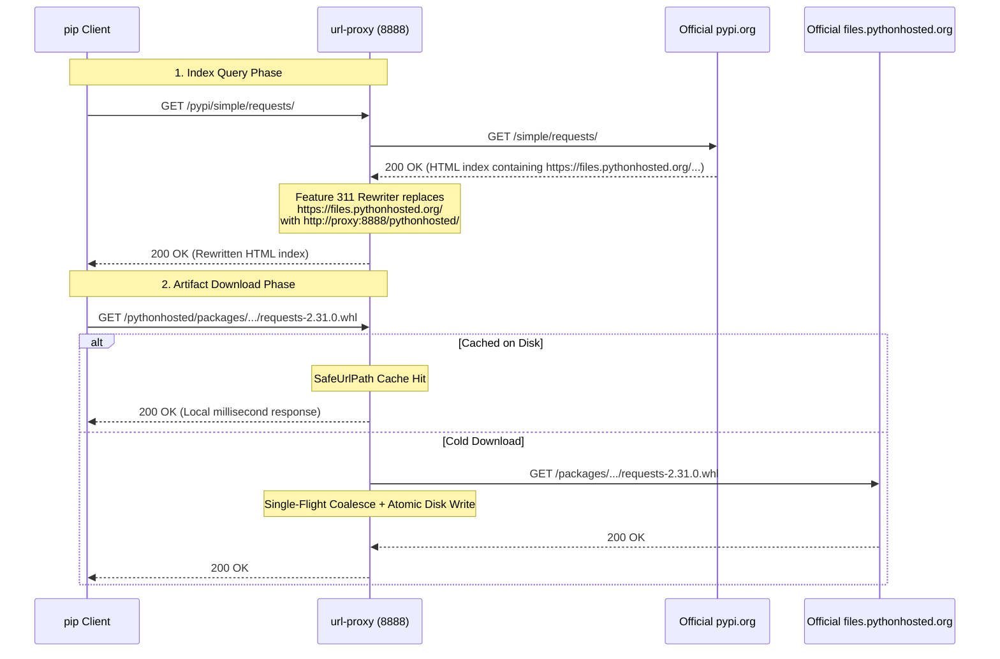

# Feature 312: Official PyPI Gateway & Multi-Host Routing Specification

## 1. Goal

The official Python Package Index (PyPI) operates under PEP 503 and PEP 691 specifications, decoupling its metadata index service (`https://pypi.org/simple/`) from its binary artifact distribution CDN (`https://files.pythonhosted.org/packages/...`).
When clients query the official index through standard pip configurations, hardcoded absolute links in the returned HTML/JSON payloads bypass the proxy, initiating direct external connections to the CDN.

**Feature 312 Goal**:
Leveraging Feature 311 (Response Body Rewriting) and Feature 306 (Alias Routing), achieve complete end-to-end caching and proxying for official PyPI:
1. **Coordinated Multi-Host Routing**: Map paired aliases for `/pypi` (metadata) and `/pythonhosted` (binary artifacts);
2. **PEP 503 / 691 Link Rewriting**: Automatically replace `https://files.pythonhosted.org/` inside `/pypi/simple/` payloads with `http://{PROXY_HOST}/pythonhosted/`;
3. **Dynamic/Static Separation**: Stream dynamic indexes without disk writes while enforcing 100% persistent caching for `.whl` and `.tar.gz` packages with Single-Flight coalescing;
4. **Transparent Client Integration**: Native pip integration using standard CLI flags or configuration files, eliminating dependence on third-party regional mirrors.

---

## 2. Architecture & Sequence



---

## 3. Configuration Syntax (`proxy.conf`)

```ini
# ==========================================
# PyPI Official Proxy Configuration
# ==========================================

# 1. Declare paired upstream aliases
alias /pypi https://pypi.org
alias /pythonhosted https://files.pythonhosted.org

# 2. Rewrite absolute CDN links within the Simple index (restricted to type:pypi)
rewrite /pypi/simple/ type:pypi https://files.pythonhosted.org/ http://{PROXY_HOST}/pythonhosted/

# 3. Dynamic metadata bypassed
bypass /pypi/simple/ prefix *

# 4. Wheel and source archives cached permanently
cache  /pythonhosted/ suffix .whl
cache  /pythonhosted/ suffix .tar.gz
cache  /pythonhosted/ suffix .zip
```

---

## 4. Client Configuration

See dedicated client guide: [PyPI Usage Guide](../usage/pypi-en.md)

### 4.1 Temporary CLI Usage
```bash
pip install requests --index-url http://<proxy-ip>:8888/pypi/simple/ --trusted-host <proxy-ip>
```

### 4.2 Persistent Configuration (`pip.conf` / `pip.ini`)
- Linux / macOS: `~/.pip/pip.conf`
- Windows: `%APPDATA%\pip\pip.ini`

```ini
[global]
index-url = http://<proxy-ip>:8888/pypi/simple/
trusted-host = <proxy-ip>
```

---

## 5. Verification

For complete test suites and automated steps, see: [PyPI Test Suite](../../tests/312_pypi_official_proxy/README-en.md)

1. **PEP 503 (HTML) Index Rewriting**: Run `curl -s http://127.0.0.1:8888/pypi/simple/requests/` and verify that all hyperlinks begin with `http://127.0.0.1:8888/pythonhosted/` while retaining `#sha256=...` fragment digests;
2. **PEP 691 (JSON) Simple API Rewriting**: Query with `Accept: application/vnd.pypi.simple.v1+json` and verify `files[].url` values point to proxy;
3. **Traffic Loopback**: Run `pip install` and verify in the server logs that package downloads route through `/pythonhosted/packages/...`;
4. **Disk Persistence & Zero WAN Latency**: Inspect the cache folder to verify `.whl` files are saved, and verify subsequent downloads or Range requests are served directly from disk.

