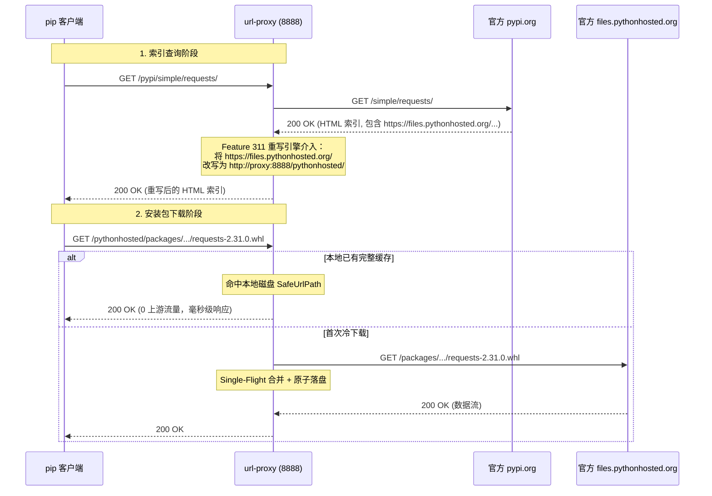

# Feature 312: PyPI 官方镜像源全链路闭环代理

## 1. 功能目标 (Goal)

Python 官方软件源（PyPI）采用 PEP 503 与 PEP 691 规范。在官方设计中，元数据索引服务（`https://pypi.org/simple/`）与实际文件分发 CDN（`https://files.pythonhosted.org/packages/...`）跨域分离。
当客户端通过 `pip` 指定索引时，若返回的 HTML/JSON 索引中含有 CDN 绝对链接，pip 会直接跳过本地代理向 CDN 发起外网直连。

**Feature 312 建设目标**：
基于 Feature 311 提供的动态响应体重写能力与 Feature 306 别名路由能力，实现官方 PyPI 的完整代理与本地持久化缓存闭环：
1. **多域名协同双别名路由**：同时纳管 `/pypi` 索引入口与 `/pythonhosted` 二进制分发入口；
2. **PEP 503 / PEP 691 动态链接重写**：自动将 Simple 索引中的 `https://files.pythonhosted.org/` 替换为代理主机的 `/pythonhosted/`；
3. **动静分离与软件包 100% 强缓存**：动态索引实时透传（结合 304 条件协商），`.whl` 与 `.tar.gz` 实施安全持久化与 Single-Flight 并发合并；
4. **客户端无缝接入**：仅需标准 pip CLI 参数或配置文件指向代理，零第三方镜像依赖。

---

## 2. 核心架构与请求处理时序 (Architecture & Sequence)



---

## 3. 配置文件语法规范 (`proxy.conf`)

在 `proxy.conf` 中追加成对规则：

```ini
# ==========================================
# PyPI 官方源全链路闭环代理配置
# ==========================================

# 1. 声明双上游别名
alias /pypi https://pypi.org
alias /pythonhosted https://files.pythonhosted.org

# 2. 声明 Simple 索引绝对链接重写规则 (使用 type:pypi 类型约束)
rewrite /pypi/simple/ type:pypi https://files.pythonhosted.org/ http://{PROXY_HOST}/pythonhosted/

# 3. 动静分离规则：Simple 动态索引纯流式直通
bypass /pypi/simple/ prefix *

# 4. 白名单强缓存规则：Wheel 与源码分发包 100% 持久化落盘
cache  /pythonhosted/ suffix .whl
cache  /pythonhosted/ suffix .tar.gz
cache  /pythonhosted/ suffix .zip
```

---

## 4. 客户端配置指南 (Client Configuration)

详见专用使用文档：[PyPI 官方源代理使用指南](../usage/pypi-zh.md)

### 4.1 单次命令行临时使用
```bash
pip install requests --index-url http://<proxy-ip>:8888/pypi/simple/ --trusted-host <proxy-ip>
```

### 4.2 全局配置文件持久化 (`pip.conf` / `pip.ini`)
- Linux / macOS: `~/.pip/pip.conf`
- Windows: `%APPDATA%\pip\pip.ini`

```ini
[global]
index-url = http://<proxy-ip>:8888/pypi/simple/
trusted-host = <proxy-ip>
```

---

## 5. 验证场景与测试标准 (Verification)

测试套件与详细验证流程参见：[PyPI 仿真测试套件](../../tests/312_pypi_official_proxy/README-zh.md)

1. **PEP 503 (HTML) 链接重写验证**：使用 `curl -s http://127.0.0.1:8888/pypi/simple/requests/`，检查返回的 HTML 文本中所有超链接的前缀已被替换为 `http://127.0.0.1:8888/pythonhosted/`，且 `#sha256=...` 锚点校验信息完好；
2. **PEP 691 (JSON) API 重写验证**：携带 `Accept: application/vnd.pypi.simple.v1+json` 时，元数据 JSON 中 `files[].url` 均正确重写指向代理；
3. **下载流量回流闭环**：执行真实 `pip install`，观察代理日志，确认软件包下载请求命中 `/pythonhosted/packages/...` 而非穿透至公网；
4. **本地落盘与 0 回源命中验证**：检查本地缓存目录中 `.whl` 文件生成，Range 请求或二次安装直接由本地磁盘高效响应（0 上游流量）。

