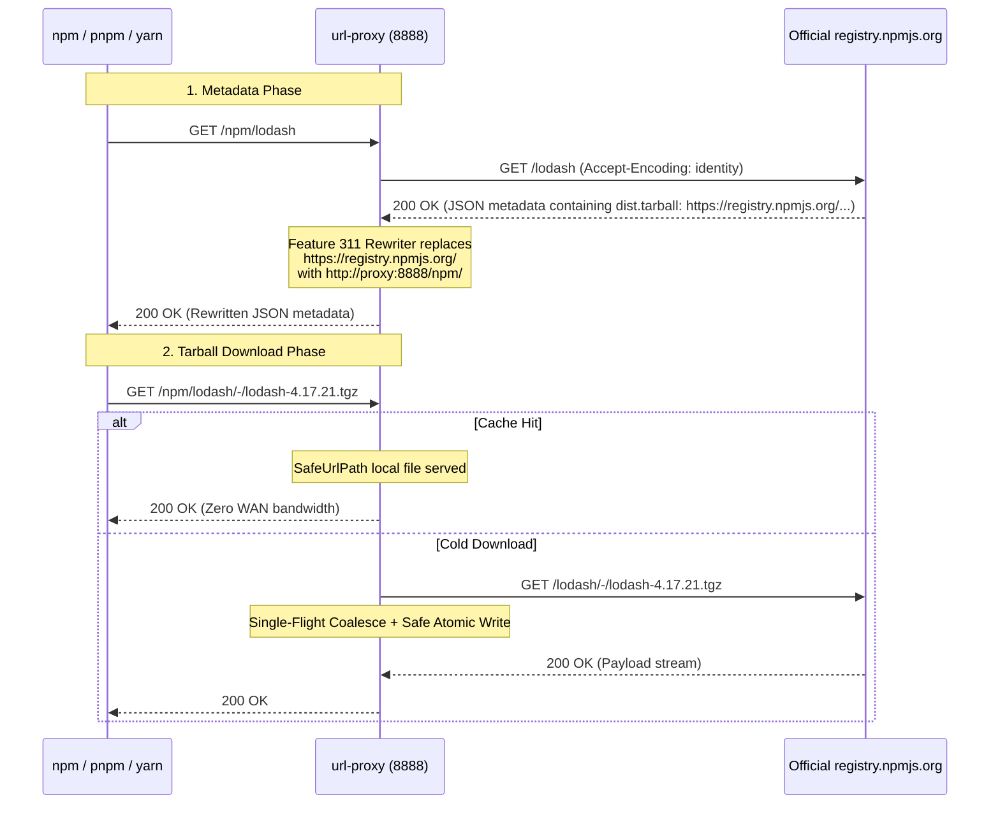

# Feature 313: Official npm Registry Gateway & Tarball Rewriter Specification

## 1. Goal

The official Node.js package registry (`registry.npmjs.org`), when serving JSON package metadata, returns full absolute URLs within the `versions[x].dist.tarball` fields (e.g. `https://registry.npmjs.org/lodash/-/lodash-4.17.21.tgz`).
Modern npm, yarn, and pnpm package managers prioritize downloading directly from the address declared in `dist.tarball`, circumventing the registry address configured on the client.

**Feature 313 Goal**:
Leveraging Feature 311 (Response Body Rewriting) and Feature 306 (Alias Routing), achieve complete closed-loop caching and proxying for the official npm registry:
1. **Unified Ingress Alias**: Route `/npm` to `https://registry.npmjs.org`;
2. **Metadata JSON Tarball Rewriting**: Automatically rewrite `https://registry.npmjs.org/` inside metadata responses to `http://{PROXY_HOST}/npm/`;
3. **Dynamic/Static Separation**: Passthrough dynamic package metadata with 304 conditional revalidation while enforcing 100% caching for `/-/*.tgz` tarballs;
4. **Broad Compatibility**: Support standard `npm`, `yarn`, and `pnpm` clients without requiring third-party mirrors.

---

## 2. Architecture & Sequence



---

## 3. Configuration Syntax (`proxy.conf`)

```ini
# ==========================================
# npm Official Registry Proxy Configuration
# ==========================================

# 1. Upstream registry alias
alias npm https://registry.npmjs.org

# 2. Rewrite official Tarball URLs in metadata JSON (using type:npm rule)
rewrite /npm/ type:npm https://registry.npmjs.org/ http://{PROXY_HOST}/npm/

# 3. Package tarballs permanently cached
cache /npm/ suffix .tgz
cache * suffix .tgz
```

---

## 4. Client Configuration

Detailed client setup guides are available in the [npm Official Registry Proxy & Caching Guide](../usage/npm-en.md).

### 4.1 npm Configuration
```bash
# Global configuration
npm config set registry http://<proxy-ip>:8888/npm/

# Or per-project .npmrc:
# registry=http://<proxy-ip>:8888/npm/
```

### 4.2 yarn Configuration
```bash
yarn config set registry http://<proxy-ip>:8888/npm/
```

### 4.3 pnpm Configuration
```bash
pnpm config set registry http://<proxy-ip>:8888/npm/
```

---

## 5. Verification

The standalone simulation test suite is located in [tests/313_npm_official_proxy/](../../tests/313_npm_official_proxy/).

1. **JSON Rewriting**: Run `curl -s http://127.0.0.1:8888/npm/chalk | grep tarball` and verify that all `tarball` URLs point to `http://127.0.0.1:8888/npm/chalk/-/chalk-...tgz`;
2. **Loopback Traffic**: Run `npm install --no-cache chalk` and verify that tarball requests route strictly through the proxy;
3. **Disk Persistence**: Inspect cache storage to ensure `.tgz` files are saved;
4. **Single-Flight Coalescing**: Concurrent requests for identical tarballs share a single upstream connection;
5. **Cache Hit on Re-run**: Clean client caches and reinstall to confirm all requests return `[CACHE-HIT]`.

