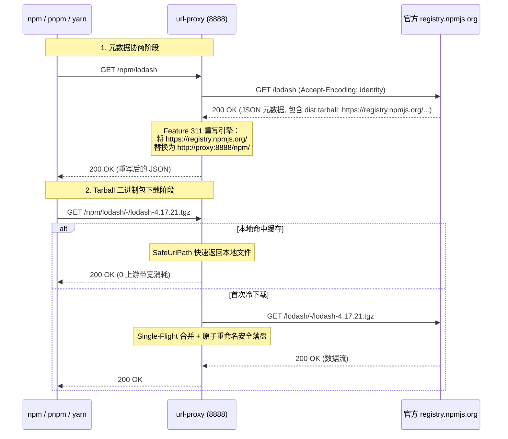

# Feature 313: npm 官方镜像源全链路闭环代理

## 1. 功能目标 (Goal)

Node.js 生态的官方包管理器注册中心（`registry.npmjs.org`）在响应客户端获取包元数据的 JSON 请求时，在 `versions[x].dist.tarball` 字段中返回了完整的官方绝对 URL（如 `https://registry.npmjs.org/lodash/-/lodash-4.17.21.tgz`）。
现代 npm、yarn 与 pnpm 客户端在安装依赖时，往往优先使用 `dist.tarball` 声明的绝对地址发起拉取，直接绕过客户端设置的内网 registry 地址。

**Feature 313 建设目标**：
基于 Feature 311 提供的动态响应体重写能力与 Feature 306 别名路由能力，实现官方 npm 注册中心的闭环代理与依赖包强缓存：
1. **统一别名接入**：声明 `/npm` 映射至官方上游 `https://registry.npmjs.org`；
2. **JSON 元数据绝对链接重写**：自动将 JSON 响应中的 `https://registry.npmjs.org/` 替换为代理主机的 `http://{PROXY_HOST}/npm/`；
3. **动静分离与 Tarball 100% 强缓存**：JSON 元数据走 304 条件协商与实时透传，`/-/*.tgz` 软件包 100% 安全落盘并合并并发请求；
4. **全客户端兼容**：支持标准 `npm`、`yarn` 与 `pnpm`。

---

## 2. 核心架构与处理流水线 (Architecture & Pipeline)



---

## 3. 配置文件语法规范 (`proxy.conf`)

在 `proxy.conf` 中追加规则：

```ini
# ==========================================
# npm 官方源代理与 Tarball 链接重写配置
# ==========================================

# 1. 声明官方注册中心别名
alias npm https://registry.npmjs.org

# 2. 声明 JSON 元数据中的官方 Tarball URL 重写规则 (使用 type:npm 类型)
rewrite /npm/ type:npm https://registry.npmjs.org/ http://{PROXY_HOST}/npm/

# 3. 白名单强缓存规则：.tgz 压缩包 100% 持久化缓存
cache /npm/ suffix .tgz
cache * suffix .tgz
```

---

## 4. 客户端配置指南 (Client Configuration)

详尽的客户端配置指南请参阅 [npm 官方源代理与缓存使用指南](../usage/npm-zh.md)。

### 4.1 npm 全局或项目配置
```bash
# 设置全局 registry
npm config set registry http://<proxy-ip>:8888/npm/

# 或在项目根目录创建 .npmrc:
# registry=http://<proxy-ip>:8888/npm/
```

### 4.2 yarn 配置
```bash
yarn config set registry http://<proxy-ip>:8888/npm/
```

### 4.3 pnpm 配置
```bash
pnpm config set registry http://<proxy-ip>:8888/npm/
```

---

## 5. 验证场景与测试标准 (Verification)

本地独立验证套件位于 [tests/313_npm_official_proxy/](../../tests/313_npm_official_proxy/)。

1. **JSON 元数据重写验证**：使用 `curl -s http://127.0.0.1:8888/npm/chalk | grep tarball`，确认所有 `tarball` 字段均指向 `http://127.0.0.1:8888/npm/chalk/-/chalk-...tgz`；
2. **下载流量回流闭环**：执行 `npm install --no-cache chalk`，观察代理日志，确认 tarball 下载精准命中代理服务；
3. **本地磁盘持久化验证**：在缓存目录下确认生成了对应的 `.tgz` 文件；
4. **并发合并（Single-Flight）**：多节点并发拉取相同版本的第三方库时，代理向上游仅发起单次连接，其余连接复用广播流；
5. **二次拉取 100% 缓存命中**：清理客户端全局与局部缓存后重新安装，确认全部请求返回 `[CACHE-HIT]`。

