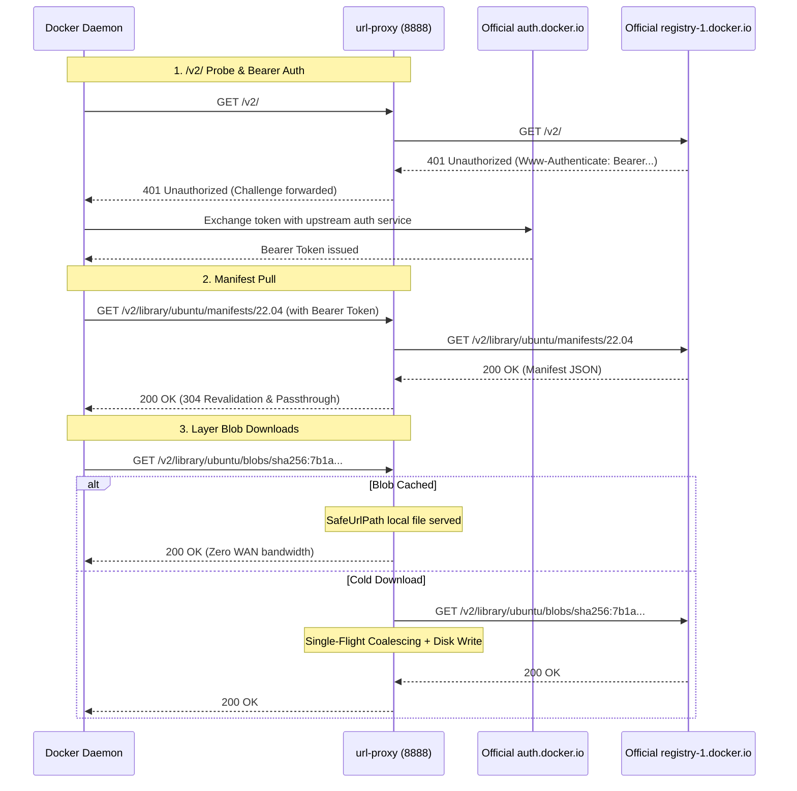

# Feature 314: Docker / OCI Registry v2 Relay & Layer Caching Specification

## 1. Goal

In microservice environments and container CI/CD runners, pulling Docker/OCI container images (`docker pull`) is a frequent, bandwidth-intensive operation.
The Docker client uses the OCI / Registry v2 API specification:
1. **401 Bearer Token Challenge**: A pull begins with a `GET /v2/` probe; the registry replies with `401 Unauthorized` and a `Www-Authenticate` challenge directing authentication to `auth.docker.io`;
2. **Immutable Layer Blobs**: Layer blobs stored at `/v2/<name>/blobs/sha256:<digest>` are strictly immutable, ranging from tens of megabytes to several gigabytes;
3. **Mutable Manifests**: Image tags resolve to manifests that change over time, supported by 304 conditional revalidation and streaming passthrough.

**Feature 314 Goal**:
Add native Docker/OCI Registry v2 relay support to `url-proxy`:
1. **Transparent Token Challenge Relay**: Forward `/v2/` probes and `Www-Authenticate` headers so clients seamlessly obtain Bearer Tokens from official auth services;
2. **100% Persistent Blob Caching**: Cache `/blobs/sha256:` payloads with Single-Flight coalescing and Range 206 resume support;
3. **Manifest Passthrough & Revalidation**: Relay manifests dynamically with 304 conditional revalidation;
4. **Simple Ingress**: Integrate via Docker's native `insecure-registries` option.

---

## 2. Architecture & Sequence



---

## 3. Configuration Syntax (`proxy.conf`)

```ini
# ==========================================
# Docker Hub Official Relay Configuration
# ==========================================

# 1. Official Registry alias
alias /docker https://registry-1.docker.io

# 2. Dynamic manifest bypass (304 fast revalidation)
bypass /docker/v2/ contains /manifests/

# 3. Layer blobs permanently cached
cache /docker/v2/ contains /blobs/sha256:
```

---

## 4. Client Configuration

Configure `/etc/docker/daemon.json` on client hosts:

```json
{
  "insecure-registries": ["<proxy-ip>:8888"]
}
```

Restart Docker:
```bash
sudo systemctl restart docker
```

Pull via proxy:
```bash
docker pull <proxy-ip>:8888/docker/library/ubuntu:22.04
```

---

## 5. Verification

1. **v2 Handshake Forwarding**: `curl -i http://127.0.0.1:8888/docker/v2/` returns 401 with `Www-Authenticate` header;
2. **Pull Verification**: `docker pull <proxy-ip>:8888/docker/library/alpine:latest` pulls and unpacks layers;
3. **Blob Caching**: Local storage persists `sha256:*` layer files;
4. **Range 206 Resuming**: Partial content requests (`Range: bytes=1048576-`) for blobs return 206 Partial Content.
