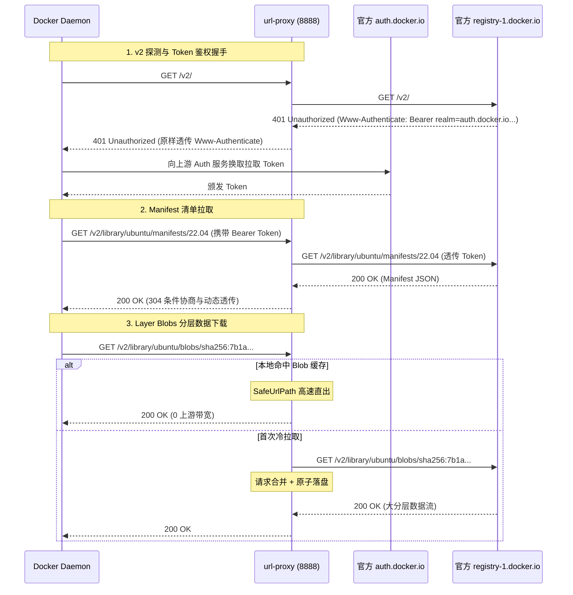

# Feature 314: Docker / OCI 镜像 Registry v2 协议中继与分层缓存

## 1. 功能目标 (Goal)

在容器化微服务集群与 CI/CD 构建环境中，拉取 Docker/OCI 镜像（`docker pull`）极其频繁。
Docker 客户端遵循 OCI / Registry v2 API 规范，拉取流程具备特殊性：
1. **401 Bearer Token 握手挑战**：拉取前向服务端发送 `GET /v2/` 探测，服务端返回 `401 Unauthorized` 并在 `Www-Authenticate` 响应头中指示认证服务器（如 `realm="https://auth.docker.io/token"`）；
2. **大体积不可变分层（Layer Blobs）**：镜像分层数据路径格式为 `/v2/<name>/blobs/sha256:<digest>`，内容严格不可变，单个文件体积达数十 MB 至数 GB，对局域网单飞合并下载与本地缓存具有极高价值；
3. **易变清单（Manifests）**：按 tag 拉取的镜像清单会随最新发布而变动，支持 304 条件协商与实时直通。

**Feature 314 建设目标**：
在 `url-proxy` 中扩展对 Docker/OCI Registry v2 协议的原生中继支持：
1. **`/v2/` 探测与鉴权挑战透明中继**：无缝中继 `Www-Authenticate` 头，客户端能顺利向官方 Auth 服务换取 Bearer Token；
2. **分层数据（Blobs）100% 强缓存**：对 `/blobs/sha256:` 实行安全落盘、Single-Flight 并发合并与 Range 206 断点续传；
3. **镜像清单（Manifests）动态直通**：对 manifests 实施 304 条件协商与动态流式直通；
4. **客户端免侵入拉取**：配置 `daemon.json` 的 `insecure-registries` 即可无缝拉取。

---

## 2. 核心架构与拉取时序 (Architecture & Pipeline)



---

## 3. 配置文件语法规范 (`proxy.conf`)

```ini
# ==========================================
# Docker Hub 官方源中继与分层缓存配置
# ==========================================

# 1. 声明 Docker Hub 官方 Registry 别名
alias /docker https://registry-1.docker.io

# 2. 镜像清单动态透传免缓存 (走 304 快速协商)
bypass /docker/v2/ contains /manifests/

# 3. 镜像分层文件 (Blobs) 100% 永久安全落盘
cache /docker/v2/ contains /blobs/sha256:
```

---

## 4. 客户端配置指南 (Client Configuration)

由于使用内网 HTTP 代理端口，在客户端宿主机的 `/etc/docker/daemon.json` 中配置不安全镜像仓库允许列表：

```json
{
  "insecure-registries": ["<proxy-ip>:8888"]
}
```

重启 Docker 服务：
```bash
sudo systemctl restart docker
```

通过代理拉取镜像：
```bash
docker pull <proxy-ip>:8888/docker/library/ubuntu:22.04
```

---

## 5. 验证场景与测试标准 (Verification)

1. **v2 探测握手透传**：`curl -i http://127.0.0.1:8888/docker/v2/` 返回 401 并准确包含 `Www-Authenticate` 头部；
2. **镜像拉取成功率**：执行 `docker pull <proxy-ip>:8888/docker/library/alpine:latest`，各分层正常拉取并成功解包；
3. **分层落盘命中**：本地缓存目录成功生成 `sha256:*` 命名的分层数据文件；
4. **大文件断点续传**：支持对 Layer Blob 发送带 `Range: bytes=1048576-` 的分片请求，正确响应 206 Partial Content。
