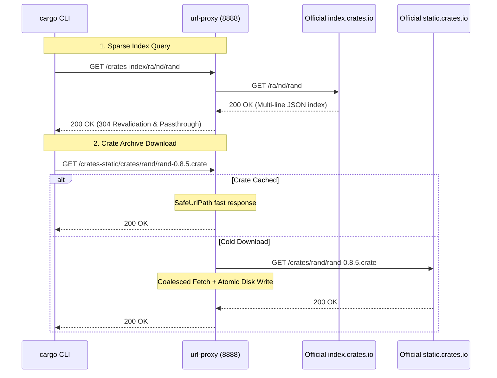

# Feature 315: Rust Cargo Sparse Index & Crates Relay Specification

## 1. Goal

Since Rust 1.68, Cargo advocates for the **Sparse Index Protocol (RFC 2785)** over monolithic Git-based index repositories.
The sparse protocol uses standard HTTP GET requests:
1. **On-Demand Textual Index Retrieval**: Fetches individual crate version listings (e.g. `GET /ra/nd/rand`, one JSON line per version);
2. **Source Archive Download**: Downloads immutable `.crate` archives from a public CDN (`https://static.crates.io/crates/<crate>/<crate>-<version>.crate`).

**Feature 315 Goal**:
Provide native sparse index relaying and persistent `.crate` artifact caching for the Rust ecosystem in `url-proxy`:
1. **Dynamic Sparse Index Passthrough**: Relay index queries with HTTP 304 conditional revalidation for instant awareness of newly published crates;
2. **100% Persistent Caching**: Safe atomic storage and Single-Flight coalescing for `.crate` archives;
3. **Simple Client Config**: Seamless configuration via `sparse+http://` in `~/.cargo/config.toml`.

---

## 2. Architecture & Sequence



---

## 3. Configuration Syntax (`proxy.conf`)

```ini
# ==========================================
# Rust Cargo Sparse Index & Crates Configuration
# ==========================================

# 1. Index and static distribution aliases
alias crates-index https://index.crates.io
alias crates-static https://static.crates.io

# 2. Dynamic config.json rewriting (redirects dl download endpoint to local proxy)
rewrite /crates-index/config.json type:json https://static.crates.io/crates http://{PROXY_HOST}/crates-static/crates

# 3. Sparse index bypass (dynamic 304 revalidation)
bypass /crates-index/ *

# 4. Source archives cached permanently
cache /crates-static/ suffix .crate
cache * suffix .crate
```

---

## 4. Client Configuration

Configure `~/.cargo/config.toml` on client machines:

```toml
[registries.crates-io]
protocol = "sparse"

[source.crates-io]
replace-with = "url-proxy-sparse"

[source.url-proxy-sparse]
registry = "sparse+http://<proxy-ip>:8888/crates-index/"
```

---

## 5. Verification

1. **On-Demand Sparse Retrieval**: `curl -s http://127.0.0.1:8888/crates-index/config.json` succeeds and conforms to TTL rules;
2. **Dependency Compilation**: `cargo build` retrieves dependencies via proxy;
3. **100% Cache Hit on Re-run**: Purge client `~/.cargo/registry/cache` and rebuild to verify zero upstream WAN bandwidth with all artifacts returning `[CACHE-HIT]`.
