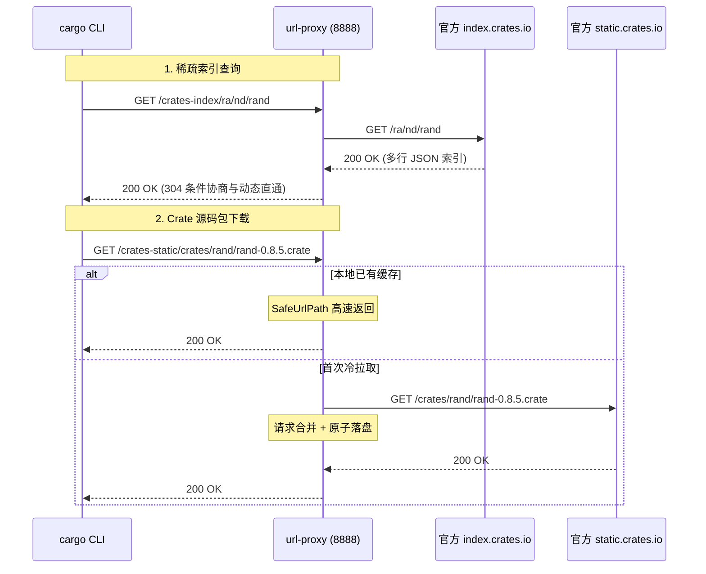

# Feature 315: Rust Cargo 稀疏索引与 Crates 官方源代理

## 1. 功能目标 (Goal)

Rust 官方自 1.68 起全面推荐使用**稀疏索引协议（Sparse Index Protocol, RFC 2785）**代替以往臃肿庞大的 Git 索引仓库。
稀疏索引基于纯 HTTP GET 请求运作：
1. **轻量文本索引查询**：按需拉取单个 crate 的版本清单（如 `GET /ra/nd/rand`，每行为一个 JSON 对象）；
2. **源码压缩包下载**：从 CDN 下载不可变源代码包（`https://static.crates.io/crates/<crate>/<crate>-<version>.crate`）。

**Feature 315 建设目标**：
在 `url-proxy` 中为 Rust 生态提供原生的稀疏索引中继与 `.crate` 软件包强缓存支持：
1. **稀疏索引高效直通**：对稀疏索引查询提供 304 条件协商与动态流式直通，确保最新包版本毫秒级感知；
2. **源码包 100% 永久安全落盘**：对 `.crate` 压缩包实施 Single-Flight 并发合并与磁盘持久化；
3. **极简客户端配置**：只需在 `~/.cargo/config.toml` 中一行配置 `sparse+http://` 即可即刻提速。

---

## 2. 核心架构与拉取流程 (Architecture & Pipeline)



---

## 3. 配置文件语法规范 (`proxy.conf`)

```ini
# ==========================================
# Rust Cargo 稀疏索引与 Crates 官方源配置
# ==========================================

# 1. 声明索引与静态分发别名
alias crates-index https://index.crates.io
alias crates-static https://static.crates.io

# 2. config.json 动态响应体重写 (将 dl 下载端点闭环重定向至代理节点)
rewrite /crates-index/config.json type:json https://static.crates.io/crates http://{PROXY_HOST}/crates-static/crates

# 3. 稀疏索引动态透传免缓存 (走 304 协商)
bypass /crates-index/ *

# 4. .crate 源码包 100% 永久安全强缓存
cache /crates-static/ suffix .crate
cache * suffix .crate
```

---

## 4. 客户端配置指南 (Client Configuration)

在客户端 `~/.cargo/config.toml` 中指定稀疏协议源：

```toml
[registries.crates-io]
protocol = "sparse"

[source.crates-io]
replace-with = "url-proxy-sparse"

[source.url-proxy-sparse]
registry = "sparse+http://<proxy-ip>:8888/crates-index/"
```

---

## 5. 验证场景与测试标准 (Verification)

1. **稀疏索引按需拉取**：`curl -s http://127.0.0.1:8888/crates-index/config.json` 返回正确配置，且按 TTL 本地保鲜；
2. **Crate 依赖编译加速**：运行 `cargo build`，依赖项首次由代理缓存下载；
3. **二次构建 100% 命中**：清理客户端本地 `~/.cargo/registry/cache` 后重新拉取，确认全部依赖返回 `[CACHE-HIT]`，上游带宽为 0。
