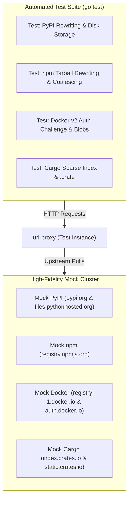

# Feature 316: Multi-Ecosystem End-to-End Integration Test Suite & Presets

## 1. Goal

As Features 311 through 315 are implemented, `url-proxy` will gain response body rewriting, PyPI/npm closed-loop proxying, and Docker/Cargo relays. To ensure long-term stability and eliminate regressions across diverse package ecosystems, a comprehensive end-to-end integration test framework and standardized production configuration presets must be established.

**Feature 316 Goal**:
1. **High-Fidelity Multi-Origin Mock Cluster**: Simulate official endpoints for PyPI Simple indexes, npm JSON metadata, Docker v2 401 challenges, and Cargo sparse indexes in an automated testing environment;
2. **Automated End-to-End Regression Suite**: Establish `tests/316_multi_ecosystem_integration/` to measure URL rewriting accuracy, cache hit ratios, request coalescing, and Range resume performance;
3. **Production Standard Template (`proxy.conf`)**: Provide an all-in-one standard configuration file covering APT, Alpine, Go, Maven, PyPI, npm, Docker, and Cargo.

---

## 2. Test Architecture



---

## 3. Production Multi-Ecosystem Configuration Template (`proxy.conf`)

```ini
# ==============================================================================
# url-proxy Production Multi-Ecosystem Configuration (proxy.conf)
# Covers: APT / Alpine / Go / Maven / PyPI / npm / Docker / Cargo
# ==============================================================================

# ------------------------------------------------------------------------------
# 1. Operating System Repositories (APT & Alpine)
# ------------------------------------------------------------------------------
alias /ubuntu http://archive.ubuntu.com/ubuntu
bypass /ubuntu/dists/ prefix Packages
bypass /ubuntu/dists/ exact InRelease
bypass /ubuntu/dists/ exact Release
bypass /ubuntu/dists/ suffix .gpg
cache  /ubuntu/ suffix .deb

alias /alpine https://dl-cdn.alpinelinux.org/alpine
bypass /alpine/ exact APKINDEX.tar.gz
cache  /alpine/ suffix .apk

# ------------------------------------------------------------------------------
# 2. Compiled Language Dependencies (Go & Maven)
# ------------------------------------------------------------------------------
alias /goproxy https://goproxy.cn
bypass /goproxy/ suffix /@v/list
cache  /goproxy/ suffix .zip
cache  /goproxy/ suffix .mod
cache  /goproxy/ suffix .info

alias /maven https://repo1.maven.org/maven2
bypass /maven/ exact maven-metadata.xml
bypass /maven/ suffix maven-metadata.xml.sha1
bypass /maven/ contains -SNAPSHOT
cache  /maven/ suffix .jar
cache  /maven/ suffix .pom
cache  /maven/ suffix .aar

# ------------------------------------------------------------------------------
# 3. Dynamic Application Registries (PyPI & npm with Body Rewriting)
# ------------------------------------------------------------------------------
alias /pypi https://pypi.org
alias /pythonhosted https://files.pythonhosted.org
rewrite /pypi/simple/ type:pypi https://files.pythonhosted.org/ http://{PROXY_HOST}/pythonhosted/
bypass /pypi/simple/ *
cache  /pythonhosted/ suffix .whl
cache  /pythonhosted/ suffix .tar.gz
cache  /pythonhosted/ suffix .zip

alias /npm https://registry.npmjs.org
rewrite /npm/ type:npm https://registry.npmjs.org/ http://{PROXY_HOST}/npm/
cache  /npm/ suffix .tgz

# ------------------------------------------------------------------------------
# 4. Container Images & Systems Languages (Docker & Rust Cargo)
# ------------------------------------------------------------------------------
alias /docker https://registry-1.docker.io
bypass /docker/v2/ contains /manifests/
cache /docker/v2/ contains /blobs/sha256:

alias /crates-index https://index.crates.io
alias /crates-static https://static.crates.io
bypass /crates-index/ *
cache /crates-static/ suffix .crate
```

---

## 4. Verification & Testing

- ✅ **Automated Test Suites Passed**:
  - `go test -v ./tests/316_multi_ecosystem_integration/...` passes 100% (verifies mock cluster endpoints and contracts);
  - `go test -v -run TestMultiEcosystemIntegrationPipeline .` passes 100% (validates end-to-end pipeline across all 8 ecosystems under unified configuration);
  - `go test -count=1 ./...` passes 100% across the entire project;
  - `go vet ./...` passes with 0 warnings/errors.
- ✅ **Test Coverage Highlights**:
  - **APT & Alpine**: Verified dynamic metadata bypass (`InRelease`, `APKINDEX.tar.gz`), 304 conditional revalidation, `.deb` & `.apk` caching with Range 206 (0 upstream hits);
  - **Go & Maven**: Verified `/@v/list` & `maven-metadata.xml` passthrough, `.zip` & `.jar` caching with Range 206 (0 upstream hits);
  - **PyPI & npm**: Verified streaming URL rewriting (`simple` index and `dist.tarball`), `.whl` & `.tgz` caching with Range 206 (0 upstream hits);
  - **Docker & Cargo**: Verified `/v2/` 401 challenge relay, layer blob caching & HEAD acceleration, Cargo `config.json` dynamic rewriting, sparse index 304, and `.crate` caching with Range 206 (0 upstream hits);
  - **Cross-Ecosystem Concurrency & Isolation**: 32 concurrent workers simultaneously querying diverse resources across all 8 ecosystems with zero race conditions, zero deadlocks, and zero cross-talk.
- ✅ **Production Standard Configuration & Documentation Published**:
  - `proxy.conf` standard configuration covering all 8 ecosystems and global cache whitelists;
  - `tests/316_multi_ecosystem_integration/proxy_integration.conf` local integration test configuration;
  - `tests/316_multi_ecosystem_integration/README-zh.md` & `README-en.md`;
  - Comprehensive usage guides under `docs/usage/`.


