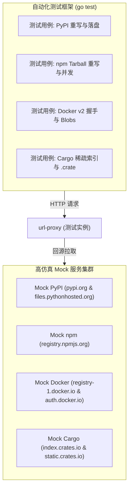

# Feature 316: 多生态全链路端到端集成测试与预置模板

## 1. 功能目标 (Goal)

随着 Feature 311 ~ 315 陆续交付，`url-proxy` 具备了响应体重写、PyPI/npm 闭环代理以及 Docker/Cargo 中继等多项核心能力。为了保障各个包管理系统在生产环境中的长期稳定性与零回归，必须建立一套端到端集成测试体系与标准化预置配置模板。

**Feature 316 建设目标**：
1. **构建高仿真多源 Mock 服务集群**：在单进程测试环境中模拟 PyPI Simple 索引、npm package JSON、Docker v2 401 握手及 Cargo 稀疏索引；
2. **自动化端到端量化回归测试**：在 `tests/316_multi_ecosystem_integration/` 中编写一体化自动化测试套件，全面校验链接重写准确性、缓存命中率、并发合并与断点续传表现；
3. **开箱即用全生态标准配置模板 (`proxy.conf`)**：集中发布包含 APT、Alpine、Go、Maven、PyPI、npm、Docker 及 Cargo 的完整生产级标准配置文件。

---

## 2. 测试架构与 Mock 拓扑 (Test Architecture)



---

## 3. 全生态生产级统一配置模板 (`proxy.conf`)

```ini
# ==============================================================================
# url-proxy 生产级全生态统一配置文件 (proxy.conf)
# 涵盖: APT / Alpine / Go / Maven / PyPI / npm / Docker / Cargo
# ==============================================================================

# ------------------------------------------------------------------------------
# 1. 操作系统底层源 (APT & Alpine)
# ------------------------------------------------------------------------------
alias /ubuntu http://archive.ubuntu.com/ubuntu
bypass /ubuntu/dists/ prefix Packages
bypass /ubuntu/dists/ exact InRelease
bypass /ubuntu/dists/ exact Release
bypass /ubuntu/dists/ suffix .gpg
cache  /ubuntu/ suffix .deb

alias /alpine https://dl-cdn.alpinelinux.org/alpine
bypass /alpine/ exact APKINDEX.tar.gz
cache  /alpine/ suffix .apk

# ------------------------------------------------------------------------------
# 2. 编译型语言依赖源 (Go & Maven)
# ------------------------------------------------------------------------------
alias /goproxy https://goproxy.cn
bypass /goproxy/ suffix /@v/list
cache  /goproxy/ suffix .zip
cache  /goproxy/ suffix .mod
cache  /goproxy/ suffix .info

alias /maven https://repo1.maven.org/maven2
bypass /maven/ exact maven-metadata.xml
bypass /maven/ suffix maven-metadata.xml.sha1
bypass /maven/ contains -SNAPSHOT
cache  /maven/ suffix .jar
cache  /maven/ suffix .pom
cache  /maven/ suffix .aar

# ------------------------------------------------------------------------------
# 3. 动态应用层官方源 (PyPI & npm - 包含动态重写与软 TTL)
# ------------------------------------------------------------------------------
alias /pypi https://pypi.org
alias /pythonhosted https://files.pythonhosted.org
rewrite /pypi/simple/ type:pypi https://files.pythonhosted.org/ http://{PROXY_HOST}/pythonhosted/
bypass /pypi/simple/ *
cache  /pythonhosted/ suffix .whl
cache  /pythonhosted/ suffix .tar.gz
cache  /pythonhosted/ suffix .zip

alias /npm https://registry.npmjs.org
rewrite /npm/ type:npm https://registry.npmjs.org/ http://{PROXY_HOST}/npm/
cache  /npm/ suffix .tgz

# ------------------------------------------------------------------------------
# 4. 容器与现代化系统语言 (Docker & Rust Cargo)
# ------------------------------------------------------------------------------
alias /docker https://registry-1.docker.io
bypass /docker/v2/ contains /manifests/
cache /docker/v2/ contains /blobs/sha256:

alias /crates-index https://index.crates.io
alias /crates-static https://static.crates.io
bypass /crates-index/ *
cache /crates-static/ suffix .crate
```

---

## 4. 自动化测试套件落地实现 (`tests/316_multi_ecosystem_integration` & `url_proxy_test.go`)

测试套件已全面落地，涵盖以下自动化场景与量化断言：
1. **APT 场景**：验证 `/ubuntu/dists/jammy/InRelease` 动态 bypass 与 304 条件协商；验证 `.deb` 首次下载落盘与 Range 206 缓存命中（0 上游请求）；
2. **Alpine 场景**：验证 `APKINDEX.tar.gz` 纯流式透传；验证 `.apk` 强缓存与 Range 206 缓存命中（0 上游请求）；
3. **Go Modules 场景**：验证 `/@v/list` bypass 免缓存；验证 `.zip` 强缓存与 Range 206 缓存命中（0 上游请求）；
4. **Maven 场景**：验证 `maven-metadata.xml` 动态透传；验证 `.jar` 强缓存与 Range 206 缓存命中（0 上游请求）；
5. **PyPI 场景**：验证 `/pypi/simple/requests/` 返回重写后的链接，请求生成的 `/pythonhosted/packages/...` 验证 `.whl` 落盘与 Range 206 缓存命中（0 上游请求）；
6. **npm 场景**：验证 package JSON 中 `dist.tarball` 重写无误，下载重写后的 tarball 成功落盘与 Range 206 缓存命中（0 上游请求）；
7. **Docker 场景**：验证 `/docker/v2/` 顺利透传 401 质询头，清单 200/304 透传，分层 blob 正常缓存且支持 HEAD 加速与 Range 206 断点续传（0 上游请求）；
8. **Cargo 场景**：验证 `config.json` 动态重写 `dl` 端点，稀疏索引 304 条件协商与 `.crate` 包顺利下载并命中 Range 206 缓存（0 上游请求）；
9. **跨生态并发与零干扰压测**：多协程高并发请求 8 大生态不同资源，验证零死锁、零竞态（Race-free）且各生态路由互不干扰。

---

## 5. 验收标准与交付物 (Delivery & Acceptance)

- ✅ **自动化回归测试通过**：
  - `go test -v ./tests/316_multi_ecosystem_integration/...` 100% 通过（Mock 集群契约验证）；
  - `go test -v -run TestMultiEcosystemIntegrationPipeline .` 100% 通过（全生态端到端全链路与高并发隔离压测）；
  - `go test -count=1 ./...` 全项目全量测试 100% 通过；
  - `go vet ./...` 静态检查 0 错误。
- ✅ **发布生产级统一配置模板**：
  - `proxy.conf` 标准配置文件，完整整合涵盖 APT / Alpine / Go / Maven / PyPI / npm / Docker / Cargo 8 大生态规则与全局强缓存白名单；
  - `tests/316_multi_ecosystem_integration/proxy_integration.conf` 本地联调配置。
- ✅ **中英文使用与测试文档**：
  - `tests/316_multi_ecosystem_integration/README-zh.md` & `README-en.md`；
  - `docs/usage/` 完整指南体系。

