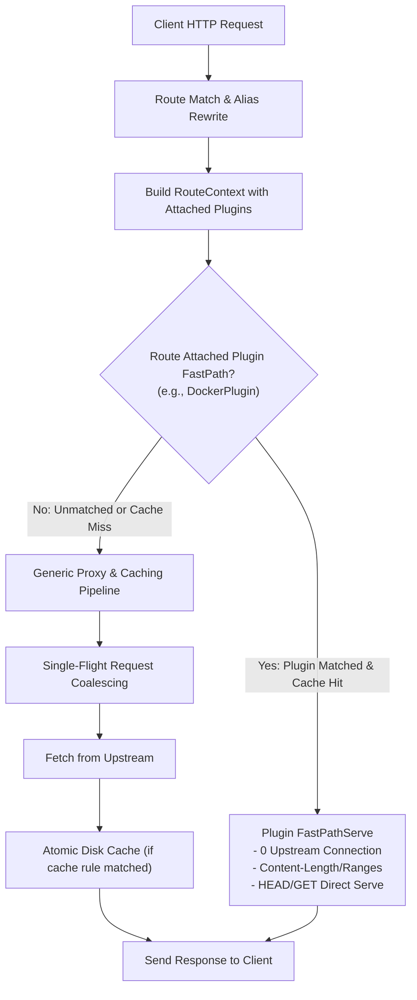
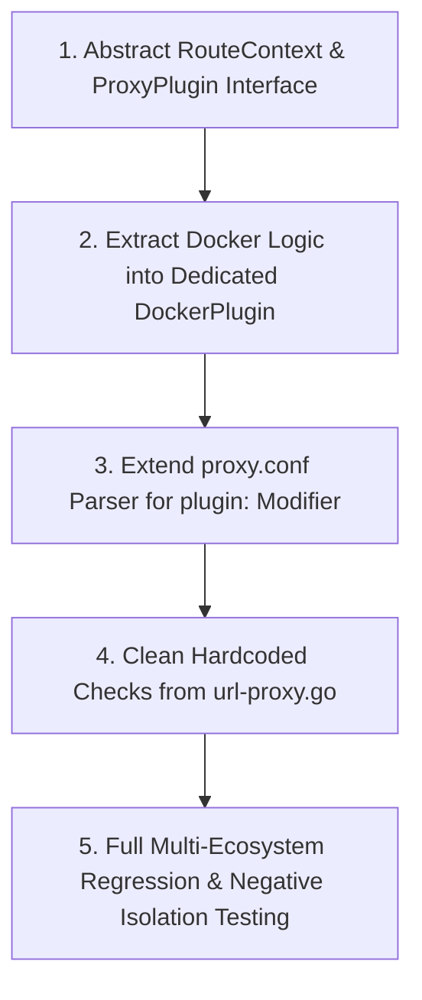

# Feature 317: Route-Scoped Plugins & Docker Layer Caching Decoupling Architecture

## 1. Goal & Background

### 1.1 History & Conversation Context
During the execution of **Plan 310 (Official Registries Proxy Plan)**, **Feature 314** introduced relay and caching support for Docker clients (`docker pull`):
- The Docker Registry v2 protocol requires multi-step handshakes: `GET /v2/` responds with 401 Unauthorized carrying `Www-Authenticate`, which the client uses to obtain a Bearer Token from the authentication server;
- The client then fetches dynamic manifests and multi-gigabyte layer blobs (`/blobs/sha256:<digest>`);
- To achieve "Zero upstream requests and microsecond local delivery for cached layers, even in offline/air-gapped environments", the proxy needed a mechanism to directly serve complete cached blobs without making preliminary upstream HTTP verification requests.

In the initial implementation of Feature 314, to quickly pass automated tests and achieve functional completion, a global path check was introduced directly into the request pipeline in `url-proxy.go`:

```go
// url-proxy.go (Initial implementation in Feature 314)
if strings.Contains(uri, "/blobs/sha256:") {
    cachePath := filepath.Join(*cache, getSafeUrlPath(uri))
    if stat, err := os.Stat(cachePath); err == nil && !stat.IsDir() && stat.Size() > 0 {
        log.Printf("[%d] blob hit local cache (direct serve): %s", reqID, uri)
        w.Header().Set("Content-Length", strconv.FormatInt(stat.Size(), 10))
        w.Header().Set("Accept-Ranges", "bytes")
        w.Header().Set("Content-Type", "application/octet-stream")
        if r.Method == http.MethodHead {
            w.WriteHeader(http.StatusOK)
            return
        }
        http.ServeFile(w, r, cachePath)
        return
    }
}
```

During architectural review, the user highlighted a structural concern:
> *"In the development of the feature above, directly matching and handling the `/blobs/sha256:` substring in the global flow might be problematic. It should be governed by configured rules—for example, integrating a docker plugin on routes bound to `docker` or `registry-1.docker.io`, so that only requests traversing that specific route trigger the special handling for `/blobs/sha256:`."*

---

### 1.2 Problem Analysis & Rationale

Why is matching `strings.Contains(uri, "/blobs/sha256:")` globally problematic?

1. **Namespace Collision & Cross-Ecosystem Contamination**:
   - `uri` represents the full rewritten target URL;
   - `strings.Contains(uri, "/blobs/sha256:")` evaluates globally on **every** request passing through `url-proxy`;
   - If an upstream service in another ecosystem (e.g. Git LFS, S3/MinIO buckets, HuggingFace model hubs, or proprietary internal REST APIs) happens to use a URL containing `/blobs/sha256:`, the proxy will misidentify it as a Docker image layer and force it through the Docker fast-path, bypassing general Single-Flight or bypass rules.

2. **Violation of Declarative Configuration Principles**:
   - `url-proxy` is designed as a **purely config-driven proxy**, where routing (`alias`), forwarding (`forward`), cache exclusion (`bypass`), caching (`cache`), and rewriting (`rewrite`) are explicitly configured in `proxy.conf`;
   - Hardcoding protocol-specific path segments in Go core code breaches this principle and introduces tight coupling between the generic proxy engine and Docker OCI semantics.

3. **Scalability & Maintainability Bottlenecks**:
   - As `url-proxy` expands to support Cargo (Feature 315), Helm, NuGet, and others, adding protocol-specific `if strings.Contains(...)` blocks into `Handler` would turn `url-proxy.go` into an unmaintainable "god function".

---

### 1.3 Core Objectives
1. **Strict Scope Isolation**: Docker-specific layer detection, HEAD acceleration, and 401 challenge relay must trigger **only when traffic matches a route explicitly associated with the Docker plugin/feature**;
2. **Route-Scoped Plugins / Handlers Abstraction**: Decouple protocol-specific logic from the main dispatch flow into modular Handler/Plugin implementations;
3. **Declarative Syntax Extension**: Allow administrators to bind plugins or policies to routes in `proxy.conf`;
4. **Backward Compatibility & Zero Regressions**: Maintain 100% test pass rates across all ecosystems (APT, PyPI, npm, Docker, Cargo) while adding negative isolation verification test cases.

---

## 2. Architecture & Pipeline



### 2.1 Plugin Interface Specification (`RoutePlugin` / `ProxyPlugin`)

```go
// ProxyPlugin defines protocol plugin interface scoped to routes/aliases
type ProxyPlugin interface {
    // Name returns the unique identifier of the plugin (e.g. "docker")
    Name() string

    // Match checks whether current request context and URI fall under this plugin
    Match(req *http.Request, uri string) bool

    // FastPathServe attempts high-speed direct serving (e.g. locally cached immutable blobs)
    // If returning true, the request has been fully served and main pipeline should return
    FastPathServe(w http.ResponseWriter, r *http.Request, uri string, cacheDir string) bool
}
```

### 2.2 Docker Plugin Decoupling (`DockerPlugin`)

Isolate Docker-specific logic into a dedicated plugin:
1. **Scope Verification**: Activated only when the matched route explicitly specifies `plugin:docker` or matches designated Docker targets;
2. **Blob Layer Fast-Path Direct Serve**:
   - Match path pattern `/blobs/sha256:`;
   - Check if cached file exists locally;
   - Respond to HEAD requests with `200 OK`, `Content-Length`, and `Accept-Ranges: bytes`;
   - Support byte-range requests and resumed downloads via `http.ServeFile`.

---

## 3. Configuration Syntax (`proxy.conf`)

### 3.1 Syntax Proposals Comparison

#### Option A: Direct Plugin Binding on Aliases (Recommended)
Allow appending a `plugin:<name>` modifier to `alias` directives:
```ini
# Attach docker plugin directly to specified alias routes
alias /v2 https://registry-1.docker.io/v2 plugin:docker
alias /docker https://registry-1.docker.io plugin:docker
```
- **Pros**: Clear, direct 1-to-1 association with minimal parsing overhead;
- **Mechanism**: When a request matches alias `/v2` or `/docker`, the `docker` plugin is attached to the request context. Only this context executes the `/blobs/sha256:` optimization.

#### Option B: Standalone Plugin Mounting Directive (`plugin`)
Introduce a dedicated `plugin` directive:
```ini
alias /v2 https://registry-1.docker.io/v2
alias /docker https://registry-1.docker.io

# Enable docker protocol plugin on specific route scopes
plugin docker scope:/v2/,/docker/
```
- **Pros**: Separates routing from plugin attachment and supports wildcard scopes.

#### Option C: Generic Declarative Immutable Caching Flag (`immutable`)
Abstract the Docker behavior into a general HTTP caching attribute:
```ini
# Declare that matched resources are immutable content-addressed entities
cache /docker/v2/ immutable contains /blobs/sha256:
```
- **Pros**: Reusable across any content-addressed system (e.g. Git LFS, Nix Store, IPFS) without writing custom Docker-specific code.

### 3.2 Recommended Specification (Option A with Extensibility)

Adopt **Option A** in `proxy.conf`, keeping syntax concise and explicit:

```ini
# ==========================================
# Docker Hub Relay & Scoped Layer Caching
# ==========================================

# 1. Declare Docker Hub registry alias with plugin:docker
alias /docker https://registry-1.docker.io plugin:docker

# 2. Dynamic manifest pass-through (via 304 revalidation)
bypass /docker/v2/ contains /manifests/

# 3. Layer blobs 100% permanently cached
cache /docker/v2/ contains /blobs/sha256:
```

---

## 4. Detailed Design & Implementation Roadmap



### 4.1 Detailed Implementation Steps

1. **Abstract Plugin Interface & Route Context**:
   - Add `Plugin string` field to `AliasRule` data structure;
   - Maintain a global plugin registry (e.g., `map[string]ProxyPlugin`);
   - Pass attached plugins to the request context during route matching.

2. **Decouple Docker Logic into `DockerPlugin`**:
   - Encapsulate the existing logic from `url-proxy.go`:
     - Path checking for `/blobs/sha256:`;
     - Local cache lookup, HEAD response headers, and `http.ServeFile`;
     - 401 handshake challenge extraction and relay;
   - Implement within `DockerPlugin.FastPathServe`;
   - Execute only when the request traverses a route configured with `plugin:docker`.

3. **Extend Configuration Parser**:
   - Support `alias <prefix> <upstream> [plugin:<name>]` in `proxy.conf` parsing;
   - Maintain backward compatibility for aliases without plugin declarations.

4. **Refactor Core Pipeline**:
   - Remove global `if strings.Contains(uri, "/blobs/sha256:")` from `Handler` in `url-proxy.go`;
   - After alias resolution, invoke `FastPathServe` on attached plugins; if handled, return immediately, else continue standard proxy pipeline.

5. **Regression & Isolation Verification**:
   - Ensure existing `TestDockerRegistryV2RelayPipeline` passes 100%;
   - Add negative isolation test cases: construct non-Docker requests containing `/blobs/sha256:` on routes without `plugin:docker`, verifying they are never intercepted by Docker optimizations.

---

## 5. Verification & Test Criteria

1. **Positive Docker Registry v2 Relay & Caching**:
   - Docker pulls targeting `/docker` achieve 0 upstream connections and microsecond local serving on cached `/blobs/sha256:`;
   - HEAD requests correctly return `Content-Length` and `Accept-Ranges: bytes`;
   - Image manifests correctly perform 304 revalidation and stream through.
2. **Cross-Ecosystem Negative Scope Isolation**:
   - Requests such as `http://127.0.0.1:8888/other/repo/blobs/sha256:abcd` on non-Docker routes bypass Docker optimizations;
   - Verified to proceed through generic proxy pipeline without unintended blob interception.
3. **Full Multi-Ecosystem Zero Regression**:
   - Run the complete automated test suite (APT, PyPI, npm, Cargo, Docker), ensuring 100% tests pass.
