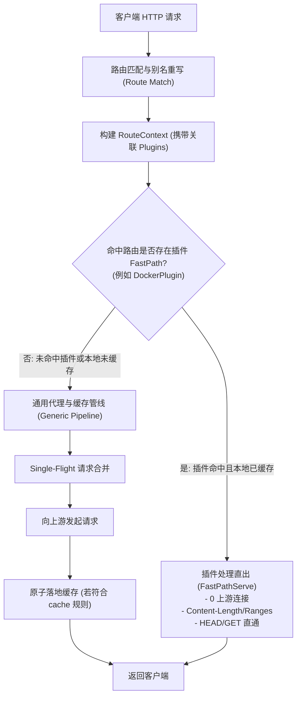
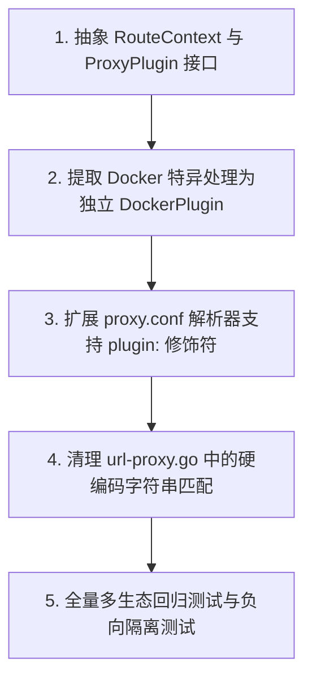

# Feature 317: 路由作用域插件化与 Docker 分层缓存解耦架构设计

## 1. 功能目标与背景 (Goal & Background)

### 1.1 历史背景与交流记录 (History & Conversation Context)
在推进 **Plan 310 (官方镜像源全链路闭环代理)** 的过程中，**Feature 314** 的任务是支持 Docker 客户端拉取镜像：
- Docker Registry v2 协议依赖复杂的流程：`GET /v2/` 返回 401 携带 `Www-Authenticate` 头，客户端凭此向 Auth 服务器换取 Bearer Token；
- 随后拉取易变清单（Manifests）与 GB 级的分层数据（Layer Blobs）；
- 为了达成「本地已命中缓存的分层实现 0 上游网络请求、微秒级直出，且断网/离线环境下仍能秒级拉取」这一核心指标，代理必须允许在无需向上游发起 HTTP 连接探测的情况下，直接将已完整下载的 Blob 响应给客户端。

在 Feature 314 初版落地中，为了快速通过自动化测试与验证功能闭环，在 `url-proxy.go` 的请求入口处直接编写了如下全局检查逻辑：

```go
// url-proxy.go (Feature 314 初版实现)
if strings.Contains(uri, "/blobs/sha256:") {
    cachePath := filepath.Join(*cache, getSafeUrlPath(uri))
    if stat, err := os.Stat(cachePath); err == nil && !stat.IsDir() && stat.Size() > 0 {
        log.Printf("[%d] blob hit local cache (direct serve): %s", reqID, uri)
        w.Header().Set("Content-Length", strconv.FormatInt(stat.Size(), 10))
        w.Header().Set("Accept-Ranges", "bytes")
        w.Header().Set("Content-Type", "application/octet-stream")
        if r.Method == http.MethodHead {
            w.WriteHeader(http.StatusOK)
            return
        }
        http.ServeFile(w, r, cachePath)
        return
    }
}
```

在代码审查过程中，用户敏锐指出了该实现方式存在的结构性隐患：
> *"在上面的这个功能开发中，直接对 `/blobs/sha256:` 后缀做了处理，这种方式可能是有问题的，需要按配置的某些规则来做某些处理，比如 docker `registry-1.docker.io` 之类的，直接在此链接中集成 docker 插件，只有走此路由的，才会触发 `/blobs/sha256:` 等的处理。"*

---

### 1.2 问题深度剖析 (Problem Analysis & Rationale)

为什么直接基于全局 URI 路径匹配 `strings.Contains(uri, "/blobs/sha256:")` 是有问题的？

1. **全局命名空间污染 (Namespace Pollution)**：
   - `uri` 是经过别名重写或客户端传入的完整目标 URL；
   - `strings.Contains(uri, "/blobs/sha256:")` 是**无差别全局生效**的；
   - 假如有其他生态的软件源（例如 Git LFS 存储、S3/MinIO 对象存储桶、HuggingFace 模型仓库、或企业内部自定义的 REST API）的 URL 路径碰巧包含 `/blobs/sha256:`，该请求就会被误认为是 Docker 镜像分层，从而强行绕过通用的 Single-Flight 机制或常规缓存策略，产生不可预料的副作用。

2. **违背声明式配置哲学 (Violation of Declarative Configuration)**：
   - `url-proxy` 的设计核心原则是**纯配置驱动（Config-Driven）**，所有路由别名（`alias`）、转发（`forward`）、缓存免除（`bypass`）、强缓存（`cache`）、响应体重写（`rewrite`）均在 `proxy.conf` 中清晰声明，核心引擎只负责规则解析与执行；
   - 直接在 Go 核心代码中将特定协议的路径片段硬编码，破坏了配置驱动的统一性，使得代理核心逻辑与 Docker OCI 协议形成了不恰当的强耦合。

3. **可维护性与拓展瓶颈 (Scalability Bottleneck)**：
   - 未来 `url-proxy` 还要支持 Rust Cargo（Feature 315）、Helm、NuGet 等多种生态；
   - 如果每增加一个生态的优化点（如 Cargo 的 Sparse Index 压缩、Helm 的 Chart 依赖查找），都在全局 `Handler` 里插入类似 `if strings.Contains(...)`，`url-proxy.go` 将迅速演变为难以测试、难以维护的“上帝函数（God Function）”。

---

### 1.3 特性建设目标 (Core Objectives)
1. **严格的作用域限定 (Scope Isolation)**：Docker 的分层识别、HEAD 加速、401 挑战透传等专属行为，**仅在流量命中配置了 Docker 插件/特性的路由时触发**；
2. **插件化/中间件化抽象 (Route-Scoped Plugins / Handlers)**：将协议特异性逻辑从主调度流程中彻底剥离，沉淀为独立的 Handler 或 Plugin 模块；
3. **声明式配置自然扩展 (Declarative Configuration)**：用户在 `proxy.conf` 中显式为路由绑定插件或行为策略；
4. **向下兼容与零回归 (Zero Regressions)**：全生态自动化回归测试 100% 保持通过，同时增加隔离性验证负向用例。

---

## 2. 核心架构与处理管线 (Architecture & Pipeline)



### 2.1 插件接口规范 (`RoutePlugin` / `ProxyPlugin`)

```go
// ProxyPlugin 定义绑定到具体路由/别名的协议插件接口
type ProxyPlugin interface {
    // Name 返回插件唯一标识名称 (如 "docker")
    Name() string

    // Match 校验当前请求上下文与 URI 是否属于该插件管辖范围
    Match(req *http.Request, uri string) bool

    // FastPathServe 尝试进行高速直出 (如本地已缓存的不可变 Blobs)
    // 若返回 true，表示请求已由插件完全接管并响应，主流程无需继续执行
    FastPathServe(w http.ResponseWriter, r *http.Request, uri string, cacheDir string) bool
}
```

### 2.2 Docker 专用插件解耦 (`DockerPlugin`)

将原先硬编码在主流程中的 Docker 特异逻辑收敛到独立插件中：
1. **作用域校验**：仅当请求关联的路由别名声明了 `plugin:docker`，或者处于特定 Docker 路由配置中时激活；
2. **Blob 分层高速直出**：
   - 匹配路径 `/blobs/sha256:`；
   - 检查本地缓存是否存在完整文件；
   - 支持 HEAD 方法快速响应 `200 OK`，自动设置 `Content-Length`、`Accept-Ranges: bytes`；
   - 支持 Range 请求与断点续传（通过 `http.ServeFile`）。

---

## 3. 配置文件语法规范 (`proxy.conf`)

### 3.1 配置文件语法演进方案对比

#### 方案 A：别名直接绑定插件参数 (推荐)
在 `alias` 指令后允许附加插件修饰符 `plugin:<name>`：
```ini
# 将 docker 插件直接挂载到指定的上游别名路由上
alias /v2 https://registry-1.docker.io/v2 plugin:docker
alias /docker https://registry-1.docker.io plugin:docker
```
- **优点**：极其直观，路由与插件强绑定，代码解析改动成本低。
- **作用机制**：当请求匹配到别名 `/v2` 或 `/docker` 时，当前路由上下文注入 `docker` 插件实例，只有该上下文会执行 `/blobs/sha256:` 优化。

#### 方案 B：独立声明式插件挂载指令 (`plugin`)
引入专门的 `plugin` 指令，显式声明插件的作用域：
```ini
alias /v2 https://registry-1.docker.io/v2
alias /docker https://registry-1.docker.io

# 声明在特定路径作用域下激活 docker 协议增强插件
plugin docker scope:/v2/,/docker/
```
- **优点**：解耦了 `alias` 指令与插件声明，支持多路由通配挂载。

#### 方案 C：通用声明式「内容寻址/不可变」缓存标记 (`immutable`)
将 Docker 的特异性进一步抽象为通用的 HTTP 缓存特性：
```ini
# 声明某个规则匹配的资源为加密哈希内容寻址的不可变资源 (Immutable Content-Addressed)
# 引擎将自动赋予其 0 回源高速直出与 HEAD 原生加速能力
cache /docker/v2/ immutable contains /blobs/sha256:
```
- **优点**：无需编写专门的 Docker 插件代码，将能力通用化为所有不可变资源（如 Git LFS、Nix/Guix Store、IPFS 网关等）。

### 3.2 推荐落地规范 (基于方案 A 并保留扩展能力)

在 `proxy.conf` 中推荐采用**方案 A**，结合现有路由声明，简洁且语义明确：

```ini
# ==========================================
# Docker Hub 官方源中继与分层插件化配置
# ==========================================

# 1. 声明 Docker Hub 官方 Registry 别名并启用 docker 插件
alias /docker https://registry-1.docker.io plugin:docker

# 2. 镜像清单动态透传免缓存 (走 304 快速协商)
bypass /docker/v2/ contains /manifests/

# 3. 镜像分层文件 (Blobs) 100% 永久安全落盘
cache /docker/v2/ contains /blobs/sha256:
```

---

## 4. 详细设计与重构实施指南 (Implementation Roadmap)



### 4.1 实施步骤详细说明

1. **抽象插件接口与路由上下文**：
   - 在 `proxy.conf` 内部数据结构 `AliasRule` 中增加 `Plugin string` 字段；
   - 维护全局插件注册表（如 `map[string]ProxyPlugin`）；
   - 请求到达时匹配路由，获取匹配的插件列表并传递到上下文。

2. **解耦 Docker 特异处理为独立插件 (`DockerPlugin`)**：
   - 将目前硬编码在 `url-proxy.go` 中的：
     - `strings.Contains(uri, "/blobs/sha256:")` 检查；
     - 本地缓存存在时的直接 `http.ServeFile` 与 Range / HEAD 处理；
     - 401 握手头的提取与校验；
   - 全部封装进 `DockerPlugin` 内部，且判定必须满足处于 `plugin:docker` 的路由绑定或相应 Docker 上下文中。

3. **扩展配置解析器**：
   - 调整 `proxy.conf` 解析逻辑，支持 `alias <prefix> <upstream> [plugin:<name>]`；
   - 保证向后兼容，未指定 `plugin:` 的别名保持原有行为不变。

4. **重构核心请求管线**：
   - 从 `url-proxy.go` 的主 `Handler` 中彻底删除全局 `if strings.Contains(uri, "/blobs/sha256:")` 代码块；
   - 改为在别名匹配完成后，若当前路由绑定了有效插件，调用 `plugin.FastPathServe(...)`；若插件处理成功则直接返回，否则进入常规代理流程。

5. **回归测试与隔离验证**：
   - 确保 `TestDockerRegistryV2RelayPipeline` 依然 100% 通过；
   - 增加负向隔离测试用例：模拟非 Docker 路由（未绑定 `plugin:docker`）但路径包含 `/blobs/sha256:` 的请求，验证其**绝不会**触发 Docker 插件的高速直出逻辑，保证全局隔离性。

---

## 5. 验证场景与测试标准 (Verification)

1. **Docker 官方源中继正向功能闭环**：
   - 命中 `/docker` 路由的镜像拉取，`/blobs/sha256:` 分层在本地命中时实现 0 上游连接、微秒级本地直出；
   - `HEAD` 请求返回正确 `Content-Length` 与 `Accept-Ranges: bytes`；
   - 镜像清单 `manifests` 正常进行 304 协商与动态直通。
2. **跨生态非 Docker 路径污染隔离 (负向隔离验证)**：
   - 构造请求如 `http://127.0.0.1:8888/other/repo/blobs/sha256:abcd`（该路由未绑定 `plugin:docker`）；
   - 验证代理正常走通用转发逻辑，不会因路径包含 `/blobs/sha256:` 被错误识别为 Docker 分层。
3. **全生态端到端零回归**：
   - 运行全量测试套件（包括 APT、PyPI、npm、Cargo、Docker），所有测试 100% 保持绿色通过。
