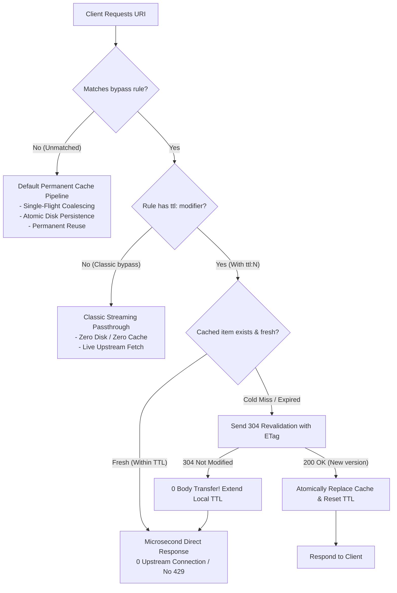

# Feature 318: Dynamic Metadata Soft TTL & SWR Caching Engine (Bypass TTL Extension)

## 1. Goal & Background

### 1.1 Architectural Baseline & Problem Analysis
The foundational design philosophy of `url-proxy` is **Default Infinite Caching (Default On-Disk TTL)**:
- **Default Baseline**: Any incoming request that does not match a `bypass` rule (e.g. `.deb`, `.whl`, `.tgz`, `.crate`, and Docker layer blobs) is automatically coalesced via Single-Flight and permanently stored on disk;
- **Origin of `bypass` Directives**: Specifically designed to break default permanent caching, exempting dynamic, fast-evolving metadata (e.g. APT `InRelease`, PyPI `/simple/` indexes, npm package manifests, Docker manifests) from permanent retention so that clients can observe newly published packages.

In large-scale concurrent continuous integration (CI/CD) pipelines or multi-node container builds, pure streaming `bypass` exhibits severe structural bottlenecks:
1. **Existing `bypass` Operates as a Pure Streaming Extreme (`TTL = 0`)**:
   - Every single client request must make a live roundtrip to the remote upstream origin;
   - When dozens or hundreds of build runners execute `pip install` or `npm install` concurrently, bursts of requests originate from the same egress IP;
   - This frequently triggers upstream CDN anti-scraping and rate-limiting blocks (**HTTP 429 Too Many Requests**), leading to build pipeline failures.
2. **Aggregated Cross-Border Build Latencies**:
   - Even when all multi-gigabyte package archives hit local cache at line-rate speeds, every runner still incurs WAN latencies fetching index metadata;
   - Overseas handshakes and time-to-first-byte (TTFB) delays can stall job initializations for tens of seconds.

---

### 1.2 Feature Objectives
Given the "default-cache" baseline, **treat the TTL mechanism as an attribute modifier on `bypass` rules** (Option A), achieving high performance with unified declarative semantics:
1. **Cohesive Modifier Syntax (`ttl:<duration>`)**: Extend existing `bypass` directives with an optional `ttl:<duration>` modifier (e.g. `bypass /pypi/ contains /simple/ ttl:300s`);
2. **Microsecond Delivery during Freshness Window**: Within the soft TTL window, serve metadata instantly from local memory/storage, generating zero upstream requests and shielding CI clusters from HTTP 429 rate limits;
3. **Stale-While-Revalidate (SWR) Conditional Revalidation**:
   - Once soft TTL expires, the proxy revalidates against upstream using conditional headers (`If-None-Match` / `If-Modified-Since`);
   - If upstream responds with `304 Not Modified`, extend the local TTL lease with zero body payload transfer;
   - If upstream responds with `200 OK` (new release detected), atomically overwrite the local cache and refresh timestamps;
4. **100% Backward Compatibility & Zero Configuration Duplication**:
   - Existing `bypass` directives without `ttl:` retain their original behavior (pure streaming passthrough, TTL=0);
   - Eliminates redundant rule declarations between `bypass` and separate `ttl` scopes.

---

## 2. Architecture & Pipeline



### 2.1 Rule Arbitration Hierarchy
1. **Permanent Cache Whitelist Rules (`cache`) - Highest Priority**:
   - Explicit `cache` rules (e.g. `cache * suffix .deb`) always take precedence, ensuring immutable packages are permanently retained on disk;
2. **Soft TTL Metadata Rules (`bypass ... ttl:<duration>`)**:
   - Matched `bypass` rules with `ttl:` modifiers enter the Soft TTL & SWR lifecycle pipeline;
3. **Classic Streaming Bypass Rules (`bypass ...` without ttl)**:
   - Matched `bypass` rules without `ttl:` execute pure streaming passthrough (zero disk, live upstream fetch).

---

## 3. Configuration Syntax (`proxy.conf`)

### 3.1 Syntax Definition
```ini
# Syntax: bypass <Scope> [MatchSpec] [ttl:<Duration>]
# Supported duration units:
#   s: Seconds
#   m: Minutes
#   h: Hours
```

### 3.2 Production Configuration Examples
```ini
# ==============================================================================
# Feature 318: Dynamic Metadata Soft TTL (Bypass TTL) Configuration Patterns
# ==============================================================================

# 1. Classic streaming passthrough (without ttl:, default behavior, TTL = 0)
bypass /docker/v2/ contains /manifests/

# 2. PyPI Simple Index: soft cache for 5 minutes (prevents concurrent 429s)
bypass /pypi/ contains /simple/ ttl:300s

# 3. npm Package Manifests: soft cache for 3 minutes
bypass /npm/ exact express ttl:180s

# 4. APT / Debian / Ubuntu Repository Indexes: soft cache for 60 seconds
bypass /ubuntu/ exact InRelease ttl:60s
bypass /debian/ exact Release   ttl:60s

# 5. Alpine Package Indexes: soft cache for 60 seconds
bypass /alpine/ exact APKINDEX.tar.gz ttl:60s

# 6. Rust Cargo Sparse Index Queries: soft cache for 2 minutes
bypass /crates-index/ ttl:120s
```

---

## 4. Detailed Design & Core Data Structures

### 4.1 Rule Model Extension (`NoCacheRule`)

```go
// NoCacheRule extended to support time-to-live attributes (Feature 318)
type NoCacheRule struct {
	Scope   string         // Scope identifier (Host or Path prefix)
	Action  string         // "bypass" or "cache"
	Type    string         // "exact", "contains", "suffix", "regex"
	Pattern string         // Match pattern
	Regexp  *regexp.Regexp // Precompiled regex (when Type == "regex")
	TTL     time.Duration  // Freshness duration (0 indicates pure streaming passthrough)
}
```

### 4.2 Core Data Structures (`TTLManager`)

```go
package main

import (
	"sync"
	"time"
)

// TTLItem encapsulates cached metadata along with lifecycle attributes
type TTLItem struct {
	Data         []byte            // Cached response payload
	Header       map[string]string // Captured response headers (Content-Type, ETag, etc.)
	StatusCode   int               // Upstream status code (typically 200)
	ETag         string            // Captured ETag for conditional revalidation
	LastModified string            // Captured Last-Modified timestamp string
	CachedAt     time.Time         // Initial cache acquisition timestamp
	ExpiresAt    time.Time         // Soft TTL expiration deadline
}

// TTLManager coordinates thread-safe metadata caching and SWR lease renewal
type TTLManager struct {
	mu    sync.RWMutex
	items map[string]*TTLItem
}

func (m *TTLManager) Get(key string) (*TTLItem, bool) {
	m.mu.RLock()
	defer m.mu.RUnlock()
	item, found := m.items[key]
	if !found {
		return nil, false
	}
	if time.Now().After(item.ExpiresAt) {
		return item, false // Item exists but has soft-expired (requires 304 revalidation)
	}
	return item, true // Fresh hit within TTL window
}

func (m *TTLManager) Set(key string, data []byte, header map[string]string, statusCode int, duration time.Duration) {
	m.mu.Lock()
	defer m.mu.Unlock()
	now := time.Now()
	m.items[key] = &TTLItem{
		Data:         data,
		Header:       header,
		StatusCode:   statusCode,
		ETag:         header["ETag"],
		LastModified: header["Last-Modified"],
		CachedAt:     now,
		ExpiresAt:    now.Add(duration),
	}
}

func (m *TTLManager) Refresh(key string, duration time.Duration) bool {
	m.mu.Lock()
	defer m.mu.Unlock()
	if item, found := m.items[key]; found {
		item.ExpiresAt = time.Now().Add(duration)
		return true
	}
	return false
}
```

---

## 5. Verification & Test Criteria

1. **Zero Upstream Inquiries within TTL Window**:
   - Dispatch 100 concurrent requests against a metadata endpoint (e.g. `/pypi/simple/requests/`);
   - Mock upstream receives exactly 1 request; subsequent 99 requests are served locally with microsecond latency;
2. **Silent 304 Extension upon Soft Expiration**:
   - Once TTL expires, proxy issues conditional request with `If-None-Match`;
   - Upon receiving `304 Not Modified`, proxy extends local TTL lease with zero body transmission;
3. **Immediate Perception of Upstream Updates**:
   - When upstream releases a new package version (responding with 200 OK and updated payload), proxy atomically overwrites local cache body and captures new ETag;
4. **Zero Regression on Classic Bypass Directives**:
   - Existing `bypass` rules without `ttl:` modifiers continue to stream through with zero retention overhead;
5. **High-Concurrency Safety & Thread Isolation**:
   - Zero deadlocks, race conditions, or panics under high-concurrency read/write bursts.
