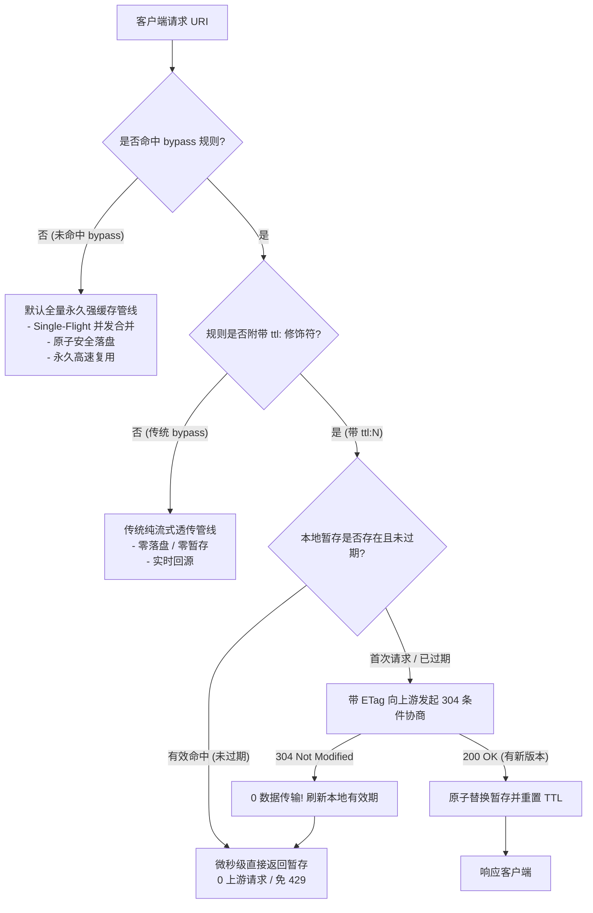

# Feature 318: 动态元数据软过期与 SWR 缓存机制设计方案 (Bypass TTL 扩展)

## 1. 功能目标与背景 (Goal & Background)

### 1.1 架构基线与痛点剖析 (Baseline & Problem Analysis)
`url-proxy` 的核心架构哲学是**默认全量持久化强缓存（Default Infinite TTL）**：
- **默认行为**：凡是未命中 `bypass` 规则的普通请求（如 `.deb`、`.whl`、`.tgz`、`.crate` 以及 Docker Blobs 等），均默认进行 Single-Flight 并发合并与磁盘永久落盘，天然具备无限生命周期；
- **`bypass` 的诞生初衷**：专用于打破默认永久缓存，针对易变动态元数据（如 APT 的 `InRelease`、PyPI 的 `/simple/` 页面、npm package JSON、Docker Manifests 等）免除永久落盘，确保客户端拉取到最新发布的版本。

在大规模并发持续集成（CI/CD）流水线或容器化多节点并行构建场景中，既有的 `bypass` 暴露了明显的结构性瓶颈：
1. **现有 `bypass` 属于 `TTL = 0` 的纯直通极端**：
   - 每次客户端请求都必须实时向公网源发起 HTTP 握手与拉取；
   - 当数十甚至上百个构建 Runner 在同一时间并发执行 `pip install` 或 `npm install` 时，出口公网 IP 在短时间内形成高频并发请求洪峰；
   - 极易触发官方 CDN 或镜像源反爬虫与速率限制风控（**HTTP 429 Too Many Requests**），导致整批流水线偶发性中断或失败。
2. **构建流水线跨境延迟累加**：
   - 即使所有体积巨大的软件包实体都已 100% 命中本地代理强缓存，每个构建容器在安装前仍必须跨境拉取最新索引；
   - 跨境网络握手与首字节延迟（TTFB）让每次初始化消耗数十秒，严重拖慢交付效率。

---

### 1.2 特性建设目标 (Feature Objectives)
针对“默认全量强缓存”的架构特征，**将 TTL 机制作为 `bypass` 规则的属性修饰扩展**（方案 A），实现动静兼备的高性能缓存管线：
1. **内聚的修饰符语法 (`ttl:<duration>`)**：在现有的 `bypass` 指令上扩展可选的 `ttl:<duration>` 修饰符（例如 `bypass /pypi/ contains /simple/ ttl:300s`）；
2. **TTL 窗口内微秒级直接返回**：在保鲜窗口期（Soft TTL）内，元数据直接从本地高速存储响应，实现 0 上游连接与微秒级响应，彻底消除并发风暴与 HTTP 429 风险；
3. **Stale-While-Revalidate (SWR) 智能条件协商**：
   - 当元数据超过 Soft TTL 软过期后，代理向上游发起带 `If-None-Match` / `If-Modified-Since` 的条件请求；
   - 上游返回 `304 Not Modified` 时，实现 0 数据体传输并瞬间刷新本地 TTL 租期；
   - 上游返回 `200 OK`（有新包发布）时，原子替换本地元数据缓存并更新有效时长；
4. **100% 向后兼容与零配置冗余**：
   - 未配置 `ttl:` 的既有 `bypass` 规则保持原有行为（纯流式直通，TTL=0）；
   - 用户无需在 `bypass` 和独立的 `ttl` 之间重复配置相同的路径匹配条件，语义自闭环。

---

## 2. 核心架构与处理管线 (Architecture & Pipeline)



### 2.1 规则优先级仲裁机制 (Rule Arbitration Hierarchy)
当请求 URI 进入代理管线时，按如下优先级仲裁：
1. **强缓存白名单规则 (`cache`) - 最高优先级**：
   - 显式声明为 `cache` 的资源（如 `cache * suffix .deb`），即使匹配宽泛的 `bypass`，依然判定为永久落盘强缓存；
2. **软过期动态元数据保鲜规则 (`bypass ... ttl:<duration>`)**：
   - 命中附带 `ttl:` 修饰符的 `bypass` 规则，进入 Soft TTL & SWR 暂存与保鲜调度管线；
3. **传统纯直通免缓存规则 (`bypass ...` 未配置 ttl)**：
   - 命中未带 `ttl:` 的常规 `bypass` 规则，执行纯流式动态直通（零落盘、零暂存、实时回源）。

---

## 3. 配置文件语法规范 (`proxy.conf`)

### 3.1 语法定义
```ini
# 语法结构: bypass <Scope> [MatchSpec] [ttl:<Duration>]
# 支持的持续时间单位:
#   s: 秒 (Seconds)
#   m: 分 (Minutes)
#   h: 小时 (Hours)
```

### 3.2 典型官方源生产级配置示例
```ini
# ==============================================================================
# Feature 318: 动态元数据软过期 (Bypass TTL) 配置范式
# ==============================================================================

# 1. 传统纯流式直通 (不带 ttl: 修饰符，保持原有行为，TTL = 0)
bypass /docker/v2/ contains /manifests/

# 2. PyPI Simple 索引软缓存 5 分钟 (300 秒，避免并发 pip install 触发 429)
bypass /pypi/ contains /simple/ ttl:300s

# 3. npm 包元数据清单软缓存 3 分钟 (180 秒)
bypass /npm/ exact express ttl:180s

# 4. APT / Debian / Ubuntu 软件源索引元数据软缓存 60 秒 (避免并发 apt update 风暴)
bypass /ubuntu/ exact InRelease ttl:60s
bypass /debian/ exact Release   ttl:60s

# 5. Alpine 软件包索引软缓存 60 秒
bypass /alpine/ exact APKINDEX.tar.gz ttl:60s

# 6. Rust Cargo 稀疏索引查询软缓存 2 分钟 (120 秒)
bypass /crates-index/ ttl:120s
```

---

## 4. 详细设计与核心数据结构 (Detailed Design)

### 4.1 规则模型扩展 (`NoCacheRule`)

```go
// NoCacheRule 扩展支持生存时间属性 (Feature 318)
type NoCacheRule struct {
	Scope   string         // 作用域 (主机或路径前缀)
	Action  string         // "bypass" 或 "cache"
	Type    string         // "exact", "contains", "suffix", "regex" 等
	Pattern string         // 匹配模式串
	Regexp  *regexp.Regexp // 预编译正则表达式 (若 Type == "regex")
	TTL     time.Duration  // 软过期保鲜时长 (若为 0 则为纯流式直通)
}
```

### 4.2 核心数据结构 (`TTLManager`)

```go
package main

import (
	"sync"
	"time"
)

// TTLItem 保存带有生命周期元数据的缓存项
type TTLItem struct {
	Data         []byte            // 缓存的响应正文数据
	Header       map[string]string // 关键响应头部 (Content-Type, ETag, Last-Modified 等)
	StatusCode   int               // 响应状态码 (通常为 200)
	ETag         string            // 上游 ETag，用于后续 304 条件协商
	LastModified string            // 上游 Last-Modified
	CachedAt     time.Time         // 首次缓存落地时间
	ExpiresAt    time.Time         // 软过期到期时间戳
}

// TTLManager 管理内存/临时存储的高并发元数据软缓存生命周期
type TTLManager struct {
	mu    sync.RWMutex
	items map[string]*TTLItem
}

func (m *TTLManager) Get(key string) (*TTLItem, bool) {
	m.mu.RLock()
	defer m.mu.RUnlock()
	item, found := m.items[key]
	if !found {
		return nil, false
	}
	if time.Now().After(item.ExpiresAt) {
		return item, false // 存在旧缓存但已过保鲜期 (需进入 304 续期协商)
	}
	return item, true // 保鲜期内有效命中
}

func (m *TTLManager) Set(key string, data []byte, header map[string]string, statusCode int, duration time.Duration) {
	m.mu.Lock()
	defer m.mu.Unlock()
	now := time.Now()
	m.items[key] = &TTLItem{
		Data:         data,
		Header:       header,
		StatusCode:   statusCode,
		ETag:         header["ETag"],
		LastModified: header["Last-Modified"],
		CachedAt:     now,
		ExpiresAt:    now.Add(duration),
	}
}

func (m *TTLManager) Refresh(key string, duration time.Duration) bool {
	m.mu.Lock()
	defer m.mu.Unlock()
	if item, found := m.items[key]; found {
		item.ExpiresAt = time.Now().Add(duration)
		return true
	}
	return false
}
```

---

## 5. 验证场景与测试标准 (Verification & Test Criteria)

1. **TTL 窗口内零外网请求 (并发 429 防护)**：
   - 对同一个配置了 `ttl:` 的元数据端点（如 `/pypi/simple/requests/`）并发发起 100 次 HTTP 请求；
   - 上游 Mock 服务端只记录到 1 次回源请求，其余 99 次全部在毫秒/微秒级由本地直接返回；
2. **软过期后 304 静默续期**：
   - 跨越 TTL 持续时间后发起请求，代理自动带上上一次缓存的 `If-None-Match: <ETag>` 请求上游；
   - 上游返回 `304 Not Modified` 时，代理直接复用旧正文响应客户端，并刷新本地 TTL 租期，网络传输为 0 字节；
3. **上游版本更新实时感知**：
   - 上游发布新包版本并修改内容，返回 `200 OK`，代理自动更新本地正文与 ETag；
4. **未配置 ttl 的 bypass 行为 100% 保持不变 (零回归)**：
   - 既有未配置 `ttl:` 的普通 `bypass` 规则（如 Docker Manifests）保持纯流式直通，绝不引入多余的暂存开销；
5. **高并发读写安全性**：
   - 在高并发读写、竞态刷新与超时并存的压力测试下，保持 100% 内存安全，无 panic 或数据竞态。
