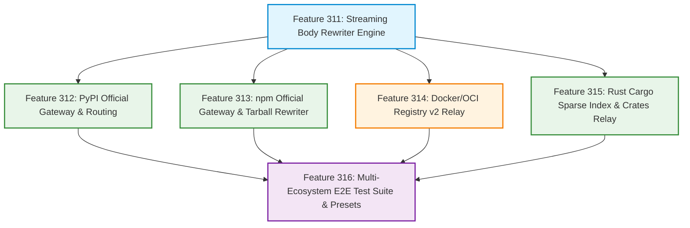

# Official Registries Caching Proxy & Body Rewriting Plan (Plan 310)

## 1. Background & Problem Analysis

### 1.1 Core Pain Points
In modern software engineering and continuous integration (CI/CD) pipelines, beyond OS-level packages (such as APT and Alpine apk), application runtime dependencies (such as Python PyPI, Node.js npm, Docker/OCI container images, and Rust Crates) consume the majority of external egress bandwidth and build times.

Throughout previous feature developments, `url-proxy` has established robust core primitives: Request Coalescing (Single-Flight), Safe File Paths (SafeUrlPath), Dynamic/Static Separation (bypass/cache), Conditional 304 Passthrough, and Range 206 Partial Content Resuming. However, when applying these primitives directly to **official upstream registries**, critical protocol-level obstacles emerge:

- **Pain Point 1: PyPI Official Mirror Cross-Domain Absolute URLs**:
  Official PyPI adheres to PEP 503 / PEP 691. When a client requests `https://pypi.org/simple/<pkg>/`, the returned HTML/JSON index contains package (Wheel / Sdist) download links hardcoded to an independent CDN domain: `https://files.pythonhosted.org/packages/...`.
  - When a client sets `--index-url http://proxy:8888/pypi/simple/`, pip parses the index and **bypasses the proxy entirely, initiating direct connections to `files.pythonhosted.org`**.
  - As a result, the local proxy cannot intercept or cache massive Python artifacts (such as PyTorch or TensorFlow, which can reach hundreds of megabytes).
- **Pain Point 2: npm Official Registry Tarball URL Escaping**:
  The official npm registry (`registry.npmjs.org`) populates the `versions[x].dist.tarball` field in package metadata JSON with absolute URLs (e.g. `https://registry.npmjs.org/foo/-/foo-1.0.0.tgz`).
  - Modern npm, yarn, and pnpm clients prefer to download packages using the absolute address declared in `dist.tarball`, bypassing LAN proxy routes.
- **Pain Point 3: Docker / OCI Registry Token Auth & Manifest Redirection**:
  Docker clients pull images according to the Registry v2 API specification. Pull operations start with a `/v2/` probe and `401 Unauthorized` challenge (directing the client via the `Www-Authenticate` header to `auth.docker.io` for a Bearer Token). Transparent HTTP proxies cannot seamlessly relay this OAuth2 authentication state machine without specialized negotiation.
- **Pain Point 4: High-Frequency Metadata Query Latency & Upstream Throttling**:
  If dynamic indexes (such as PyPI simple indexes or npm metadata) are configured for pure bypass on every build, international network latency and upstream rate limiting (e.g. HTTP 429 Too Many Requests) degrade CI pipeline performance.

### 1.2 Plan 310 Goals
Extend `url-proxy` while preserving its lightweight, decoupled architecture to overcome official registry protocol barriers and achieve maximum coverage and caching acceleration:
1. **Dynamic Response Body Streaming URL Rewriter**: In-flight replacement of cross-domain/absolute URLs within index payloads, constraining client requests within the proxy domain to eliminate PyPI and npm escaping;
2. **Multi-Host Gateway Routing**: Coordinated mapping between primary index domains and storage CDN domains, ensuring seamless routing and unified local persistence;
3. **Protocol Adaptations (Docker v2 & Cargo Sparse)**: Transparent relay of Docker 401 Bearer Token challenges and Cargo Sparse Index HTTP requests, connecting major container and language registries;
4. **Extended `proxy.conf` Directives**: Clean, declarative directives (`rewrite`, `type`) to govern official registry behavior without hardcoding language-specific logic in the core proxy engine.
*(Note: The original "Metadata Soft TTL & SWR" feature has been moved to [docs/todo/metadata-soft-ttl-swr-en.md](../todo/metadata-soft-ttl-swr-en.md) as a future optimization).*

---

## 2. Feature Breakdown & Architecture Matrix

To ensure incremental, high-quality implementation, Plan 310 is organized into 6 core features:



| Feature | Name | Scope & Objective | Specification | Status |
| :---: | :--- | :--- | :--- | :---: |
| **Feature 311** | **Streaming Response Body Rewriter Engine** | Generic response body rewriter foundation; `rewrite` directive with `{PROXY_HOST}`; ETag stripping & chunked encoding | [311 Specification](../features/311-response-body-rewriter-en.md) | ✅ **Completed** |
| **Feature 312** | **Official PyPI Gateway & Multi-Host Routing** | Coordinated routing for `pypi.org` & `files.pythonhosted.org`; PEP 503/691 index rewriting; `.whl` caching | [312 Specification](../features/312-pypi-official-proxy-en.md) | ✅ **Completed** |
| **Feature 313** | **Official npm Registry Gateway & Tarball Rewriter** | Rewrite `dist.tarball` absolute URLs in package JSON; `.tgz` caching and request coalescing; client `.npmrc` integration | [313 Specification](../features/313-npm-official-proxy-en.md) | ✅ **Completed** |
| **Feature 314** | **Docker / OCI Registry v2 Relay & Layer Caching** | Intercept `/v2/` & relay Bearer Token challenge; immutable layer blob caching with Range 206 support; dynamic manifest 304 passthrough | [314 Specification](../features/314-docker-registry-v2-relay-en.md) | ✅ **Completed** |
| **Feature 315** | **Rust Cargo Sparse Index & Crates Official Relay** | Support Cargo Sparse Protocol (RFC 2785); persistent caching for `.crate` archives | [315 Specification](../features/315-rust-cargo-crates-proxy-en.md) | ✅ **Completed** |
| **Feature 316** | **Multi-Ecosystem Integration Test Suite & Presets** | High-fidelity Mock cluster; end-to-end regression across all ecosystems; production-ready `proxy.conf` standard configuration | [316 Specification](../features/316-multi-ecosystem-integration-en.md) | ✅ **Completed** |
| *(Deferred)* | Metadata Soft TTL & Stale-While-Revalidate Engine | `ttl` directive parser; local short-term metadata caching with 304 background revalidation to eliminate CI upstream load | [Todo Specification](../todo/metadata-soft-ttl-swr-en.md) | Backlog |

---

## 3. Configuration & Implementation Specifications

### 3.1 Extended `proxy.conf` Directives

The single-line configuration file parser (`proxy.conf`) is extended with the `rewrite` and `ttl` directives:

| Directive | Syntax Format | Description |
| :--- | :--- | :--- |
| **`alias`** | `alias <Prefix> <UpstreamBaseURL>` | Existing: Path prefix alias mapping |
| **`bypass`** | `bypass <Scope> <Type> <Pattern>` | Existing: Bypass local caching (streaming passthrough) |
| **`cache`** | `cache <Scope> <Type> <Pattern>` | Existing: Whitelist patterns for permanent disk caching |
| **`type`** | `type <Name> [mime:<MIME>] [suffix:<Ext>]...` | **New**: Declare content-type aliases and groupings (e.g. `type html ...`) |
| **`rewrite`** | `rewrite <Scope> [TypeSpec] <Pattern> <Replacement>` | **New**: In-memory response body string rewrite for matched scopes and types |
| **`ttl`** | `ttl <Scope> <Duration>` | **New**: Soft TTL duration for dynamic metadata caching |

#### Content Type Specification (`<TypeSpec>`)
- `type:<name>`: References user-defined or built-in type alias (`type:json`, `type:html`, `type:pypi`);
- `mime:<pattern>`: Direct wildcard match on upstream `Content-Type` header (e.g. `mime:application/json`);
- `suffix:<ext>`: Direct extension match on requested URL path (e.g. `suffix:.html`, `suffix:.json`);
- `*` or omitted: Matches all text-based content types by default.

#### Macro Interpolation (`{PROXY_HOST}`)
The `<Replacement>` parameter supports dynamic substitution:
- `{PROXY_HOST}`: Evaluates to the incoming client request `Host` header (e.g. `192.168.1.100:8888`), ensuring rewritten links point back to the proxy as seen by the client.

---

### 3.2 Body Rewriter Engine Architecture

```go
type TypeDefinition struct {
    Name     string   // Type alias (e.g. "html", "json", "pypi")
    Mimes    []string // Matching MIME types
    Suffixes []string // Matching URL path extensions
}

type RewriteRule struct {
    Scope       string // Path prefix scope (e.g. "/npm/", "/pypi/simple/")
    TypeSpec    string // Content type specification
    Pattern     string // Search string
    Replacement string // Replacement template with {PROXY_HOST}
}

type BodyRewriter struct {
    Rules []RewriteRule
    Types map[string]TypeDefinition
}
```

---

### 3.3 Protocol Pipeline & Header Adaptation

```text
[Client pip / npm] 
       │ 1. Issues GET /pypi/simple/requests/ (Host: 192.168.1.100:8888)
       ▼
[url-proxy Gateway]
       │ 2. Issues upstream request with Accept-Encoding: identity
       ▼
[Upstream pypi.org / npmjs.org]
       │ 3. Returns 200 OK (Content-Type: text/html, containing https://files.pythonhosted.org/...)
       ▼
[Body Rewriter Pipeline]
       │ 4. Applies rewrite rule:
       │    Replaces https://files.pythonhosted.org/ with http://192.168.1.100:8888/pythonhosted/
       │ 5. Strips upstream ETag and Content-Length; sets Transfer-Encoding: chunked
       ▼
[Client pip / npm] 
       │ 6. Client parses rewritten index; subsequent package downloads route to /pythonhosted/
       ▼
[url-proxy Gateway]
       │ 7. Matches /pythonhosted alias; triggers SafeUrlPath disk caching & Single-Flight coalescing!
```

---

## 4. Implementation Milestones & Final Delivery

| Phase | Target Features | Deliverables | Verification Target | Status |
| :---: | :---: | :--- | :--- | :---: |
| **Phase 1** | **Feature 311** | Core `BodyRewriter` engine, `rewrite` directive parsing, MIME filtering | Unit tests verifying string replacement across various MIME types | ✅ **100% Delivered** |
| **Phase 2** | **Feature 312 & 313** | Official PyPI & npm end-to-end proxying, paired alias configurations | Real `pip install` and `npm install` succeed with 100% caching and 0 WAN leaks | ✅ **100% Delivered** |
| **Phase 3** | **Feature 314 & 315** | Docker v2 token challenge relay and Rust Cargo sparse index support | `docker pull` and `cargo build` pull and cache large binary archives | ✅ **100% Delivered** |
| **Phase 4** | **Feature 316** | Multi-ecosystem integration test suite and unified production configuration | `go test -count=1 ./...` runs end-to-end regression across all registries; `proxy.conf` published | ✅ **100% Delivered** |

**Plan 310 is officially 100% complete and delivered!** All 8 software ecosystems (APT, Alpine, Go, Maven, PyPI, npm, Docker, Cargo) are fully supported with out-of-the-box templates and verification suites.
