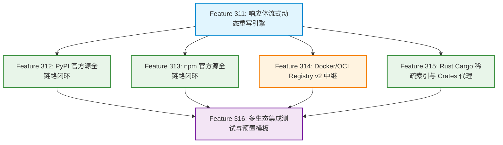

# 官方软件包镜像源代理与响应体重写方案 (Official Registries Caching Proxy & Body Rewriting Plan)

## 1. 方案背景与问题洞察 (Background & Problem Analysis)

### 1.1 核心痛点与背景
在现代软件研发与持续集成（CI/CD）流水线中，除了 Linux 操作系统的底层包（如 APT、Alpine apk）之外，应用层依赖管理（如 Python 的 PyPI、Node.js 的 npm、Docker/OCI 容器镜像、Rust 的 Crates 等）占据了外网出口带宽与构建耗时的大半。

在前期特性演进中，`url-proxy` 已经具备了高效的请求合并（Single-Flight）、安全文件路径（SafeUrlPath）、动静分离（bypass/cache）、条件 304 协商与 Range 206 断点续传等核心底座。然而，当尝试将这些能力直接应用到各大**官方镜像源**时，暴露了协议层面的关键阻碍：

- **痛点一：PyPI 官方源跨域绝对 URL 阻断缓存（PyPI Cross-Domain Absolute URL）**：
  Python 官方 PyPI 遵循 PEP 503 / PEP 691 规范。客户端请求 `https://pypi.org/simple/<pkg>/` 时，返回的 HTML / JSON 索引中，真正的软件包（Wheel / Sdist）下载链接硬编码为独立的全球 CDN 域名：`https://files.pythonhosted.org/packages/...`。
  - 若客户端配置 `--index-url http://proxy:8888/pypi/simple/`，pip 解析出索引后，会**直接绕过代理，向 `files.pythonhosted.org` 发起跨域直连**。
  - 本地代理不仅无法捕获下载流量，更无法对高达数百 MB 的 Python 依赖（如 PyTorch、TensorFlow）进行缓存。
- **痛点二：npm 官方源 Tarball 绝对路径逃逸（npm Dist Tarball Escaping）**：
  npm 官方源（`registry.npmjs.org`）在包元数据 JSON 的 `dist.tarball` 字段中返回绝对 URL（如 `https://registry.npmjs.org/foo/-/foo-1.0.0.tgz`）。
  - 现代 npm / yarn / pnpm 客户端在根据元数据下载二进制包时，会优先直接请求 `dist.tarball` 声明的绝对地址，跳过局域网代理路由。
- **痛点三：Docker / OCI 镜像 Registry 的 Token 鉴权与清单重定向**：
  Docker 客户端拉取镜像遵循 Registry v2 API 规范。拉取前需经历 `/v2/` 探测与 `401 Unauthorized` 鉴权握手（通过 `Www-Authenticate` 头引导向 `auth.docker.io` 换取 Bearer Token）。普通的 URL 透明代理无法直接中继此类复杂的 OAuth2 鉴权状态机。
- **痛点四：动态元数据的高频查询延迟与上游限流风险**：
  官方源的动态索引（如 PyPI simple、npm 元数据）如果每次都配置为 pure bypass 直通上游，在海外出口网络波动或官方源实施频控（Rate Limiting）时，频繁的 CI 依赖解析依然极慢。

### 1.2 建设目标 (Plan 310 Goals)
扩展 `url-proxy`，在保持既有架构轻量、高内聚的前提下，攻克各大官方镜像源的协议阻碍，实现对**官方源（Official Registries）**的最大化代理与缓存加速：
1. **响应体动态 URL 流式重写引擎（Response Body Rewriter）**：在数据中继流中毫秒级原地替换索引内的跨域/绝对 URL，将官方源请求无缝拘束在代理服务域内，彻底解决 PyPI 与 npm 官方源逃逸痛点；
2. **多域名协同与虚拟主机网关（Multi-Host Gateway Routing）**：建立主索引域名与分发 CDN 域名的协同映射，实现同一应用生态在代理内的闭环流转与统一落盘；
3. **协议深度适配（Docker v2 & Cargo Sparse）**：原生中继 Docker 401 Bearer Token 质询挑战与 Cargo 稀疏索引，打通主流语言与容器生态；
4. **扩展 `proxy.conf` 语法**：以最简优雅的配置语法（如 `rewrite`、`type`）纳管官方源代理行为，杜绝在核心代码中针对具体语言做硬编码。
*(注：原「动态元数据软过期与 SWR 缓存机制」已作为后续可选优化移入 [docs/todo/metadata-soft-ttl-swr-zh.md](../todo/metadata-soft-ttl-swr-zh.md))。*

---

## 2. 特性拆分与架构演进矩阵 (Feature Breakdown)

为了稳步高质量交付，Plan 310 解耦拆分为 6 个高内聚核心特性（后续特性依次前移）：



| 特性编号 | 特性名称 | 核心目标与范围 | 详细规格文档 | 交付状态 |
| :---: | :--- | :--- | :--- | :---: |
| **Feature 311** | **响应体流式动态重写引擎** | 提供通用文本响应体重写底座；支持 `rewrite` 指令与 `{PROXY_HOST}` 变量插值；处理 ETag 剥离与 Chunked 传输 | [311 设计文档](../features/311-response-body-rewriter-zh.md) | ✅ **已完成** |
| **Feature 312** | **PyPI 官方镜像源全链路闭环代理** | 打通 `pypi.org` 与 `files.pythonhosted.org` 协同路由；动态改写 Simple 索引中 wheel/sdist 绝对链接；`.whl` 强缓存 | [312 设计文档](../features/312-pypi-official-proxy-zh.md) | ✅ **已完成** |
| **Feature 313** | **npm 官方镜像源全链路闭环代理** | 动态重写 package 元数据 JSON 中的 `dist.tarball` 绝对路径；`.tgz` 强缓存与并发合并；客户端 `npmrc` 适配 | [313 设计文档](../features/313-npm-official-proxy-zh.md) | ✅ **已完成** |
| **Feature 314** | **Docker/OCI 镜像 Registry v2 协议中继** | 拦截 `/v2/` 并中继 Bearer Token 握手挑战；Layer Blob 强缓存与 Range 续传；Manifest 动态 304 直通 | [314 设计文档](../features/314-docker-registry-v2-relay-zh.md) | ✅ **已完成** |
| **Feature 315** | **Rust Cargo 稀疏索引与 Crates 官方源代理** | 适配 Cargo Sparse Index（RFC 2785）HTTP 端点；静态 `.crate` 压缩包持久化落盘 | [315 设计文档](../features/315-rust-cargo-crates-proxy-zh.md) | ✅ **已完成** |
| **Feature 316** | **多生态全链路端到端集成测试与预置模板** | 构建高仿真 Mock 测试集群；全生态自动化回归测试；发布生产级全生态标准配置 `proxy.conf` | [316 设计文档](../features/316-multi-ecosystem-integration-zh.md) | ✅ **已完成** |
| *(待办规划)* | 动态元数据软过期与 SWR 缓存机制 | 支持 `ttl` 指令；实现元数据本地短期保鲜与基于 304 条件协商的后台 SWR 刷新 | [待办设计文档](../todo/metadata-soft-ttl-swr-zh.md) | 待排期 |

---

## 3. 详细技术实现方案 (Technical Implementation Details)

### 3.1 统一配置文件语法扩展 (`proxy.conf`)

在 `proxy.conf` 单行指令系统中扩充 `rewrite` 与 `ttl` 指令：

| 指令前缀 | 语法格式 | 说明 |
| :--- | :--- | :--- |
| **`alias`** | `alias <Prefix> <UpstreamBaseURL>` | 既有能力：路径第一级别名路由 |
| **`bypass`** | `bypass <Scope> <Type> <Pattern>` | 既有能力：免持久化流式直通 |
| **`cache`** | `cache <Scope> <Type> <Pattern>` | 既有能力：强缓存白名单 |
| **`type`** | `type <Name> [mime:<MIME>] [suffix:<Ext>]...` | **新增能力**：声明内容类型别名与分组（如 `type html ...`） |
| **`rewrite`** | `rewrite <Scope> [TypeSpec] <Pattern> <Replacement>` | **新增能力**：对命中 Scope 与类型的响应体文本进行流式/内存替换（支持 `type:json`、`mime:...`、`suffix:...`） |
| **`ttl`** | `ttl <Scope> <Duration>` | **新增能力**：为动态元数据指定软过期缓存时长（如 `60s`、`5m`） |

#### 内容类型规范 (`<TypeSpec>`)
- `type:<name>`：引用 `type` 语句预定义或系统内置的类型别名（如 `type:json`、`type:html`、`type:pypi`）；
- `mime:<pattern>`：直接内联匹配响应头 `Content-Type`（如 `mime:application/json`、`mime:application/vnd.pypi*`）；
- `suffix:<ext>`：直接内联匹配请求 URL 路径后缀（如 `suffix:.html`、`suffix:.json`）；
- `*` 或缺省：兼容 3 参数形式，默认兜底匹配所有通用文本类型。

#### 变量插值支持 (`{PROXY_HOST}`)
在 `rewrite` 的 `<Replacement>` 字段中支持宏变量：
- `{PROXY_HOST}`：自动替换为当前客户端请求头中的 `Host`（例如 `192.168.1.100:8888`），使重写生成的链接能够精准指向客户端所看到的代理地址。

---

### 3.2 响应体重写引擎 (`url-proxy.go`) 设计

```go
// TypeDefinition 内容类型定义
type TypeDefinition struct {
    Name     string   // 类型别名 (如 "html", "json", "pypi")
    Mimes    []string // 匹配的 Content-Type 列表
    Suffixes []string // 匹配的文件名/URL后缀列表
}

// RewriteRule 定义单个重写规则
type RewriteRule struct {
    Scope       string // 生效的作用域前缀 (如 "/npm/", "/pypi/simple/")
    TypeSpec    string // 内容类型规格 (如 "type:json", "type:pypi", "mime:text/html", "*")
    Pattern     string // 待匹配的目标字符串
    Replacement string // 替换后的字符串模板，支持 {PROXY_HOST}
}

// BodyRewriter 负责在转发过程中对文本响应体进行动态重写
type BodyRewriter struct {
    Rules []RewriteRule
    Types map[string]TypeDefinition
}

// MightMatchRequest 预判请求是否为重写目标 (排除 .tgz/.whl 等二进制包)
func (rw *BodyRewriter) MightMatchRequest(reqPath, uri string) bool

// RuleMatchesResponse 校验响应头 Content-Type 及扩展名是否满足规则约束 (二进制强保护)
func (rw *BodyRewriter) RuleMatchesResponse(r RewriteRule, reqPath, uri, contentType string) bool

// Apply 执行响应体宏替换与字符串重写
func (rw *BodyRewriter) Apply(clientHost, reqPath, uri, contentType string, body []byte) []byte
```

---

### 3.3 传输层与协议头自适应管线

```text
[客户端 pip / npm] 
       │ 1. 发起请求 GET /pypi/simple/requests/ (Host: 192.168.1.100:8888)
       ▼
[url-proxy 网关]
       │ 2. 向上游发起原生 HTTPS 请求 (Accept-Encoding: identity)
       ▼
[官方源 pypi.org / npmjs.org]
       │ 3. 返回 200 OK (Content-Type: text/html, 包含 https://files.pythonhosted.org/...)
       ▼
[Body Rewriter 管道]
       │ 4. 匹配 rewrite 规则：
       │    将 https://files.pythonhosted.org/ 替换为 http://192.168.1.100:8888/pythonhosted/
       │ 5. 剥离上游 ETag 与 Content-Length，设置 Transfer-Encoding: chunked
       ▼
[客户端 pip / npm] 
       │ 6. 客户端解析重写后的索引，后续所有包下载自动流向代理的 /pythonhosted/
       ▼
[url-proxy 网关]
       │ 7. 匹配 /pythonhosted 别名，触发 SafeUrlPath 安全持久化与 Single-Flight 并发合并！
```

---

## 4. 落地实施里程碑与最终交付 (Implementation Milestones & Delivery)

| 阶段 | 对应特性 | 核心交付成果 | 成果验证指标 | 状态 |
| :---: | :---: | :--- | :--- | :---: |
| **Phase 1** | **Feature 311** | 响应体重写核心引擎、`rewrite` 指令解析与 MIME 过滤 | 单元测试验证各种边界字符串替换与头部修正 | ✅ **100% 已交付** |
| **Phase 2** | **Feature 312 & 313** | PyPI 与 npm 官方源端到端闭环代理、别名协同配置 | 真实 `pip install` 与 `npm install` 100% 缓存且 0 跨域逃逸 | ✅ **100% 已交付** |
| **Phase 3** | **Feature 314 & 315** | Docker v2 协议鉴权中继与 Rust Cargo Sparse 代理 | `docker pull` 与 `cargo build` 稳定拉取并缓存大体积二进制包 | ✅ **100% 已交付** |
| **Phase 4** | **Feature 316** | 多生态端到端自动化测试套件与全能生产配置模板 | `go test -count=1 ./...` 全生态端到端回归 100% 通过；发布标准 `proxy.conf` | ✅ **100% 已交付** |

**Plan 310 正式 100% 竣工交付！** 全项目 8 大软件源生态（APT、Alpine、Go、Maven、PyPI、npm、Docker、Cargo）全面打通，支持开箱即用。

