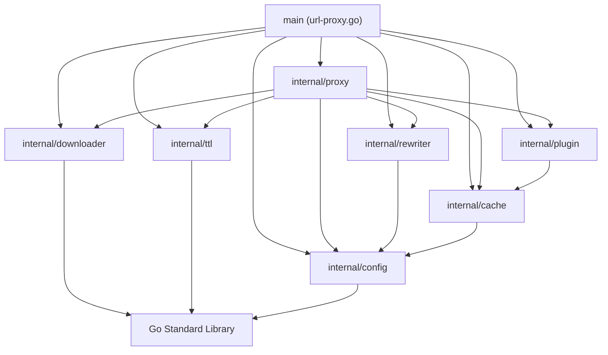

# Codebase Modular Refactoring & Domain Layering Plan (Plan 320)

## 1. Background & Problem Analysis

### 1.1 Core Pain Points & Evolution Context
As `url-proxy` progressively evolved, the system achieved full coverage ranging from basic transparent proxying (101) to 8 major official package registries (APT, Alpine, Go, Maven, PyPI, npm, Docker, Cargo) and advanced proxy mechanisms:
- Foundation & Forward Proxying: Standard HTTP forward proxying (301), conditional 304 fast short-circuiting (302), and HTTP Range 206 resume/slicing (303);
- Routing & Configuration: Unified configuration engine (304), selective cache bypass with whitelist priority arbitration (305), and path alias routing (306);
- Official Registries & Body Rewriting: Type-aware streaming response body rewriter (311), official registry protocols for PyPI/npm/Docker/Cargo (312-315), and multi-cluster integration testing (316);
- Extensibility & Cache Acceleration: Route-scoped protocol plugin framework (317), and dynamic metadata soft TTL & SWR caching engine (318).

However, all 18 features and 1,750+ lines of core implementation logic currently reside within a single source file at the project root: `url-proxy.go`.

This single-file monolith structure has introduced critical architectural and engineering bottlenecks:
- **Code Bloat & Mixed Responsibilities**: The monolithic source file has grown to 1,759 lines, intertwining CLI flag parsing, configuration lexing, regex pre-compilation, cross-platform cache path sanitization, cache bypass whitelist arbitration, in-memory SWR metadata caching, binary MIME sniffing with Gzip decompression/re-compression, Docker Blobs fast-path dispatch, TCP CONNECT tunneling, Range 206 cache slicing, Single-Flight download request coalescing, synchronization condition broadcasts, and idle watchdog routines.
- **Global Mutable State & Concurrency Vulnerabilities**: The download task pool `jobs`, global mutex `jobsMu`, monotonic counter `requestID`, metadata store `globalTTLManager`, and route plugin registry `routePlugins` all exist as package-level global variables. This hinders multi-instance test isolation and prevents clean object lifecycle management.
- **Absence of Native Go Unit Testing**: The project currently relies on black-box end-to-end mock server tests (under `tests/`), lacking native Go white-box unit tests (`*_test.go`). As a result, CI workflows cannot execute fine-grained logic regression or test coverage analysis via `go test ./...`.

### 1.2 Objectives (Plan 320 Goals)
Execute a comprehensive modular decoupling and domain-layered architecture refactoring for the `url-proxy` codebase (Plan 320 / Feature 321):
1. **Separation of Concerns & Domain Layering**: Decouple the monolithic codebase into 7 cohesive, loosely-coupled `internal` domain packages adhering to the Single Responsibility Principle (`config`, `cache`, `ttl`, `rewriter`, `plugin`, `downloader`, `proxy`);
2. **Object-Oriented Design & State Encapsulation**: Eliminate all package-level global variables and mutexes, managing task pools, SWR metadata, plugin registries, and server dispatchers via struct instances and dependency injection;
3. **100% Backward Compatibility**: Preserve the root `url-proxy.go` entrypoint as a lightweight component assembler (~70 lines), ensuring full compatibility with existing workflows (`go run url-proxy.go`, `go run .`, `go build .`, `build.bat`, `build.sh`, and `Dockerfile`);
4. **Native Go Unit Testing Closed-Loop**: Deliver dedicated `*_test.go` unit test suites for each subpackage, enabling automated quality validation via `go test ./...`.

---

## 2. Architecture & Domain Layering Design

### 2.1 Directory Structure Layout

```text
url-proxy/
??? url-proxy.go                # Lightweight entrypoint (flag parsing, DI & wiring, ~70 lines)
??? proxy.conf                  # Production unified configuration template
??? go.mod                      # Module definition: uri-proxy
??? build.sh / build.bat        # Cross-platform multi-architecture build scripts
??? Dockerfile                  # Container build recipe
??? internal/
?   ??? config/                 # Configuration domain
?   ?   ??? config.go           # ProxyConfig, NoCacheRule, TypeDefinition, RewriteRule, Load, Parse
?   ?   ??? config_test.go      # Directives syntax, scoping, and regex precompilation tests
?   ??? cache/                  # Cache path & bypass arbitration domain
?   ?   ??? path.go             # GetSafeUrlPath (safe relative paths & query isolation)
?   ?   ??? bypass.go           # ShouldBypassCache, MatchBypassRule (strict whitelist priority)
?   ?   ??? dir.go              # EnsureCacheDir (cache directory lifecycle)
?   ?   ??? cache_test.go       # Path escape, query isolation & whitelist anti-bypass tests
?   ??? ttl/                    # Metadata soft TTL & SWR caching domain
?   ?   ??? manager.go          # TTLManager, TTLItem (thread-safe in-memory cache)
?   ?   ??? ttl_test.go         # Soft expiration, SWR refresh, and concurrent access tests
?   ??? rewriter/               # Response body dynamic rewriter domain
?   ?   ??? rewriter.go         # BodyRewriter, RuleMatchesResponse, ShouldRewrite, Apply
?   ?   ??? mime.go             # Type aliases, MIME/extension detection, binary safety checks
?   ?   ??? rewriter_test.go    # PEP 691 JSON, HTML tags, and Gzip stream rewrite tests
?   ??? plugin/                 # Route-scoped protocol plugin domain
?   ?   ??? plugin.go           # RoutePlugin interface and Registry definition
?   ?   ??? docker.go           # DockerPlugin (Blobs fast-path & manifest passthrough)
?   ?   ??? plugin_test.go      # Plugin matching, route scope, and fast-path tests
?   ??? downloader/             # Concurrent coalescing & state machine domain
?   ?   ??? job.go              # DownloadJob model, atomic rename, and dirty cleanup
?   ?   ??? manager.go          # Manager task pool (GetOrCreate, Remove, state encapsulation)
?   ?   ??? watchdog.go         # Idle Watchdog background routine
?   ?   ??? downloader_test.go  # Single-Flight coalescing, Cond broadcast, and timeout tests
?   ??? proxy/                  # Protocol proxy & top-level routing domain
?       ??? server.go           # Server entity & ServeHTTP main dispatcher
?       ??? router.go           # URL normalization, path alias rewriting, target resolution
?       ??? tunnel.go           # HTTPS CONNECT TCP tunnel hijacking
?       ??? range.go            # Range 206 local cache direct slicing & streaming
?       ??? bypass.go           # Cache bypass & SWR async background revalidation
?       ??? download.go         # Coalescing download coordination & shared stream feeding
?       ??? proxy_test.go       # Protocol loop, Range direct serve, and 304 fast shortcut tests
??? docs/                       # Architecture designs, feature specs, and user guides
??? tests/                      # Existing mock-server end-to-end integration test suites
```

### 2.2 Directed Acyclic Graph (DAG) Dependency Topology

To eliminate Go circular import compilation errors (`import cycle not allowed`), a strict unidirectional dependency topology is enforced:



---

## 3. Subpackage Specifications

### 3.1 `internal/config` (Configuration Domain)
- **Responsibility**: Single source of truth for configuration data structures and parsing logic.
- **Key Structs**:
  - `ProxyConfig`: Encapsulates host mappings, alias routing, bypass rules, rewrite rules, type definitions, route plugins, metadata TTL, and metadata SWR durations.
  - `NoCacheRule`, `TypeDefinition`, `RewriteRule`.
- **Key Methods**:
  - `Load(confPath string) *ProxyConfig`: Loads configuration from disk with safe default fallback.
  - `Parse(r io.Reader) (*ProxyConfig, error)`: Parses directive-based configuration lines with syntax error tolerance and regex precompilation.

### 3.2 `internal/cache` (Cache Path & Bypass Domain)
- **Responsibility**: Manages cross-platform filesystem paths, cache directory lifecycle, and bypass arbitration.
- **Key Capabilities**:
  - `GetSafeUrlPath(rawUri string) string`: Sanitizes arbitrary URLs into safe relative disk paths, removing Windows reserved characters (`:`) and hashing query strings.
  - `EnsureCacheDir(customDir string) (string, error)`: Validates and initializes the root cache directory hierarchy.
  - `ShouldBypassCache(rawUri string, rules []config.NoCacheRule, clientPaths ...string) bool`: Evaluates cache bypass rules with absolute priority granted to whitelist rules (`Action == "cache"`).

### 3.3 `internal/ttl` (Metadata Soft TTL & SWR Domain)
- **Responsibility**: High-concurrency in-memory metadata soft caching lifecycle (Feature 318).
- **Key Structs**:
  - `TTLItem`: Holds cached metadata bytes, cloned HTTP headers, status code, ETag, Last-Modified, cached timestamp, and expiration deadline.
  - `TTLManager`: Struct-based RWMutex container replacing the package-level `globalTTLManager`.
- **Key Methods**:
  - `Get(key string) (*TTLItem, bool)`: Retrieves item and indicates whether it is within the soft TTL window.
  - `Set(key string, data []byte, header http.Header, statusCode int, duration time.Duration)`: Stores item with deep header copy.
  - `Refresh(key string, duration time.Duration) bool`: Extends expiration on successful revalidation.

### 3.4 `internal/rewriter` (Streaming Response Body Rewriter Domain)
- **Responsibility**: Performs dynamic on-the-fly URL rewrites inside index metadata streams (Feature 311).
- **Key Capabilities**:
  - `BodyRewriter`: Encapsulates rules and type definitions.
  - `ShouldRewrite(reqPath, uri, contentType string) bool`: Multi-dimensional match against scopes, file suffixes, and MIME types.
  - `isBinaryMimeType` / `isKnownBinaryPath`: Strict binary detection preventing corruption of archives and binary wheels.
  - `Apply(clientHost, reqPath, uri, contentType string, body []byte) []byte`: Transparently handles Gzip decompression, `{PROXY_HOST}` substitution, and re-compression.

### 3.5 `internal/plugin` (Route-Scoped Protocol Plugin Domain)
- **Responsibility**: Extensible contract and performance plugins for specific ecosystems (Feature 317).
- **Key Capabilities**:
  - `RoutePlugin` interface: `Name() string`, `Match(req *http.Request, uri string) bool`, `FastPathServe(w http.ResponseWriter, r *http.Request, uri string, cacheDir string) bool`.
  - `DockerPlugin`: Specialized fast-path handler serving cached Docker Blobs directly without general proxy overhead.
  - `Registry`: Manages route-scoped plugin instances and execution dispatch.

### 3.6 `internal/downloader` (Concurrent Download Coalescing Domain)
- **Responsibility**: Single-Flight download request coalescing, atomic renaming, and idle watchdogs (Features 201, 202).
- **Key Capabilities**:
  - `DownloadJob`: Task state container with `sync.Cond`, active `Readers` atomic counter, and `context.CancelFunc`.
  - `Manager`: Encapsulated task pool replacing package-level `jobs` map and `jobsMu` mutex.
  - `TryRename(reqID uint64)`: Executes atomic rename when active readers reach zero; guarantees deletion of incomplete `.tmp` files on error.
  - `Watchdog`: Background routine canceling stalled tasks and unblocking waiting followers with errors.

### 3.7 `internal/proxy` (Protocol Proxy & Orchestration Domain)
- **Responsibility**: Standard `http.Handler` orchestrating all domain packages.
- **Key Capabilities**:
  - `Server`: Top-level handler holding references to all modular domain components.
  - `ServeHTTP`: Coordinates request processing:
    1. HTTPS CONNECT tunnel hijacking (`handleConnect`);
    2. URL resolution and short alias rewriting (`rewriteTargetURI`);
    3. Plugin fast-path detection (`FastPathServe`);
    4. HTTP Range 206 local slicing or upstream streaming (`handleRange`);
    5. Cache bypass and asynchronous SWR revalidation (`handleBypass`);
    6. Static asset coalescing downloads (`handleDownload`).

### 3.8 Root Entrypoint `url-proxy.go`
The root file is reduced from 1,759 lines to ~70 lines of clean wiring logic:
```go
func main() {
    flag.Parse()
    cfg := config.Load(*conf)
    cDir, err := cache.EnsureCacheDir(*cacheDir)
    if err != nil { log.Fatalf(...) }

    ttlMgr := ttl.NewManager()
    downMgr := downloader.NewManager(cDir, *idleTime)
    downMgr.StartWatchdog()
    defer downMgr.StopWatchdog()

    bodyRewriter := rewriter.NewBodyRewriter(cfg.Rewrites, cfg.Types)
    pluginRegistry := plugin.NewDefaultRegistry()

    proxyServer := proxy.NewServer(cfg, cDir, downMgr, ttlMgr, bodyRewriter, pluginRegistry)
    server := &http.Server{Addr: *addr, Handler: proxyServer}
    log.Fatal(server.ListenAndServe())
}
```

---

## 4. Implementation Roadmap

| Phase | Objectives | Deliverables & Actions |
| :--- | :--- | :--- |
| **Phase 1: Foundation & Model Layer** | Extract basic config, path safe utilities, and TTL | Implement `internal/config`, `internal/cache`, `internal/ttl` with unit tests |
| **Phase 2: Rewriter & Plugin Layer** | Extract streaming rewriter and route-scoped plugins | Implement `internal/rewriter`, `internal/plugin` with unit tests |
| **Phase 3: Download State Machine** | Refactor task pool to object-oriented manager | Implement `internal/downloader` eliminating package globals |
| **Phase 4: Server Core & Entrypoint** | Implement proxy dispatcher and slim down entrypoint | Implement `internal/proxy`, rewrite `url-proxy.go`, verify `go test ./...` |
| **Phase 5: Full Integration & Regression** | Verify multi-architecture builds and E2E suites | Run `./build.sh`, `build.bat`, and `tests/e2e/test.sh` |

---

## 5. Expected Benefits

1. **Dramatic Code Slimming**: Root entrypoint reduced from 1,759 lines to ~70 lines (**96% reduction**);
2. **Robust Concurrency & Lifecycle**: Complete elimination of package-level mutable global variables and locks;
3. **Comprehensive Native Unit Testing**: First-class white-box unit test suites across all packages enabling rapid `go test ./...` in CI;
4. **Zero Workflow Breakage**: 100% backward compatibility with existing command invocations, build scripts, and Docker images.
