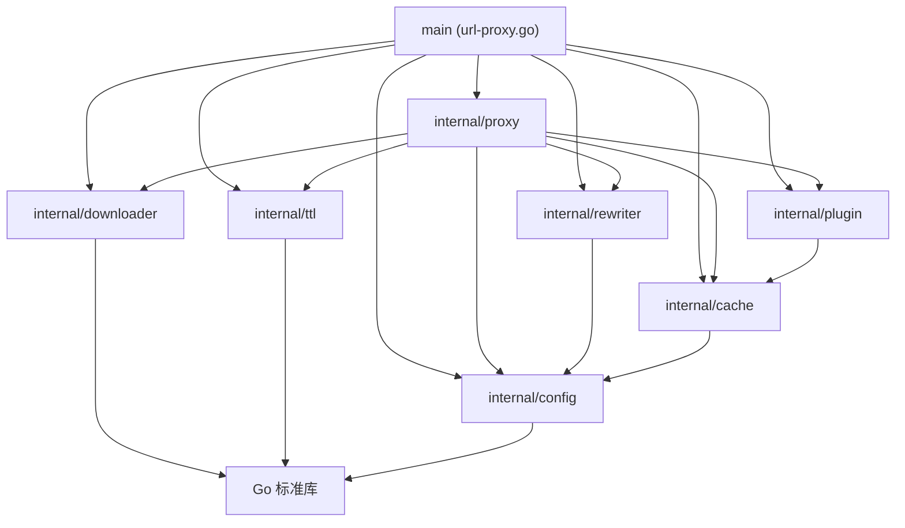

# 代码库模块化拆分与领域分层重构方案 (Codebase Modular Refactoring & Domain Layering Plan - Plan 320)

## 1. 方案背景与问题洞察 (Background & Problem Analysis)

### 1.1 核心痛点与演进背景
随着 `url-proxy` 项目持续迭代演进，系统已完整支持从基础透明代理（101）到 8 大官方镜像源生态（APT、Alpine、Go、Maven、PyPI、npm、Docker、Cargo）以及进阶能力：
- 基础与正向代理：标准 HTTP 正向代理（301）、条件 304 快速短路（302）、HTTP Range 206 断点续传（303）；
- 路由与配置：统一配置文件引擎（304）、免缓存规则与白名单仲裁（305）、路径短别名路由（306）；
- 官方源与响应体重写：动态响应体流式重写引擎（311）、PyPI/npm/Docker/Cargo 官方源协议闭环（312-315）、多源融合验证（316）；
- 扩展与缓存加速：路由作用域协议插件机制（317）、动态元数据软过期与 SWR 缓存机制（318）。

然而，上述全部 18 项特性和 1750+ 行的核心实现代码目前全部集中堆砌在根目录的单个源文件 `url-proxy.go` 中。

这种“单文件单体大杂烩”模式暴露出了显著的架构与维护性瓶颈：
- **代码规模膨胀与职责严重混杂**：单个源文件达 1759 行，集成了 CLI 标志解析、配置词法解析、正则预编译、跨平台文件路径安全转义、免缓存白名单优先仲裁、内存 SWR 软缓存管理、响应体二进制嗅探与 Gzip 解压缩重写、Docker Blobs 插件快路径、TCP CONNECT 隧道劫持、Range 206 分片直出、并发任务合并（Single-Flight）、条件广播状态机以及看门狗巡检协程。
- **全局状态污染与并发安全隐患**：下载任务池 `jobs`、互斥锁 `jobsMu`、请求自增计数器 `requestID`、全局元数据缓存 `globalTTLManager` 以及全局插件注册表 `routePlugins` 全部作为包级全局变量分散存在。导致无法进行多实例并发隔离测试，无法安全优雅地管理子系统生命周期。
- **缺乏原生自动化单元测试**：既有测试套件（`tests/` 目录）均为基于独立 Mock Server 的黑盒端到端脚本，缺乏标准 Go 语言层面的白盒单元测试（`*_test.go`）。CI 流水线无法通过标准的 `go test ./...` 快速进行细粒度逻辑验证与代码覆盖率分析。

### 1.2 建设目标 (Plan 320 Goals)
对 `url-proxy` 代码库进行系统性的模块化解耦与工程分层重构（Plan 320 / Feature 321）：
1. **单一职责与领域分层**：基于单一职责原则（SRP），将单体逻辑解耦拆解为 7 个高内聚、低耦合的 `internal` 领域子包（`config`、`cache`、`ttl`、`rewriter`、`plugin`、`downloader`、`proxy`）；
2. **面向对象与状态完全隔离**：彻底消除包级全局变量与全局锁，采用结构体封装与依赖注入管理任务池、SWR 缓存、插件表与调度器生命周期；
3. **零破坏向下兼容**：保留根目录 `url-proxy.go` 入口，精简为主装配器（约 60-80 行），保持与既有的 `go run url-proxy.go`、`go run .`、`go build .`、`build.bat`、`build.sh` 以及 `Dockerfile` 100% 编译运行兼容；
4. **原生 Go 单元测试闭环**：为每个子包提供原生的 `*_test.go` 单元测试套件，实现 `go test ./...` 全面质量覆盖与一键自动化回归。

---

## 2. 核心架构与领域分层设计 (Architecture & Domain Layering)

### 2.1 目录结构规划

```text
url-proxy/
├── url-proxy.go                # 轻量级主入口 (参数解析、依赖注入与组件装配，~70 行)
├── proxy.conf                  # 生产级统一配置模板
├── go.mod                      # Go 模块定义: uri-proxy
├── build.sh / build.bat        # 跨平台多架构交叉编译脚本
├── Dockerfile                  # 容器镜像构建脚本
├── internal/
│   ├── config/                 # 统一配置解析领域
│   │   ├── config.go           # ProxyConfig, NoCacheRule, TypeDefinition, RewriteRule, Load, Parse
│   │   └── config_test.go      # 配置指令语法、作用域与正则预编译测试
│   ├── cache/                  # 缓存路径与免缓存仲裁领域
│   │   ├── path.go             # GetSafeUrlPath (跨平台安全路径与 Query 隔离)
│   │   ├── bypass.go           # ShouldBypassCache, MatchBypassRule (白名单绝对优先仲裁)
│   │   ├── dir.go              # EnsureCacheDir (缓存目录初始化)
│   │   └── cache_test.go       # 路径转义、Query 隔离与白名单防误杀测试
│   ├── ttl/                    # 动态元数据软过期与 SWR 缓存领域
│   │   ├── manager.go          # TTLManager, TTLItem (并发安全内存元数据管理)
│   │   └── ttl_test.go         # 软过期检测、SWR 状态刷新与并发读写测试
│   ├── rewriter/               # 响应体流式/内存动态重写领域
│   │   ├── rewriter.go         # BodyRewriter, RuleMatchesResponse, ShouldRewrite, Apply
│   │   ├── mime.go             # 类型别名嗅探、MIME/文件后缀匹配、二进制安全检测
│   │   └── rewriter_test.go    # PEP 691 JSON 替换、HTML 标签重写、Gzip 解压重写测试
│   ├── plugin/                 # 路由作用域协议插件领域
│   │   ├── plugin.go           # RoutePlugin 接口定义与 Registry 注册表
│   │   ├── docker.go           # DockerPlugin (Blobs 快路径与清单透传)
│   │   └── plugin_test.go      # 插件匹配、路由作用域隔离与快路径响应测试
│   ├── downloader/             # 并发下载合并与状态机领域
│   │   ├── job.go              # DownloadJob 模型、临时文件原子重命名与错误清理
│   │   ├── manager.go          # Manager 任务池 (GetOrCreate, Remove, 全局状态消除)
│   │   ├── watchdog.go         # Idle Watchdog 后台巡检例程
│   │   └── downloader_test.go  # 请求合并、广播流分发与看门狗超时取消测试
│   └── proxy/                  # 协议代理与高层路由调度领域
│       ├── server.go           # Server 主实体与 ServeHTTP 路由调度
│       ├── router.go           # URL 规范化、路径别名 (alias) 重写与目标探测
│       ├── tunnel.go           # HTTPS CONNECT 隧道劫持透传
│       ├── range.go            # Range 206 本地切片直出与流式透传
│       ├── bypass.go           # 免缓存与 SWR 异步后台同步调度
│       ├── download.go         # 并发请求合并下载与 Followers 共享流式分发
│       └── proxy_test.go       # 代理协议闭环、Range 直出、304 快速短路集成测试
├── docs/                       # 架构设计、特性说明与操作手册
└── tests/                      # 既有端到端 Mock 集成与 E2E 测试套件
```

### 2.2 有向无环依赖拓扑 (Directed Acyclic Graph)

为严格杜绝 Go 编译器循环依赖（`import cycle not allowed`），各层级确立严格单向调用拓扑：



---

## 3. 各领域子包核心职责与设计 (Package Specifications)

### 3.1 `internal/config` (统一配置领域)
- **职责**：项目唯一配置数据模型与解析引擎，定义不可变业务规则。
- **核心数据结构**：
  - `ProxyConfig`：包含 Hosts 映射、Alias 短别名映射、NoCache 规则链、Rewrite 规则链、Type 自定义类型定义、Plugin 路由插件映射、MetadataTTL 及 MetadataSWR 策略。
  - `NoCacheRule`、`TypeDefinition`、`RewriteRule`。
- **核心方法**：
  - `Load(confPath string) *ProxyConfig`：加载指定路径配置文件，提供默认配置回退。
  - `Parse(r io.Reader) (*ProxyConfig, error)`：流式逐行解析配置指令，支持语法容错、行内注释过滤与正则表达式预编译。

### 3.2 `internal/cache` (缓存管理领域)
- **职责**：负责跨平台文件系统安全路径映射、缓存根目录生命周期维护与免缓存仲裁。
- **核心能力**：
  - `GetSafeUrlPath(rawUri string) string`：安全转义 URL 为合法本地相对路径，消除 Windows 非法字符（`:` 等），将 Query 参数哈希隔离。
  - `EnsureCacheDir(customDir string) (string, error)`：校验并创建多层级缓存根目录。
  - `ShouldBypassCache(rawUri string, rules []config.NoCacheRule, clientPaths ...string) bool`：按规则链进行上下文与正则匹配。
  - **白名单绝对优先仲裁**：一旦命中 `Action == "cache"` 规则，立即强制落盘，杜绝安装包被通用规则误伤免缓存。

### 3.3 `internal/ttl` (元数据软过期与 SWR 领域)
- **职责**：高并发内存元数据软缓存生命周期管理（Feature 318）。
- **核心数据结构**：
  - `TTLItem`：承载元数据内容切片、响应头克隆副本、HTTP 状态码、ETag、Last-Modified、缓存时间及软过期时间戳。
  - `TTLManager`：面向对象读写锁容器，彻底替换原 `globalTTLManager` 全局变量。
- **核心方法**：
  - `Get(key string) (*TTLItem, bool)`：返回缓存项及是否仍在软有效期限内。
  - `Set(key string, data []byte, header http.Header, statusCode int, duration time.Duration)`：原子写入并深拷贝头部。
  - `Refresh(key string, duration time.Duration) bool`：条件请求验证通过后延长有效期。

### 3.4 `internal/rewriter` (响应体流式重写领域)
- **职责**：针对 PyPI、npm 等官方源索引元数据执行 URL 动态原地重写（Feature 311）。
- **核心能力**：
  - `BodyRewriter`：封装重写规则集与类型映射字典。
  - `ShouldRewrite(reqPath, uri, contentType string) bool`：多维判定（作用域、文件后缀、MIME 类型）。
  - `isBinaryMimeType` / `isKnownBinaryPath`：严格防污染机制，拦截压缩包、Wheel 与二进制层。
  - `Apply(clientHost, reqPath, uri, contentType string, body []byte) []byte`：透明支持 Gzip 流解压、`{PROXY_HOST}` 宏替换及重新压缩。

### 3.5 `internal/plugin` (路由作用域插件领域)
- **职责**：协议扩展点契约与领域优化插件管理（Feature 317）。
- **核心能力**：
  - `RoutePlugin` 接口：`Name() string`、`Match(req *http.Request, uri string) bool`、`FastPathServe(w http.ResponseWriter, r *http.Request, uri string, cacheDir string) bool`。
  - `DockerPlugin`：针对 Docker Registry v2 Blobs 执行高效本地缓存快路径直出，解耦通用代理逻辑。
  - `Registry`：实例化插件容器，支持路由作用域绑定与执行分发。

### 3.6 `internal/downloader` (并发下载合并领域)
- **职责**：高并发 Single-Flight 请求合并状态机、文件原子重命名与空闲看门狗（Features 201, 202）。
- **核心能力**：
  - `DownloadJob`：并发状态载体，内置 `sync.Cond`、Readers 活跃引用计数器与底层取消句柄 `context.CancelFunc`。
  - `Manager`：面向对象任务池管理器，封装 `jobs` 字典与 `jobsMu` 互斥锁，彻底消除包级全局变量。
  - `TryRename(reqID uint64)`：当 Readers 为 0 时执行原子重命名；下载失败时杜绝重命名并自动清理 `.tmp` 脏文件。
  - `Watchdog`：后台巡检协程，自动发现停滞超时的任务并通过 Context 取消底层请求、唤醒 Followers 报错退出。

### 3.7 `internal/proxy` (协议代理与调度领域)
- **职责**：标准 `http.Handler` 统一调度入口，组装各领域模块协同工作。
- **核心能力**：
  - `Server`：顶层调度实体，持有全部子模块依赖实例。
  - `ServeHTTP`：请求进入时按序列号调度：
    1. HTTPS CONNECT 隧道劫持（`handleConnect`）；
    2. URL 提取与短别名重写（`rewriteTargetURI`）；
    3. 插件快路径探测与拦截（`FastPathServe`）；
    4. HTTP Range 206 本地切片直出或未命中透传（`handleRange`）；
    5. 动态免缓存与 SWR 软过期协商（`handleBypass` 与后台异步 Revalidate）；
    6. 静态资源并发请求合并下载（`handleDownload`）。

### 3.8 根目录主入口 `url-proxy.go`
主程序仅保留启动参数解析、子系统实例化注入与 HTTP 服务监听（由 1759 行精简至 ~70 行）：
```go
func main() {
    flag.Parse()
    cfg := config.Load(*conf)
    cDir, err := cache.EnsureCacheDir(*cacheDir)
    if err != nil { log.Fatalf(...) }

    ttlMgr := ttl.NewManager()
    downMgr := downloader.NewManager(cDir, *idleTime)
    downMgr.StartWatchdog()
    defer downMgr.StopWatchdog()

    bodyRewriter := rewriter.NewBodyRewriter(cfg.Rewrites, cfg.Types)
    pluginRegistry := plugin.NewDefaultRegistry()

    proxyServer := proxy.NewServer(cfg, cDir, downMgr, ttlMgr, bodyRewriter, pluginRegistry)
    server := &http.Server{Addr: *addr, Handler: proxyServer}
    log.Fatal(server.ListenAndServe())
}
```

---

## 4. 实施规划与步骤 (Implementation Roadmap)

| 阶段 (Phase) | 任务目标 | 产出物与操作 |
| :--- | :--- | :--- |
| **阶段一：基础与模型层拆解** | 抽取基础配置与通用工具，建立叶子节点子包 | `internal/config`、`internal/cache`、`internal/ttl` 落地与独立单元测试通过 |
| **阶段二：流式处理与插件扩展层拆解** | 抽取响应体重写引擎与路由作用域插件 | `internal/rewriter`、`internal/plugin` 落地与重写单元测试通过 |
| **阶段三：并发下载状态机改造** | 任务池面向对象封装，消除包级全局变量与锁 | `internal/downloader` 落地，并发安全单元测试通过 |
| **阶段四：调度核心与主入口重构** | 组装协议调度服务器，主入口极简化重写 | `internal/proxy` 落地，精简 `url-proxy.go` 入口，跑通 `go test ./...` |
| **阶段五：全量集成与回归测试** | 验证现有 CI/CD 构建脚本与全套 E2E 软件源测试 | `./build.sh`、`build.bat`、`tests/e2e/test.sh` 全生态测试一次性通过 |

---

## 5. 预期成效与价值评估 (Expected Benefits)

1. **结构精炼清晰**：根目录主文件行数由 1759 行锐减至 ~70 行，缩减 **96%**；
2. **状态完全可控**：消除所有全局变量与全局互斥锁，多实例并发与生命周期管理更加稳健；
3. **原生测试体系完善**：建立全套白盒 `*_test.go` 单元测试，支撑 `go test ./...` 快速持续集成；
4. **向下兼容零侵入**：外部构建脚本、Docker 镜像构建与命令行调用接口保持 100% 兼容。
