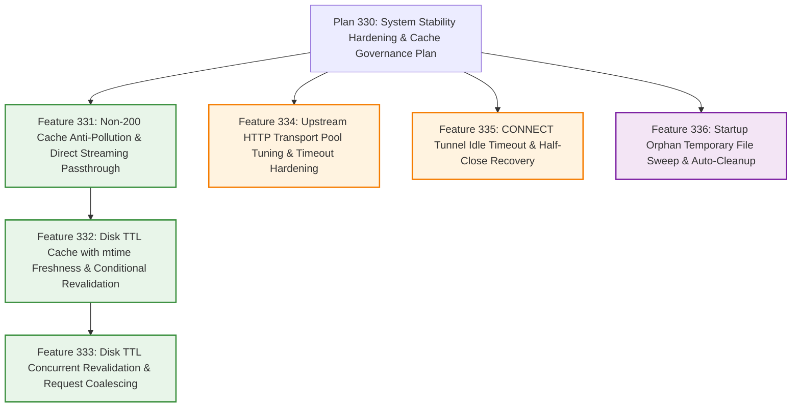

# System Stability Hardening & Cache Governance Plan (Plan 330)

## 1. Background & Problem Analysis

### 1.1 Evolution Context & Full-Link Audit Findings
Following the completion of `Plan 310 (Official Registries Caching Proxy & Body Rewriting Plan)` and `Plan 320 (Codebase Modular Refactoring & Domain Layering Plan)`, the system now provides protocol-aware caching across 8 major software ecosystems with a clean, domain-layered architecture. However, a deep audit of long-running production workloads, abnormal upstream responses, and high-concurrency connection scenarios revealed critical risks across three dimensions: memory lifecycle, cache hygiene, and network transport stability:

1. **Dynamic Metadata Heap Retention OOM Hazards & Expiration Revalidation Stampedes (P1 Risk)**:
   - Early exploratory designs cached dynamic metadata index payloads (such as APT `InRelease` and YUM `repodata`) in heap memory maps. In long-running package mirror workloads, retaining large numbers of metadata slices in heap memory creates severe Out-Of-Memory (OOM) risks, and cached data is lost upon process restart.
   - Furthermore, when a TTL-governed metadata resource reaches expiration, high-concurrency environments (such as dozens of CI runner containers starting simultaneously) trigger simultaneous redundant `If-Modified-Since` probes or duplicate payload downloads without request coalescing, causing outbound connection spikes and upstream rate limiting (`HTTP 429`).
2. **Non-200 Error Responses Persisted to Disk Causing Permanent Cache Pollution (P0 Defect)**:
   - In the Downloader Module and Proxy Dispatcher Core, only `304 Not Modified` is currently short-circuited. Non-200 error status codes such as `404 Not Found`, `401 Unauthorized`, `403 Forbidden`, `500 Internal Server Error`, and `502 Bad Gateway` are not isolated from disk persistence.
   - When an upstream origin experiences transient outages, permission issues, or a client requests a missing resource, the upstream error page (e.g., HTML error pages or JSON error bodies) is written in its entirety to a temporary file and atomically renamed to the target binary artifact (e.g., `.deb`, `.whl`, `.tgz`), permanently poisoning the disk cache and causing subsequent automated builds to fail.
3. **Upstream Transport Pool Bottlenecks, CONNECT Tunnel Leaks, and Orphan Temp Files (P1/P2 Risks)**:
   - Outbound HTTP requests rely directly on the standard library's default client (`MaxIdleConnsPerHost` defaults to only `2`, with no `ResponseHeaderTimeout`), causing excessive connection churn under concurrent upstream fetches and indefinite goroutine hangs if an upstream server stalls after accepting a connection.
   - Hijacked HTTPS `CONNECT` tunnel connections run bidirectional `io.Copy` goroutines without read/write idle deadlines or TCP half-close propagation (`CloseWrite`), leaking goroutines and file descriptors when clients silently drop or half-close connections.
   - If the proxy process terminates unexpectedly (e.g., `SIGKILL`, host power loss, or container OOM restart), in-progress `.<timestamp>` temporary files remain permanently on disk as orphan files.

### 1.2 Plan 330 Goals
Centered on "Zero Memory Overhead, Cache Anti-Pollution, and High-Reliability Transport", `Plan 330` establishes four primary objectives:
1. **Disk-Backed TTL Caching with mtime Freshness & Concurrent Coalescing**: Persist dynamic metadata 100% to disk and evaluate freshness via filesystem modification time (`mtime`) with zero heap overhead; coalesce concurrent revalidations through the Downloader Module (Leader/Follower) into a single upstream probe, supporting 304 zero-bandwidth touch renewal, stale-fallback resilience, and client disconnection decoupling;
2. **100% Pure Disk Cache & Non-200 Anti-Pollution**: Strictly block all non-`200 OK` responses from creating temporary files or executing atomic renames, streaming error responses directly to clients with zero heap buffering and zero disk pollution;
3. **End-to-End Network Transport & Disk Startup Self-Healing**: Replace the default HTTP client with a tuned high-concurrency `http.Transport` and `ResponseHeaderTimeout`, harden `CONNECT` tunnels with rolling idle deadlines and TCP `CloseWrite` half-close semantics, and automatically sweep stale orphan temporary files on startup;
4. **Zero Configuration Overhead & Out-of-the-Box Stability**: Enable all hardening safeguards with built-in production-grade defaults without introducing complex configuration directives, maintaining full backwards compatibility with existing `proxy.conf` syntax.

---

## 2. Feature Breakdown & Architecture Evolution Matrix

To keep each change cohesive, properly ordered by dependency, and independently verifiable, `Plan 330` is decomposed into 6 fine-grained sub-plans (`Feature 331` ~ `Feature 336`):

| Feature ID | Feature Name | Logical Modules Involved | Core Objective & Deliverable Scope |
| :---: | :--- | :--- | :--- |
| **Feature 331** | **Non-200 Cache Anti-Pollution & Direct Streaming Passthrough** | Proxy Server Module, Downloader Module | Block all non-`200 OK` responses from creating temporary files or executing atomic renames; stream error responses directly to clients with zero heap memory and zero disk pollution |
| **Feature 332** | **Disk TTL Cache with mtime Freshness & Conditional Revalidation** | Proxy Server Module, Downloader Module, Config Module | Persist TTL-governed payloads to disk; evaluate freshness via file modification time (`mtime`) with zero heap overhead; support `If-Modified-Since` 304 zero-bandwidth touch renewal and request coalescing |
| **Feature 333** | **Disk TTL Concurrent Revalidation & Request Coalescing** | Proxy Server Module, Downloader Module | Extend Downloader Module to coalesce concurrent TTL revalidations; ensure strictly 1 upstream probe per URI, broadcast 304 sharing, fallback to stale files, and decouple client disconnections |
| **Feature 334** | **Upstream HTTP Transport Pool Tuning & Timeout Hardening** | Proxy Server Module | Replace `http.DefaultClient` with a tuned `http.Transport` (`MaxIdleConnsPerHost: 100`, explicit dial, TLS handshake, and `30s` response header timeouts) |
| **Feature 335** | **CONNECT Tunnel Idle Timeout & Half-Close Recovery** | Proxy Server Module | Wrap hijacked `CONNECT` tunnel sockets with rolling idle deadlines and propagate TCP `CloseWrite` half-close signals to prevent zombie goroutine leaks |
| **Feature 336** | **Startup Orphan Temporary File Sweep & Auto-Cleanup** | Cache Module, Main Entrypoint | Asynchronously scan the cache directory upon initialization and remove stale `.<timestamp>` temporary files left behind by prior abnormal terminations |

---

## 3. Global Configuration & Principles

`Plan 330` adheres strictly to the design principle of "Zero Configuration Overhead, Built-In Production Stability":
1. **Zero New Global Configuration Directives**:
   - TTL caching seamlessly reuses the existing `bypass <scope> <type> <pattern> ttl:<duration>` syntax without requiring any new configuration directives;
   - Non-200 anti-pollution, transport connection pool tuning, tunnel idle deadlines, and orphan temporary file sweeps all operate with built-in production defaults;
2. **Full Backwards Compatibility**: Existing configurations require no changes to upgrade and benefit from all stability protections.

---

## 4. Deferred & Out-of-Scope Decisions

During the architectural review for `Plan 330`, we evaluated the remaining candidate proposals from earlier explorations against engineering ROI and complexity constraints. The following **3 items are explicitly deferred or excluded**, with their original problem context and technical rationale preserved below:

### 4.1 Streaming Sliding-Window Response Rewriter —— [Deferred / Out of Scope]
- **Original Problem Context**:
  - In the Proxy Server Module's bypass rewrite path, responses matching body rewrite rules (such as PyPI `/simple/` pages, npm package JSON metadata, and Cargo `config.json`) are currently read into memory via `io.ReadAll`, transformed by the Rewriter Module (`bytes.ReplaceAll`), and sent with a recalculated `Content-Length`.
  - The concern was that if an upstream registry returned an unusually large uncompressed JSON index (tens or hundreds of megabytes), `io.ReadAll` would allocate heap memory proportional to the body size and delay Time-To-First-Byte (TTFB) until the entire payload was downloaded. The proposed solution was a 64KB fixed-size sliding-window stream filter chained with streaming `gzip.Reader` and `gzip.Writer`.
- **Technical Rationale for Deferral**:
  1. **Real-World Workload Characteristics**: In practice, only text metadata indexes trigger body rewriting (99% of which range from a few kilobytes to a few megabytes), where in-memory replacement completes in milliseconds. Large binary artifacts (`.whl`, `.tgz`, `.deb`, Docker Blobs) always traverse the static download or fast-path pipelines and **never enter the body rewriter**.
  2. **High Complexity & Protocol Side Effects**: Implementing a multi-pattern sliding-window state machine that preserves $L-1$ overlap bytes across chunk boundaries—combined with streaming Gzip decompression and recompression—introduces significant complexity and subtle boundary truncation risks. It also strips `Content-Length` in favor of `Transfer-Encoding: chunked`.
  3. **Lightweight Alternative**: Adhering to minimal modification and avoiding over-engineering, the current in-memory rewriter is retained. If protection against pathological oversized responses is ever needed, a simple `io.LimitReader` cap suffices.

### 4.2 Sharded Locks for Downloader Manager —— [Out of Scope]
- **Original Problem Context**:
  - The Downloader Module protects its active download registry `map[string]*DownloadJob` (covering Leader creation, Follower attachment, completion removal, and watchdog sweeps) with a single `sync.Mutex`.
  - The concern was potential lock contention under thousands of QPS or brief stalls during watchdog map iteration, leading to a proposal for 16/32 sharded hash locks and a hierarchical timer wheel.
- **Technical Rationale for Exclusion**:
  1. **Nanosecond Critical Section**: The mutex only guards an in-memory map lookup and pointer assignment (taking tens of nanoseconds). All network I/O, disk writes, and `sync.Cond` broadcasts occur outside the manager lock on per-job primitives.
  2. **Workload Scale**: For a software package caching proxy, the number of concurrently active upstream downloads (`jobs` map cardinality) typically ranges from single digits to a few hundred, meaning watchdog iteration takes microseconds every few minutes. Sharded locks and timer wheels represent unnecessary over-engineering with zero measurable benefit.

### 4.3 Disk Cache Quota LRU Engine & Windows Long-Path SHA256 Folding —— [Deferred]
- **Original Problem Context**:
  - **Disk Cache Quota LRU**: Persistent disk cache files currently have no built-in `disk_cache_max_size` quota enforcement or automatic cold-file eviction based on access timestamps (`atime`/`mtime`).
  - **Windows `MAX_PATH` Truncation Guard**: Windows traditionally enforces a 260-character path limit (`MAX_PATH`), raising concern that deeply nested URLs could fail disk creation unless paths exceeding 200 characters were folded into SHA256 hashes.
- **Technical Rationale for Deferral**:
  1. **Operational Separation of Concerns**: In production, `url-proxy` is predominantly deployed on Linux hosts or containers where disk capacity monitoring and cold artifact pruning are handled by external volume management or lightweight cron jobs (e.g., `find ... -atime +30 -delete`). Maintaining an in-process full-disk metadata index adds memory overhead and startup disk I/O scanning costs.
  2. **Path Readability & Platform Priority**: Folding long paths into SHA256 hashes breaks the transparent 1:1 mapping between upstream URLs and local disk paths (hindering operational debugging), and neither Linux nor modern Windows environments with long-path support suffer from this constraint.

---

## 5. Implementation Roadmap

Each sub-plan maps 1-to-1 to an independent implementation phase in sequential order (`Feature 331` ~ `Feature 336`):

| Phase | Target Feature | Core Tasks | Acceptance Criteria |
| :---: | :---: | :--- | :--- |
| **Phase 1** | **Feature 331** | Block all non-`200 OK` responses from creating temporary files or atomic renaming, stream error responses directly to clients, and add double-guard assertion in `TryRename` | Non-200 responses (404/5xx, etc.) never create temporary files or disk artifacts; streaming passthrough with zero heap retention |
| **Phase 2** | **Feature 332** | Persist dynamic metadata 100% to disk, evaluate freshness via `mtime`, implement `If-Modified-Since` 304 revalidation with `os.Chtimes` touch renewal and origin outage stale-fallback | Direct disk streaming within freshness; 304 refreshes mtime with zero bandwidth; graceful fallback to stale disk files on upstream errors |
| **Phase 3** | **Feature 333** | Extend the Downloader Module to coalesce concurrent TTL revalidations, single-stream upstream probes, broadcast 304 renewal, and isolate client disconnections | Concurrent requests for expired resources send strictly 1 upstream request; client disconnections do not affect background pre-warming or followers |
| **Phase 4** | **Feature 334** | Configure high-concurrency outbound `http.Transport` with `ResponseHeaderTimeout` and inject into `Server` | High connection reuse under concurrency; stalled upstream response headers fail fast on 30s timeout |
| **Phase 5** | **Feature 335** | Harden `CONNECT` tunnels with rolling idle deadlines and TCP `CloseWrite` half-close propagation | Silent zombie tunnels close automatically upon idle timeout; unidirectional `EOF` does not truncate reverse traffic |
| **Phase 6** | **Feature 336** | Implement asynchronous startup sweep for stale `.<timestamp>` orphan temporary files and run full regression tests | Stale orphan temp files are cleaned on startup without affecting active downloads; `go test ./...` passes 100% |
