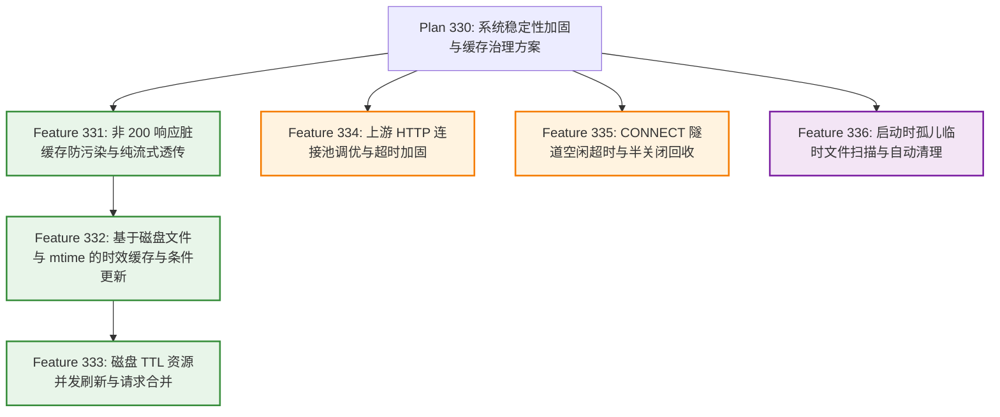

# 系统稳定性加固与缓存治理方案 (System Stability Hardening & Cache Governance Plan - Plan 330)

## 1. 方案背景与问题洞察 (Background & Problem Analysis)

### 1.1 演进背景与全链路痛点审查
在完成 `Plan 310 (官方软件包镜像源代理与响应体重写方案)` 与 `Plan 320 (代码库模块化拆分与领域分层重构方案)` 后，系统已具备覆盖 8 大主流软件源生态的协议代理能力，并形成了职责清晰的领域分层架构。然而，在对生产级长周期运行、异常上游响应及高并发连接场景进行深度审计时，识别出内存生命周期、缓存纯净度与网络传输稳态三大维度的核心隐患：

1. **动态元数据内存驻留 OOM 隐患与时效过期并发击穿风险（P1 级隐患）**：
   - 早期探索将动态元数据索引（如 APT `InRelease`、YUM `repodata`）在内存堆中通过字典缓存响应体。在镜像源长周期运行中，海量包元数据切片驻留堆内存极易导致容器 OOM 崩溃，且进程重启后缓存丢失。
   - 此外，当带 TTL 的元数据跨过保鲜期时，若瞬间涌入大量并发请求（如数十个构建容器同时启动），若缺乏并发请求合并，各协程将同时向上游源站发起重复的条件协商（`If-Modified-Since`）甚至全量重复下载，引发网络连接激增与源站限流（`HTTP 429`）。
2. **非 200 错误响应落盘引发持久化脏缓存污染（P0 级缺陷）**：
   - 在并发下载合并模块与协议代理与调度核心中，当前仅针对 `304 Not Modified` 做了短路返回，未对 `404 Not Found`、`401 Unauthorized`、`403 Forbidden`、`500 Internal Server Error`、`502 Bad Gateway` 等异常状态码做落盘隔离。
   - 一旦上游源站出现瞬时故障、权限异常或客户端请求了不存在的资源，上游返回的错误页面（如 HTML 错误页或 JSON 报错）只要网络读取正常完成，就会被完整写入临时文件并原子重命名为目标二进制制品（如 `.deb`、`.whl`、`.tgz`），导致本地磁盘缓存被永久污染，后续所有客户端均会下载到破损的伪二进制包导致自动化构建全面中断。
3. **上游传输连接池瓶颈、隧道泄漏与异常崩溃孤儿文件残留（P1/P2 级隐患）**：
   - 出向请求直接使用标准库默认客户端（`MaxIdleConnsPerHost` 默认仅为 `2`，且未设置响应头超时），高并发回源同一镜像站时连接频繁销毁重建，且上游静默挂起会导致请求协程无限期阻塞。
   - HTTPS `CONNECT` 隧道劫持后的双向数据对拷协程未设置读写空闲超时（Deadline）与 TCP 半关闭传递，客户端异常断连或半开连接将导致协程与底层套接字永久泄漏。
   - 进程若遭遇强制终止（如 `SIGKILL`、宿主机断电或容器 OOM 重启），正在下载中的 `.<timestamp>` 临时文件将作为孤儿文件永久残留在缓存目录中。

### 1.2 建设目标 (Plan 330 Goals)
围绕“零内存开销、缓存防污染、传输高可靠”三大核心诉求，确立 `Plan 330` 的建设目标：
1. **基于磁盘文件与 mtime 的零内存时效缓存与并发合并**：动态元数据 100% 落盘并基于文件修改时间（`mtime`）判定保鲜期，堆内存占用归零；过期重验证复用并发下载合并模块（Leader/Follower）收敛为单次回源，支持 304 零带宽 touch 续期、旧文件故障降级与客户端断连解耦；
2. **磁盘缓存 100% 纯净与非 200 响应防污染**：严格拦截所有非 `200 OK` 响应创建临时文件与执行原子重命名，错误响应纯流式直出客户端，零内存堆积、零磁盘污染；
3. **全链路网络传输与磁盘启动自愈加固**：定制高并发出向 HTTP 传输连接池与响应头超时控制，为 `CONNECT` 隧道引入滑动空闲超时与 TCP `CloseWrite` 半关闭传递，并在服务启动阶段自动清理崩溃残留的孤儿临时文件；
4. **零新增配置与开箱即用**：所有加固与治理能力默认开箱即用，无需引入额外复杂的配置指令，既有 `proxy.conf` 语法原生兼容。

---

## 2. 特性拆分与架构演进矩阵 (Feature Breakdown)

为确保每项改造职责单一、依赖清晰、验证独立，`Plan 330` 按演进顺序拆分为 6 个细粒度子方案（`Feature 331` ~ `Feature 336`）：

| 特性编号 | 特性名称 | 涉及逻辑模块 | 核心目标与交付范围 |
| :---: | :--- | :--- | :--- |
| **Feature 331** | **非 200 响应脏缓存防污染与纯流式透传** | 协议代理与调度核心、并发下载合并模块 | 拦截所有非 `200 OK` 状态码禁止创建临时文件与原子重命名；错误响应纯流式透传客户端，零内存缓存、零磁盘污染 |
| **Feature 332** | **基于磁盘文件与 mtime 的时效缓存与条件更新** | 协议代理与调度核心、并发下载合并模块、统一配置模块 | 将带 TTL 的响应体统一落盘，基于文件修改时间（`mtime`）实现零内存时效判断，支持 `If-Modified-Since` 304 零流量 touch 续期与并发合并 |
| **Feature 333** | **磁盘 TTL 资源并发刷新与请求合并** | 协议代理与调度核心、并发下载合并模块 | 扩展并发下载合并模块复用至 TTL 过期重验证管线；确保同一 URI 瞬间仅发起 1 次上游探针，支持 304 广播共享、旧文件降级与断连隔离 |
| **Feature 334** | **上游 HTTP 连接池调优与超时加固** | 协议代理与调度核心 | 替换默认客户端，定制高并发出向传输层（提升 `MaxIdleConnsPerHost` 至 `100`，配齐拨号、TLS 握手与 `30s` 响应头超时） |
| **Feature 335** | **CONNECT 隧道空闲超时与半关闭回收** | 协议代理与调度核心 | 为 HTTPS `CONNECT` 隧道封装带空闲超时刷新的连接包装器，引入 TCP `CloseWrite` 半关闭优雅传递，杜绝僵尸连接与协程泄漏 |
| **Feature 336** | **启动时孤儿临时文件扫描与自动清理** | 缓存管理模块、服务主装配入口 | 在缓存目录初始化阶段异步扫描残留的 `.<timestamp>` 临时文件，自动清理超过安全阈值的崩溃孤儿文件 |

---

## 3. 全局配置与规范原则 (Configuration & Principles)

`Plan 330` 严格遵循“零新增配置负担、内置生产级稳态”的设计原则：
1. **零新增全局配置指令**：
   - 时效缓存完全复用统一配置中已有的 `bypass <scope> <type> <pattern> ttl:<duration>` 规则，无需额外配置；
   - 非 200 防污染、连接池参数、隧道空闲超时及启动孤儿清理均内置最佳生产实践默认值，杜绝过度配置复杂度；
2. **完全向后兼容**：既有配置文件无需任何修改即可平滑升级并获得全部稳定性防护。

---

## 4. 暂缓与不做项评估记录 (Deferred & Out-of-Scope Decisions)

在制定 `Plan 330` 的过程中，我们对早期架构探讨中提出的其余候选项进行了严格的工程收益比（ROI）与复杂度评估，决定对以下 **3 项内容予以暂缓或不做**，并在此完整归档其原始问题背景与技术取舍依据：

### 4.1 流式滑动窗口响应体重写引擎 (Streaming Sliding-Window Response Rewriter) —— 【暂缓 / 不做】
- **原始问题背景**：
  - 在协议代理与调度核心的免缓存重写流程中，针对匹配重写规则的索引响应（如 PyPI `/simple/` 索引、npm 包元数据 JSON、Cargo `config.json`），当前采用 `io.ReadAll` 将响应体全量读入内存切片后，再调用响应体重写引擎执行字节替换并重新计算 `Content-Length`。
  - 原担忧在于：若上游返回数十 MB 乃至上百 MB 的超大未压缩 JSON 索引，`io.ReadAll` 与 `bytes.ReplaceAll` 会产生与响应体体积成正比的瞬间堆内存分配，且客户端必须等待代理完整拉取完上游响应后才能收到首字节（TTFB 延迟增加）。原构想是设计基于 64KB 定长环形缓冲区的流式滑动窗口替换器，并串联 `gzip.Reader -> SlidingWindowFilter -> gzip.Writer` 全流式管道。
- **暂缓/不做的技术评估依据**：
  1. **真实负载特征无需重度流式状态机**：在实际软件源生态中，命中响应体重写的目标仅有文本类索引（99% 体积在数 KB 至数 MB 之间），全量内存替换耗时仅数毫秒；而真正体积庞大的二进制包（`.whl`、`.tgz`、`.deb`、Docker Blobs）均走静态下载流或快路径直出，**根本不会进入响应体重写分支**。
  2. **复杂度与协议副作用极高**：手写支持多模式串、跨 Chunk 边界保留 $L-1$ 重叠区的流式滑动窗口状态机以及流式 Gzip 解压重压缩管线，代码复杂度极高，极易在边界截断处引入难以排查的字节错位 Bug；同时流式改写无法预知改写后的总长度，会强制丢失 `Content-Length` 转为 `Transfer-Encoding: chunked`，影响部分客户端进度评估。
  3. **轻量替代建议**：遵循最小改动与禁止过度设计原则，当前保持内存重写模式即可；若未来确需防御极端异常超大响应，仅需在读取前增加 `io.LimitReader` 体积上限保护即可。

### 4.2 并发下载任务池分片哈希锁 (Downloader Manager Sharded Locks) —— 【不做】
- **原始问题背景**：
  - 并发下载合并模块（`Downloader Module`）使用单一互斥锁保护在途下载任务字典 `map[string]*DownloadJob`（涵盖 Leader 任务创建、Follower 挂载、任务完成移除以及后台看门狗巡检遍历）。
  - 原担忧在于：在数千 QPS 的极高并发场景下，单一互斥锁可能产生锁竞争排队，或后台看门狗遍历字典时短暂阻塞新请求注册。原构想是将任务字典拆分为 16 或 32 个哈希分片锁（Sharded Locks）并引入定时时间轮。
- **不做的技术评估依据**：
  1. **临界区极短，非系统性能瓶颈**：任务池互斥锁保护的临界区仅包含一次内存哈希表查找与指针赋值（耗时在数十纳秒级别），所有的网络拉取、磁盘写入与 `sync.Cond` 广播均在各自独立的 `DownloadJob` 局部锁或无锁状态下执行。
  2. **场景规模匹配度**：作为软件包与镜像缓存代理，正在并发下载的在途文件数（即 `jobs` 字典基数）通常在个位数至百位数之间，看门狗每隔数分钟遍历一次仅需微秒级时间。引入 32 分片锁与时间轮属于典型的过度设计，徒增维护成本而无实际性能收益。

### 4.3 磁盘缓存容量配额 LRU 引擎与 Windows 超长路径哈希折叠 —— 【暂缓】
- **原始问题背景**：
  - **磁盘容量配额 LRU**：本地持久化缓存目录目前采用永久缓存策略，缺乏内置的 `disk_cache_max_size` 容量上限监控与基于访问时间（`atime`/`mtime`）的冷文件自动淘汰机制。
  - **Windows 超长路径限制**：Windows 系统默认存在 260 字符（`MAX_PATH`）路径长度限制，当极端超长 URL 映射为本地缓存文件路径时，可能触发文件系统路径超长报错。原构想是对超过 200 字符的相对路径自动截断并拼接 SHA256 哈希后缀。
- **暂缓的技术评估依据**：
  1. **运维职责解耦**：生产环境中 `url-proxy` 主要以 Linux 容器或服务形式部署，磁盘空间告警与历史冷包清理通常由宿主机外部存储卷策略或定时运维脚本（如 `find ... -atime +30 -delete`）统一管控。在代理进程内常驻维护全量磁盘文件元数据索引与容量账本，会增加额外的内存开销与启动全盘 I/O 扫描负担。
  2. **路径可读性与平台优先级**：对路径做截断与 SHA256 折叠会破坏本地缓存目录与上游 URL 的直观映射关系（降低运维排查可读性），且主流 Linux 部署环境及现代开启长路径支持的 Windows 环境并不受此限制，故暂缓实施，待出现明确跨平台痛点时再按需评估。

---

## 5. 实施里程碑规划 (Implementation Roadmap)

各子方案按编号顺序分为 6 个独立阶段依次推进，确保每阶段均可独立交付与单元测试验收：

| 阶段 | 对应特性 | 核心改造任务 | 验收指标 |
| :---: | :---: | :--- | :--- |
| **Phase 1** | **Feature 331** | 在下载合并与代理调度中拦截所有非 `200 OK` 响应，禁止创建临时文件与原子重命名，错误响应纯流式透传客户端，并在 `TryRename` 增加二次防护 | 非 200 响应（404/5xx 等）绝不产生临时文件与磁盘缓存；错误流式透传客户端且堆内存零驻留 |
| **Phase 2** | **Feature 332** | 完成动态元数据 100% 落盘、基于文件 `mtime` 的时效判断、`If-Modified-Since` 304 条件协商与 `os.Chtimes` 续期及源站故障旧文件降级 | 保鲜期内直接返回磁盘文件；304 零流量刷新 mtime 续期；源站故障平稳返回旧文件降级 |
| **Phase 3** | **Feature 333** | 将并发下载合并模块复用至 TTL 过期重验证流程，同 URI 并发探测收敛为 1 次回源，广播共享 304 续期结果与断连解耦 | 高并发请求已过期同一资源时上游仅收到 1 次请求；Leader/Followers 客户端断连互不干扰 |
| **Phase 4** | **Feature 334** | 定制高并发出向 `http.Transport` 连接池与 `ResponseHeaderTimeout` 并注入代理核心 | 并发回源连接高效复用；上游响应头挂死时按 30s 超时阈值快速中断返回 |
| **Phase 5** | **Feature 335** | 为 `CONNECT` 隧道封装滑动空闲超时包装器与 TCP `CloseWrite` 半关闭传递 | 半开静默隧道到期自动断开回收；单向 `EOF` 半关闭不截断反向在途数据 |
| **Phase 6** | **Feature 336** | 实现缓存目录启动时的孤儿临时文件异步扫描清理，完成全量回归验证 | 过期残留临时文件启动即清，活跃临时文件与正常缓存文件零误删，`go test ./...` 全部通过 |

---

## 6. 附录：后续功能补充与架构收敛记录 (Appendix: Post-Submission Governance & Enhancements)

在主方案 `Plan 330` 正式提交与前 6 个基础特性（`Feature 331` ~ `Feature 336`）交付收敛后，针对长周期高负载运行中暴露出的冗余死代码、管线重复实现及进程生命周期治理盲区，以文末追加附录形式推进并交付了 3 项后续补充与治理特性（`Feature 337` ~ `Feature 339`）：

### 6.1 补充特性矩阵与演化全景 (Supplementary Feature Matrix)

| 特性编号 | 特性名称 | 涉及逻辑模块 | 核心补充目标与治理成果 |
| :---: | :--- | :--- | :--- |
| **Feature 337** | **废弃内存软 TTL 机制清理与时效缓存收敛方案** | 内存软过期管理模块（废弃移除）、协议代理与调度核心、服务主装配入口 | 彻底移除已架空的堆内存软 TTL 组件及不可达回源协商代码，消除双轨制技术债务，时效缓存 100% 收敛至磁盘 TTL 体系 |
| **Feature 338** | **并发下载与时效缓存广播管线统合方案** | 并发下载合并模块、协议代理与调度核心 | 将静态强缓存与磁盘 TTL 两条重复度达 85% 的并发管道解耦为“统一流式落盘与多路广播引擎 + 差异化策略驱动”，消除 200+ 行重复流控样板代码 |
| **Feature 339** | **优雅停机与进程生命周期治理方案** | 服务主装配入口、并发下载合并模块、协议代理与调度核心 | 接入系统级信号监听与优雅停机编排，实现在途流量平稳排空、在途下载安全取消与临时文件零污染清理、被劫持活跃长连接隧道主动切断及出向连接池释放 |

### 6.2 详细补充治理说明 (Detailed Governance Notes)

#### 6.2.1 Feature 337: 废弃内存软 TTL 机制清理与时效缓存收敛
- **演进动因**：在 `Feature 332` 与 `Feature 333` 完成磁盘文件与 mtime 零内存时效校验体系建设后，协议代理调度核心前置拦截了所有 `TTL > 0` 的请求，导致原免缓存流内的堆内存软 TTL 处理逻辑被完全架空。
- **治理成果**：
  1. 彻底废弃并移除内存软过期管理模块及其堆内存切片缓存字典；
  2. 剥离免缓存处理管线中的不可达死代码，保持免缓存逻辑纯粹聚焦于流式透传与响应体重写；
  3. 精简协议代理核心的初始化参数与装配依赖，消除时效缓存双轨制设计的历史技术债务。

#### 6.2.2 Feature 338: 并发下载与时效缓存广播管线统合
- **演进动因**：早期引入的普通并发下载合并管线与稳定性阶段引入的磁盘 TTL 管线在 Leader 边下边存广播泵、Follower 追读消费泵及非 200 拦截旁路等流控机制上存在高达 85% 的代码重复，且存在偶发重复反注册与维护脱节隐患。
- **治理成果**：
  1. 抽象统一流式落盘与多路广播引擎，将读写协同、Readers 引用计数与安全原子重命名等底层并发机制下沉为通用执行底座；
  2. 实行机制与策略彻底解耦，通过声明式策略驱动静态制品与动态 TTL 在请求头构造、条件协商（304 续期）、旧文件降级与状态标头上的差异化行为；
  3. 消减逾 200 行高度重复的并发控制样板代码，统一组件间协同日志规范。

#### 6.2.3 Feature 339: 优雅停机与进程生命周期治理
- **演进动因**：服务直接通过阻塞监听运行，在遭遇系统终止信号（`SIGINT` / `SIGTERM`）时直接异常直杀，导致在途请求突发断裂、看门狗等后台组件未正常析构、在途下载临时文件残留甚至存在残缺文件误重命名污染风险，且被劫持长连接隧道与出向连接池无法主动释放。
- **治理成果**：
  1. 在服务主装配入口统一接入操作系统信号监听，派生根级可取消上下文并设定 15 秒优雅停机宽限窗口；
  2. 协调 HTTP 服务平稳排空在途流量并停止接入新连接；
  3. 任务池管理器实现幂等停机，停止后台看门狗轮询并主动取消所有在途 Leader 下载任务，确保遭遇取消时 100% 清理临时文件，杜绝缓存库数据污染；
  4. 协议代理核心维护活跃长连接隧道账本并在停机时主动关闭双端套接字，同时主动调用出向连接池释放接口关闭空闲连接，实现完整的生命周期治理闭环。
