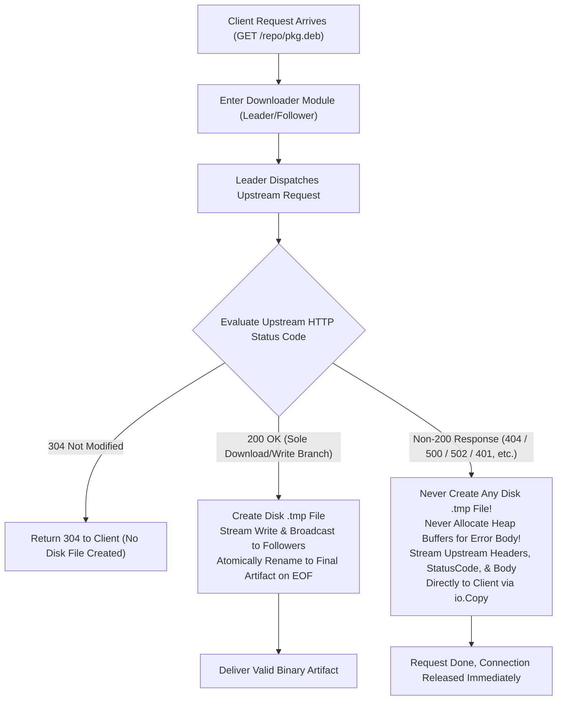

# Feature 331: Non-200 Cache Anti-Pollution & Direct Streaming Passthrough

## 1. Goal & Background

### 1.1 Problem Analysis
In the existing concurrent download and disk caching workflow, there is a P0-grade defect that permanently corrupts the local disk cache:
1. **Current Defect (Non-200 Dirty Cache Persistence)**:
   - In the Downloader Module and Proxy Dispatcher Core, when the Leader goroutine queries the upstream origin and obtains an HTTP response, only `304 Not Modified` is short-circuited.
   - If the upstream server returns non-`200 OK` status codes—such as `404 Not Found`, `401 Unauthorized`, `403 Forbidden`, `500 Internal Server Error`, `502 Bad Gateway`, or `503 Service Unavailable`—due to non-existent resources, permission denials, or service outages, the system lacks any status code validation guard.
   - As long as the network stream reads cleanly to `EOF`, the system writes the error payload (such as an HTML error page or JSON error message) in its entirety to a `.<timestamp>` temporary disk file, and then atomically renames it via `TryRename` into the final target artifact (e.g., `lib.deb`, `pkg.whl`, `image.tar`).
2. **Disastrous Consequences (Permanent Poisoning & Client Build Breakages)**:
   - The disk cache is permanently poisoned by non-200 error pages. Whenever any subsequent client requests the same file, the proxy matches the corrupt local file and directly transmits the HTML error page as a valid binary package.
   - Package managers (such as `apt`, `pip`, `docker`) inevitably fail with fatal errors such as `Hash Sum mismatch`, `Corrupted archive`, or `Invalid header`, causing automated builds and deployments to completely fail.

### 1.2 Feature Objectives
Subordinated to `Plan 330 (System Stability Hardening & Cache Governance Plan)`, this feature eliminates unnecessary negative caching and heap buffering complexity, adhering to a minimalist, pure, and zero-side-effect architectural principle to eradicate disk cache pollution:
1. **Strict Zero-Disk-Persistence for Non-200 Responses**: Strictly enforce that **temporary disk files are created and atomically renamed if and only if the upstream status code is `200 OK`**, preventing any non-200 error payload from polluting the disk cache;
2. **Direct Streaming Passthrough with Zero Memory Buffering**: For all non-200 responses (e.g., `404`, `500`, `502`, `401`), the proxy avoids allocating heap buffers to hold the error body. Instead, it streams upstream headers, the status code, and the response body directly to the client via kernel streaming (`io.Copy`), releasing network connections immediately upon completion with zero heap memory retention;
3. **Double-Defense Guard in Downloader Renaming**: Add a strict status code assertion in the Downloader Module's `TryRename` phase to immediately delete any leftover temporary file and refuse renaming if the job status code is not `200 OK`;
4. **Zero-Configuration Out of the Box**: This safeguard functions as an intrinsic security barrier of the proxy server, active out of the box without requiring manual configuration.

---

## 2. Architecture & Pipeline

### 2.1 Status Code Branching & Streaming Isolation Model



### 2.2 Response Handling Behavior Matrix

| Upstream Status Code | Disk Filesystem Behavior | Memory Handling | Client Delivery Format | Architectural Benefit |
| :--- | :--- | :--- | :--- | :--- |
| **`200 OK`** | Create `.tmp` file, atomically `os.Rename` on success | Fixed small buffer (e.g., 32KB) | Stream concurrently while writing to disk | Ensures reliable persistence and rapid reuse of valid artifacts |
| **`304 Not Modified`** | No file creation, no modification to existing file | Zero heap allocations | Directly respond with 304 headers | Zero-bandwidth lease confirmation |
| **`404 Not Found`** | **Strictly prohibited from creating or renaming files** | **No heap retention, zero heap storage** | Stream original 404 status code and error body | Completely prevents 404 HTML error pages from poisoning binary caches |
| **`500 / 502 / 503 / 504`** | **Strictly prohibited from creating or renaming files** | **No heap retention, zero heap storage** | Stream origin error status code and error body | Once upstream recovers, subsequent requests can immediately fetch valid files |
| **`401 / 403`** | **Strictly prohibited from creating or renaming files** | **No heap retention, zero heap storage** | Stream authentication failure status and body | Allows subsequent requests with valid credentials to pass through normally |

---

## 3. Detailed Module Design

### 3.1 Proxy Dispatcher Core
In the download request handling pipeline, enforce strict status code branching immediately upon receiving the upstream response:
1. **Status Code Branching Guard**:
   - If `resp.StatusCode == http.StatusNotModified` (`304`), close header signaling and return immediately;
   - If `resp.StatusCode != http.StatusOK`:
     - Log diagnostic entry: `log.Printf("[%d] upstream non-200 response (%d): %s (skip disk caching)", reqID, resp.StatusCode, uri)`;
     - **Do not create any temporary disk file**;
     - Copy response headers and write `resp.StatusCode` to the client response;
     - Stream the body directly: `_, _ = io.Copy(w, resp.Body)`;
     - Wake any queued Followers by signaling the corresponding status code, terminating the current request flow without proceeding to downstream file creation.
2. **200 OK Dedicated Caching Pipeline**:
   - Directory creation (`os.MkdirAll`), temporary file creation (`os.Create(tmp)`), and concurrent read-write broadcast proceed if and only if `resp.StatusCode == http.StatusOK`.

### 3.2 Downloader Module
To provide defense-in-depth against edge cases (such as network interruptions or abnormal routine terminations), add a defensive safeguard to the underlying download manager:
- **`TryRename` Double-Assertion Guard**:
  Before executing the final atomic file replacement (`os.Rename`), enforce a mandatory status check:
  ```go
  if job.StatusCode != http.StatusOK {
      if job.TmpName != "" {
          _ = os.Remove(job.TmpName)
      }
      return
  }
  ```
  If the status code is not `200`, any temporary file is deleted immediately and renaming is aborted, forming an impenetrable second line of defense.

---

## 4. Verification & Test Criteria

1. **404 Zero-Disk-Persistence and Direct Streaming Verification**:
   - Set up an upstream mock server configured to return `404 Not Found` with an HTML error body for `/repo/not-found.deb`;
   - Send a download request through the proxy;
   - Verify that the client receives an HTTP `404` status code with the exact upstream error body;
   - Inspect the cache directory to confirm that **neither `not-found.deb` nor any leftover `.<timestamp>` temporary files exist**.
2. **500/502 Outage Zero-Disk-Persistence Verification**:
   - Configure the mock server to return `500 Internal Server Error` and `502 Bad Gateway`;
   - Send requests through the proxy and confirm that the status codes are passed through transparently;
   - Switch the mock server to return `200 OK`, send the request again, and verify that the file is downloaded and cached properly without being affected by prior 5xx failures.
3. **200 OK Valid Artifact Caching Non-Regression Verification**:
   - Request a valid package file (upstream returns `200 OK`);
   - Verify that the proxy creates temporary files and atomically renames them to the final target file, with the client receiving complete, hash-verified content.
4. **Concurrent Error Passthrough Safety Verification**:
   - Send 10 concurrent download requests for an uncached URL that returns `404`;
   - Verify that all requests receive `404` cleanly without goroutine hangs, deadlocks, or leftover temporary files on disk.
