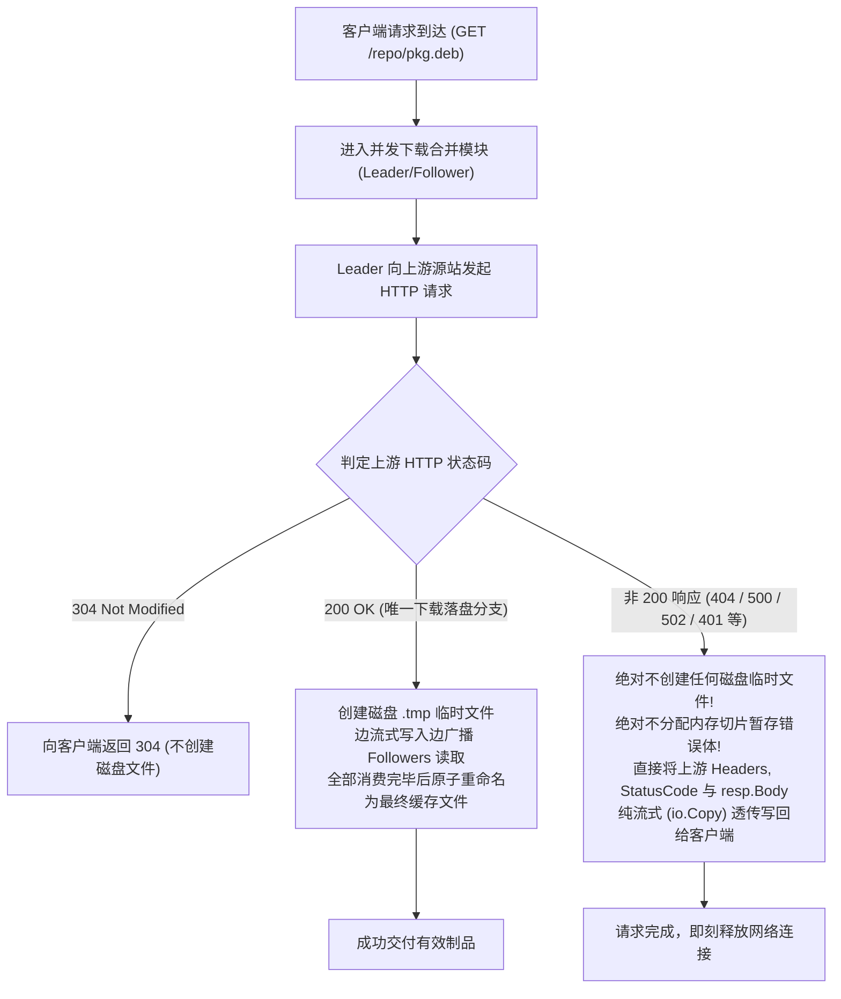

# Feature 331: 非 200 响应脏缓存防污染与纯流式透传方案 (Non-200 Cache Anti-Pollution & Direct Streaming Passthrough)

## 1. 功能目标与背景 (Goal & Background)

### 1.1 现状痛点与核心风险剖析 (Problem Analysis)
在既有的静态资源并发下载与落盘流程中，存在一处导致磁盘缓存被永久破坏的 P0 级致命缺陷：
1. **现状缺陷（非 200 脏缓存持久化污染）**：
   - 在并发下载合并模块与协议代理与调度核心中，当 Leader 协程向上游源站发起请求并获取 HTTP 响应后，当前实现仅针对 `304 Not Modified` 做了短路返回。
   - 若上游因资源不存在、权限限制或服务过载返回 `404 Not Found`、`401 Unauthorized`、`403 Forbidden`、`500 Internal Server Error`、`502 Bad Gateway`、`503 Service Unavailable` 等非 `200 OK` 状态码，系统未对状态码做任何有效性拦截。
   - 只要网络流正常读取至 `EOF`，系统就会将上游返回的错误正文（如 HTML 错误页或 JSON 报错信息）全量写入 `.<timestamp>` 磁盘临时文件，并在读取完毕后通过 `TryRename` 将其原子重命名为最终的制品文件（如 `lib.deb`、`pkg.whl`、`image.tar`）。
2. **灾难性后果（永久毒化与客户端安装崩溃）**：
   - 磁盘缓存被非 200 错误页面永久污染。后续任何客户端再次请求该文件时，代理服务器在命中本地缓存后，会直接将该 HTML 错误页面作为有效二进制包发送给客户端；
   - 客户端（如 `apt`、`pip`、`docker`）在校验哈希或解压时必然遭遇 `Hash Sum mismatch`、`Corrupted archive` 或 `Invalid header` 致命错误，导致自动化部署与构建流水线完全瘫痪。

### 1.2 建设目标 (Feature Objectives)
隶属于 `Plan 330 (系统稳定性加固与缓存治理方案)`，本特性摒弃复杂的负缓存和内存常驻机制，坚持极简、纯粹且零副作用的架构原则，彻底攻克脏缓存持久化缺陷：
1. **非 200 响应绝对零落盘**：严格限制**仅当上游响应状态码为 `200 OK` 时才允许创建磁盘临时文件与执行原子重命名**，从根源杜绝任何非 200 响应污染磁盘缓存；
2. **纯流式安全透传，零内存缓存**：对于 `404`、`500`、`502`、`401` 等所有非 200 响应，系统不分配任何内存切片去驻留错误响应体，直接通过内核流式机制（`io.Copy`）透传给客户端，请求传输完毕即刻释放网络连接，保持零堆内存占用；
3. **底层重命名双重安全守卫**：在并发下载管理器的 `TryRename` 阶段增加硬性断言，若任务状态码非 `200 OK`，强制销毁任何残留临时文件并绝对禁止重命名；
4. **零配置开箱即用**：该防护属于代理服务器的基础核心安全屏障，开箱即生效，无需运维介入配置任何参数。

---

## 2. 核心架构与处理管线 (Architecture & Pipeline)

### 2.1 状态码分支与流式隔离模型



### 2.2 响应处理行为矩阵

| 上游响应状态码 | 磁盘文件行为 | 内存处理方式 | 客户端交付形式 | 架构收益 |
| :--- | :--- | :--- | :--- | :--- |
| **`200 OK`** | 正常创建 `.tmp` 临时文件，下载成功后原子 `os.Rename` | 固定缓冲区（如 32KB）循环对拷 | 边写盘边流式输出给客户端 | 保障正向有效制品的可靠持久化与秒级复用 |
| **`304 Not Modified`** | 不创建文件，不修改已有目标文件 | 零内存占用 | 直接响应 304 头部 | 0 流量完成时效确认 |
| **`404 Not Found`** | **严禁创建临时文件，严禁重命名** | **不分配内存缓存，零堆常驻** | 纯流式透传原始 404 状态码与响应体 | 彻底杜绝 404 错误页毒化磁盘制品缓存 |
| **`500 / 502 / 503 / 504`** | **严禁创建临时文件，严禁重命名** | **不分配内存缓存，零堆常驻** | 纯流式透传源站报错状态码与响应体 | 源站恢复后后续请求立即可重试获取正向文件 |
| **`401 / 403`** | **严禁创建临时文件，严禁重命名** | **不分配内存缓存，零堆常驻** | 纯流式透传鉴权失败状态码与响应体 | 允许携带合规鉴权头的后续请求正常穿透 |

---

## 3. 详细模块设计 (Detailed Module Design)

### 3.1 协议代理与调度核心 (Proxy Dispatcher Core)
在下载请求处理管线中，紧随获取上游响应之后增加严格的状态码分流拦截：
1. **状态码分流守卫**：
   - 若 `resp.StatusCode == http.StatusNotModified`（`304`），关闭头部信号直接返回；
   - 若 `resp.StatusCode != http.StatusOK`：
     - 记录诊断日志：`log.Printf("[%d] upstream non-200 response (%d): %s (skip disk caching)", reqID, resp.StatusCode, uri)`；
     - **不创建任何磁盘临时文件**；
     - 复制响应头，向客户端写入对应的 `resp.StatusCode`；
     - 纯流式透传正文：`_, _ = io.Copy(w, resp.Body)`；
     - 唤醒可能排队的 Follower（通过广播对应状态码），直接结束当前请求流程，严禁进入下游文件创建与落盘阶段。
2. **200 OK 专属落盘管线**：
   - 唯有当 `resp.StatusCode == http.StatusOK` 时，才执行目录创建（`os.MkdirAll`）、临时文件建立（`os.Create(tmp)`）与环形广播读写。

### 3.2 并发下载合并模块 (Downloader Module)
为确保极端边界情况下（如网络异常、协程提前终止、调用方绕过）系统依然具备绝对防御能力，在底层下载管理器中增加防御性安全保障：
- **`TryRename` 双重断言校验**：
  在执行文件最终原子覆盖（`os.Rename`）之前，强制校验当前任务状态码：
  ```go
  if job.StatusCode != http.StatusOK {
      if job.TmpName != "" {
          _ = os.Remove(job.TmpName)
      }
      return
  }
  ```
  若状态码不为 `200`，立即物理删除临时文件并拒绝重命名，构成不可穿透的“双重熔断防线”。

---

## 4. 验证场景与测试标准 (Verification & Test Criteria)

1. **404 响应零落盘与流式透传验证**：
   - 搭建模拟源站，配置 `/repo/not-found.deb` 返回 `404 Not Found` 及特定的 HTML 错误正文；
   - 客户端通过代理请求该文件；
   - 验证客户端收到的 HTTP 状态码为 `404`，响应正文与源站返回完全一致；
   - 检查本地缓存目录，验证**既不存在 `not-found.deb`，也不存在任何残留的 `.<timestamp>` 临时文件**。
2. **500/502 服务端故障零落盘验证**：
   - 配置模拟源站返回 `500 Internal Server Error` 与 `502 Bad Gateway`；
   - 客户端发起下载请求，验证代理如实透传状态码；
   - 随后将源站切换为正常的 `200 OK`，再次发起相同请求，验证代理能够立即正常下载并成功落盘，未被前序 5xx 故障产生任何干扰。
3. **200 OK 正常制品下载与落盘无回归验证**：
   - 请求有效的软件包文件（上游返回 `200 OK`）；
   - 验证代理正常创建临时文件并原子替换为最终文件，客户端完整接收且哈希一致。
4. **并发请求下的错误透传安全性验证**：
   - 针对一个返回 `404` 的 URL，同时发起 10 个并发下载请求；
   - 验证所有并发请求均能平稳收到 `404` 响应，无协程挂起、无死锁，且磁盘无任何临时文件残留。
