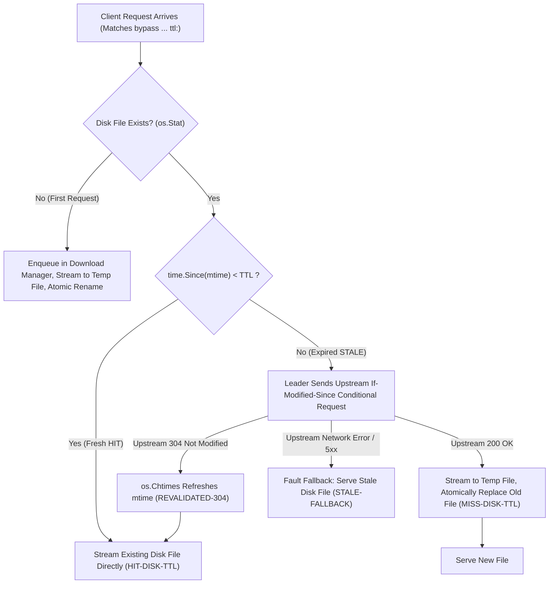

# Feature 332: Disk TTL Cache with mtime Freshness & Conditional Revalidation

## 1. Goal & Background

### 1.1 Problem Analysis & Architectural Reflection
The initial dynamic metadata soft-caching design proposed storing TTL-governed response payloads (`Data []byte`) along with cloned HTTP headers in a Go heap memory map. However, after an in-depth audit of real-world package manager proxy scenarios (e.g., Debian/Ubuntu APT `InRelease`, YUM/RPM `repodata`, Alpine `APKINDEX`, etc.) and long-term production operations, critical architectural drawbacks emerged:
1. **Unbounded Heap Consumption and OOM Hazards**:
   - Dynamic index files in production mirrors range from dozens of kilobytes to tens of megabytes (such as massive package index JSONs). Retaining these payloads in heap memory—even with an item count cap like 5,000—inevitably drives memory consumption into gigabytes under high concurrency or heavy workloads, risking container OOM kills;
2. **Lack of Persistence and Cold-Start Cache Stampedes**:
   - In-memory caches do not persist across process lifecycles. Every proxy restart or container recreation instantly evaporates all cached metadata, forcing initial client requests to penetrate directly to the upstream source and triggering severe cold-start stampedes;
3. **Concurrent Refresh Stampedes and Redundant Bandwidth Consumption**:
   - When in-memory cached items expire, a lack of deep integration with the underlying concurrent download coalescing mechanism (Leader/Follower) causes simultaneous incoming requests to independently query the upstream source, wasting bandwidth and triggering upstream rate limits.

### 1.2 Feature Objectives
Subordinated to `Plan 330 (System Stability Hardening & Cache Governance Plan)`, this feature transitions the architecture away from heap storage to **"100% Disk-Backed Payloads + Zero-Memory Freshness Evaluation via File Modification Time (mtime)"**:
1. **100% Disk-Backed Storage**: All requests governed by TTL rules are persisted to the disk cache directory just like static artifacts, completely eliminating heap memory pressure;
2. **Zero-Memory Freshness Check via File `mtime`**: The filesystem modification time (`os.Stat`'s `ModTime`) serves as a natural timestamp index. As long as `time.Since(mtime) < TTL`, requests are served directly from disk via kernel streaming/zero-copy mechanisms with zero heap allocations;
3. **`If-Modified-Since` Conditional Revalidation & Zero-Bandwidth Touch Extension**: When a file exceeds its TTL, the proxy issues a standard conditional request upstream. Upon receiving `304 Not Modified`, `os.Chtimes` touches the file's modification timestamp, extending its lease by an entire TTL cycle with zero bytes downloaded;
4. **Leader/Follower Request Coalescing**: Expired file revalidation and downloads are routed through the download manager. The first arriving request acts as the Leader, while subsequent concurrent requests share the stream as Followers, preventing upstream stampedes;
5. **Stale-Fallback Resilience on Upstream Failure**: If the upstream source times out, drops connections, or returns 5xx errors, the proxy automatically falls back to serving the existing stale disk file with an `X-Cache-Status: STALE-FALLBACK` header, ensuring ultra-high availability.

---

## 2. Architecture & State Machine Design

### 2.1 Disk TTL Execution Flow State Machine



### 2.2 Freshness Status Definitions & Header Specifications
The proxy injects a standardized `X-Cache-Status` response header to convey the cache lifecycle state to clients:
1. **`HIT-DISK-TTL` (Disk Cache Fresh Hit)**:
   - Trigger condition: Disk file exists and `time.Since(stat.ModTime()) < matchedBypass.TTL`.
   - Behavior: No upstream network requests are made. The disk file is streamed directly to the client, supporting HTTP Range requests and resumed downloads.
2. **`REVALIDATED-304` (Conditional Revalidation Lease Extended)**:
   - Trigger condition: Disk file has expired; the proxy sends an `If-Modified-Since` conditional request upstream, and the upstream responds with `304 Not Modified`.
   - Behavior: Invokes `os.Chtimes(diskPath, time.Now(), time.Now())` to reset the file modification time to the current timestamp, seamlessly renewing the lease for another TTL period and serving the existing disk file.
3. **`MISS-DISK-TTL` (Cache Expired & Content Updated)**:
   - Trigger condition: Disk file does not exist, or the file has expired and the upstream returns `200 OK` (content updated).
   - Behavior: Streams the new response payload into a temporary file, atomically replaces the old file upon completion, and streams the new payload to the client.
4. **`STALE-FALLBACK` (Upstream Outage Fault Fallback)**:
   - Trigger condition: Disk file has expired, but conditional revalidation against upstream encounters timeouts, network unreachability, or 5xx server errors.
   - Behavior: Immediately falls back to reading and serving the existing stale disk file, avoiding exposing 502/504 errors to clients.

---

## 3. Configuration Specification (`proxy.conf`)

This feature seamlessly inherits the existing bypass and TTL directive specification in the unified configuration module:

```ini
# Syntax: bypass <scope> <type> <pattern> ttl:<duration>
# Semantics: Enables disk-backed TTL caching for matching resources, valid for duration

# Example 1: APT repository metadata cached for 180 seconds
bypass /apt/ exact InRelease ttl:180s
bypass /apt/ exact Release ttl:180s
bypass /apt/ exact Release.gpg ttl:180s

# Example 2: PyPI dynamic Simple index pages cached for 5 minutes
bypass /pypi/simple/ prefix * ttl:5m

# Example 3: Pure dynamic passthrough (no ttl: specified, strictly streaming passthrough, no disk caching)
bypass /auth/ prefix *
```

---

## 4. Detailed Module Design

### 4.1 Proxy Dispatcher Core
- **Request Routing & Dispatching**:
  Upon receiving a request, the dispatcher evaluates `cache.MatchBypassRule`:
  - If no bypass rule matches, the request follows the standard static artifact disk-caching path;
  - If a bypass rule matches but `matchedBypass.TTL <= 0`, it maintains strictly streaming passthrough (no disk writes);
  - If a bypass rule matches and `matchedBypass.TTL > 0`, it enters the **Disk TTL Cache Pipeline**.
- **Sanitized Disk Path Computation**:
  Invokes `cache.GetSafeUrlPath(uri)` to compute the normalized physical filesystem path:
  ```
  diskPath = filepath.Join(cacheDir, safeUrlPath)
  ```

### 4.2 Cache Storage & Freshness Verification
- **Minimal Freshness Probe**:
  Inspects file metadata via `os.Stat(diskPath)`. If the file exists, it compares timestamps:
  ```
  isFresh := time.Since(stat.ModTime()) < matchedBypass.TTL
  ```
- **Client Conditional Coordination**:
  If the file is fresh (`isFresh == true`), the proxy checks if the client sent an `If-Modified-Since` header. If the client's timestamp is equal to or later than the file's modification time, the proxy immediately returns `304 Not Modified`, maximizing local network bandwidth savings.

### 4.3 Downloader & Conditional Touch
- **Upstream Conditional Request Formulation**:
  When `isFresh == false`, the download job automatically appends:
  ```
  If-Modified-Since: stat.ModTime().UTC().Format(http.TimeFormat)
  ```
- **Leader/Follower Coalescing**:
  Registers the refresh task in the concurrent download manager:
  - The first arriving goroutine acts as the Leader, dispatching the conditional request upstream and managing the network stream;
  - Subsequent concurrent Follower goroutines block on condition variable broadcasts, awaiting the Leader's probe outcome;
  - If the Leader receives `304 Not Modified`: it executes `os.Chtimes(diskPath, time.Now(), time.Now())` and wakes all Followers to serve from disk;
  - If the Leader receives `200 OK`: the Leader writes to a temporary file while Followers stream concurrently, atomically renaming it to the target file upon finish;
  - If the Leader encounters errors and a stale disk file exists: it executes the fallback routine, waking Followers to serve the stale disk file.

---

## 5. Verification & Test Criteria

1. **Disk Freshness Hit Verification**:
   - Request a resource configured with `ttl:10s`;
   - After the initial request completes, send multiple concurrent requests within 5 seconds;
   - Verify that all subsequent responses contain `X-Cache-Status: HIT-DISK-TTL` and the upstream mock server receives zero requests.
2. **Upstream 304 Revalidation & Timestamp Touch Verification**:
   - Request an expired resource (file exists but `time.Since(mtime) > TTL`);
   - Configure the upstream mock server to respond with `304 Not Modified`;
   - Verify the proxy returns `X-Cache-Status: REVALIDATED-304` and the file's `ModTime` is refreshed to current time;
   - Immediately follow with another request and verify it returns `HIT-DISK-TTL`.
3. **Content Update & Atomic Replacement Verification**:
   - After an item expires, configure the upstream mock to return `200 OK` with updated payload bytes;
   - Verify the client receives updated content, the response header indicates `X-Cache-Status: MISS-DISK-TTL`, and the disk file is atomically updated without exposing partial writes.
4. **Upstream Outage Stale-Fallback Verification**:
   - After an item expires, simulate upstream timeouts or 502 Bad Gateway responses;
   - Verify the proxy responds with `200 OK` and `X-Cache-Status: STALE-FALLBACK`, returning content identical to the stale disk file.
5. **Persistence Across Restarts & Zero Memory Leaks**:
   - Simulate a proxy process restart;
   - Immediately request an unexpired resource;
   - Verify the request hits the disk cache (`HIT-DISK-TTL`) without network traffic, and heap allocations remain constant over time.
