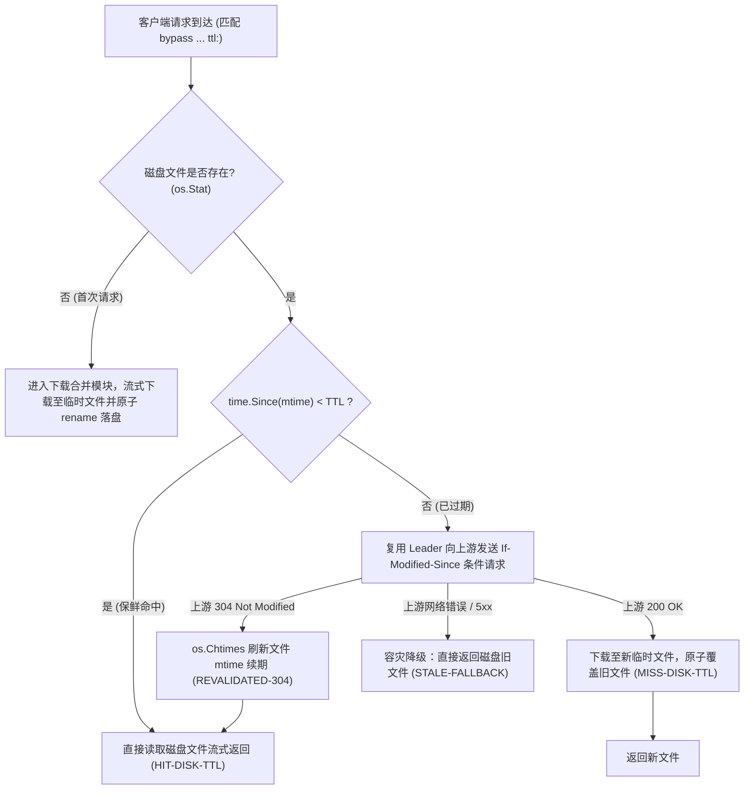

# Feature 332: 基于磁盘文件与 mtime 的时效缓存与条件更新方案 (Disk TTL Cache with mtime Freshness & Conditional Revalidation)

## 1. 功能目标与背景 (Goal & Background)

### 1.1 现状痛点与架构反思 (Problem Analysis & Architectural Reflection)
在原动态元数据软缓存设计中，曾设想将带 TTL 的元数据响应体（`Data []byte`）与克隆的 HTTP 响应头全量驻留在 Go 堆内存字典中。然而，在针对生产级长周期运行与各类包管理器（如 Debian/Ubuntu APT 的 `InRelease`、YUM/RPM 的 `repodata`、Alpine 的 `APKINDEX` 等）实际镜像代理场景进行深度审计后，发现该设计存在显著的架构缺陷：
1. **内存占用失控与 OOM 风险**：
   - 真实镜像源中的动态索引文件体积从几十 KB 到数 MB 不等（甚至包含大型包索引 JSON）。若全量驻留在堆内存中，即使引入条目数上限（如 5000 条），在极端高并发与大包场景下依然会导致内存占用激增至数 GB，带来容器 OOM 终止隐患；
2. **缺乏持久化与重启冷击穿**：
   - 纯内存缓存无法跨进程持久化。每次代理服务升级或容器重启，全部元数据缓存瞬时丢失，导致大量客户端首批请求瞬间穿透回源站，引发严重的冷启动风暴；
3. **并发更新击穿与重复带宽消耗**：
   - 内存软缓存过期后，若缺乏与底层并发下载合并机制（Leader/Follower）的深度协同，瞬间涌入的大量并发请求会重复向上游发起请求，既浪费带宽又易触发上游源站频控。

### 1.2 建设目标 (Feature Objectives)
隶属于 `Plan 330 (系统稳定性加固与缓存治理方案)`，本特性旨在摒弃纯内存堆存储，确立**“数据体 100% 磁盘落盘 + 基于文件修改时间 (mtime) 零内存开销时效校验”**的新一代时效缓存架构：
1. **数据体 100% 磁盘落盘**：所有带 TTL 规则的请求与普通静态制品一样，统一落盘至磁盘缓存目录，堆内存占用彻底归零；
2. **基于文件系统 `mtime` 的零内存时效判定**：利用文件系统的修改时间（`os.Stat` 的 `ModTime`）作为天然的时间戳索引。在 `time.Since(mtime) < TTL` 保鲜期内，直接通过内核流式/零拷贝机制响应客户端，零内存消耗、零系统冗余状态；
3. **`If-Modified-Since` 条件协商与 0 流量 touch 续期**：当文件超出 TTL 时，自动向上游发起标准条件请求。若上游返回 `304 Not Modified`，直接调用 `os.Chtimes` 刷新磁盘文件的修改时间，以 0 字节下载完成租期续约；
4. **并发请求合并（Leader/Follower）防源站击穿**：将过期文件的重新验证与下载接入下载合并管理器，首个请求作为 Leader，后续并发请求作为 Follower 共享数据流，杜绝源站击穿；
5. **源站故障旧文件容灾降级（Stale-Fallback）**：若上游源站出现网络超时、连接重置或 5xx 故障，系统自动降级返回磁盘中已有的过期旧文件，并标记 `STALE-FALLBACK`，保障极端场景下的高可用。

---

## 2. 核心架构与状态机设计 (Architecture & State Machine Design)

### 2.1 磁盘时效缓存执行流状态机



### 2.2 状态判定规则与响应头定义
系统在响应客户端时，通过注入统一的 `X-Cache-Status` 响应头反映当前缓存命中状态：
1. **`HIT-DISK-TTL`（磁盘保鲜命中）**：
   - 触发条件：磁盘文件存在且 `time.Since(stat.ModTime()) < matchedBypass.TTL`。
   - 行为：无需进行任何上游网络请求，直接将磁盘文件流式传输给客户端，支持 HTTP Range 分片与断点续传。
2. **`REVALIDATED-304`（条件重验证续期）**：
   - 触发条件：磁盘文件已过期，向上游发起 `If-Modified-Since` 条件请求，上游返回 `304 Not Modified`。
   - 行为：调用操作系统接口 `os.Chtimes(diskPath, time.Now(), time.Now())` 将修改时间刷新为当前时间，将租期无缝顺延一个 TTL 周期，直接向客户端返回现有磁盘文件。
3. **`MISS-DISK-TTL`（缓存失效且内容更新）**：
   - 触发条件：磁盘文件不存在，或文件已过期且上游返回 `200 OK`（内容发生变更）。
   - 行为：流式下载新响应体到临时文件，下载成功后通过原子重命名替换旧文件，并流式输出给客户端。
4. **`STALE-FALLBACK`（源站故障容灾降级）**：
   - 触发条件：磁盘文件已过期，但在向上游发起条件重验证时遭遇超时、网络不可达或 5xx 服务端错误。
   - 行为：立即降级读取本地已存在的旧磁盘文件返回给客户端，避免向客户端暴露 502/504 错误。

---

## 3. 配置文件语法规范 (`proxy.conf`)

本方案完全继承现有的免缓存与时效配置指令体系，保持与统一配置模块的平滑兼容：

```ini
# 语法格式: bypass <scope> <type> <pattern> ttl:<duration>
# 语义说明: 对符合 scope 与 pattern 匹配规则的资源启用磁盘 TTL 缓存，保鲜期为 duration

# 示例 1: APT 软件源索引元数据缓存 180 秒
bypass /apt/ exact InRelease ttl:180s
bypass /apt/ exact Release ttl:180s
bypass /apt/ exact Release.gpg ttl:180s

# 示例 2: PyPI 动态 Simple 索引页面缓存 5 分钟
bypass /pypi/simple/ prefix * ttl:5m

# 示例 3: 纯动态透传资源 (未指定 ttl: 参数，保持纯流式穿透，严禁落盘)
bypass /auth/ prefix *
```

---

## 4. 详细模块设计 (Detailed Module Design)

### 4.1 协议代理与调度核心 (Proxy Dispatcher Core)
- **请求调度分流**：
  在请求进入代理核心后，匹配 `cache.MatchBypassRule`：
  - 若未匹配免缓存规则，按普通静态制品走全量磁盘缓存流；
  - 若匹配免缓存规则但 `matchedBypass.TTL <= 0`，维持纯流式透传（严禁落盘）；
  - 若匹配免缓存规则且 `matchedBypass.TTL > 0`，转入**磁盘时效缓存管线**。
- **磁盘安全路径计算**：
  调用缓存模块的路径净化方法 `cache.GetSafeUrlPath(uri)`，计算出确定的物理落盘路径：
  ```
  diskPath = filepath.Join(cacheDir, safeUrlPath)
  ```

### 4.2 缓存路径与文件时效校验 (Cache Storage & Freshness Verification)
- **极简时效探测**：
  通过 `os.Stat(diskPath)` 获得文件元数据。若文件存在，对比当前时间戳：
  ```
  isFresh := time.Since(stat.ModTime()) < matchedBypass.TTL
  ```
- **客户端协同处理**：
  若本地文件处于保鲜状态（`isFresh == true`），代理服务器自动检查客户端请求中是否携带 `If-Modified-Since`。若客户端提供的时间晚于或等于文件修改时间，直接向客户端响应 `304 Not Modified`，最大化节省代理与客户端之间的局域网带宽。

### 4.3 并发下载合并与条件续期 (Downloader & Conditional Touch)
- **上游条件请求构造**：
  当 `isFresh == false` 时，下载任务在向源站构造出向 HTTP 请求时，自动附加：
  ```
  If-Modified-Since: stat.ModTime().UTC().Format(http.TimeFormat)
  ```
- **Leader/Follower 协同更新**：
  将该 URL 的刷新任务注册进并发下载管理器：
  - 首个到达的协程作为 Leader，向上游发出条件请求并接管网络流；
  - 并发到达的 Follower 协程阻塞在条件变量广播上，等待 Leader 探测结果；
  - 若 Leader 收到 `304 Not Modified`：执行 `os.Chtimes(diskPath, time.Now(), time.Now())`，唤醒所有 Follower 直接从磁盘读取；
  - 若 Leader 收到 `200 OK`：Leader 写入临时文件，Follower 同步流式消费，下载完毕后原子 `os.Rename` 替换目标文件；
  - 若 Leader 收到错误且磁盘文件存在：执行降级逻辑，唤醒 Follower 一同读取磁盘旧文件返回。

---

## 5. 验证场景与测试标准 (Verification & Test Criteria)

1. **磁盘保鲜期命中测试**：
   - 向代理请求一个已配置 `ttl:10s` 的资源；
   - 首次请求完成后，在 5 秒内连续发起多次并发请求；
   - 验证后续请求的响应头包含 `X-Cache-Status: HIT-DISK-TTL`，且上游模拟服务器未收到任何回源网络流量。
2. **上游 304 条件续期与时间戳更新测试**：
   - 请求已过期的资源（文件存在但 `time.Since(mtime) > TTL`）；
   - 上游模拟服务器配置为响应 `304 Not Modified`；
   - 验证代理返回 `X-Cache-Status: REVALIDATED-304`，且磁盘文件的 `ModTime` 被成功刷新为当前系统时间；
   - 紧接着再次发起请求，验证其状态自动恢复为 `HIT-DISK-TTL`。
3. **内容更新与原子替换测试**：
   - 资源过期后，上游模拟服务器返回 `200 OK` 及新的响应体内容；
   - 验证客户端收到最新内容，响应头标记为 `X-Cache-Status: MISS-DISK-TTL`，且磁盘文件内容被原子替换，无半写文件暴露。
4. **源站故障旧文件容灾降级测试**：
   - 资源过期后，人为模拟上游超时（Timeout）或 502 网关故障；
   - 验证代理向客户端返回 `200 OK` 与 `X-Cache-Status: STALE-FALLBACK`，内容与过期的磁盘旧文件完全一致。
5. **服务重启持久化与零内存泄漏测试**：
   - 模拟代理进程重启；
   - 重启后立即请求尚未超过 TTL 的资源；
   - 验证服务依然直接命中磁盘返回 `HIT-DISK-TTL`，无需重新联网拉取，且运行过程中 Go 堆内存对象数量不随请求数量增加而增长。
