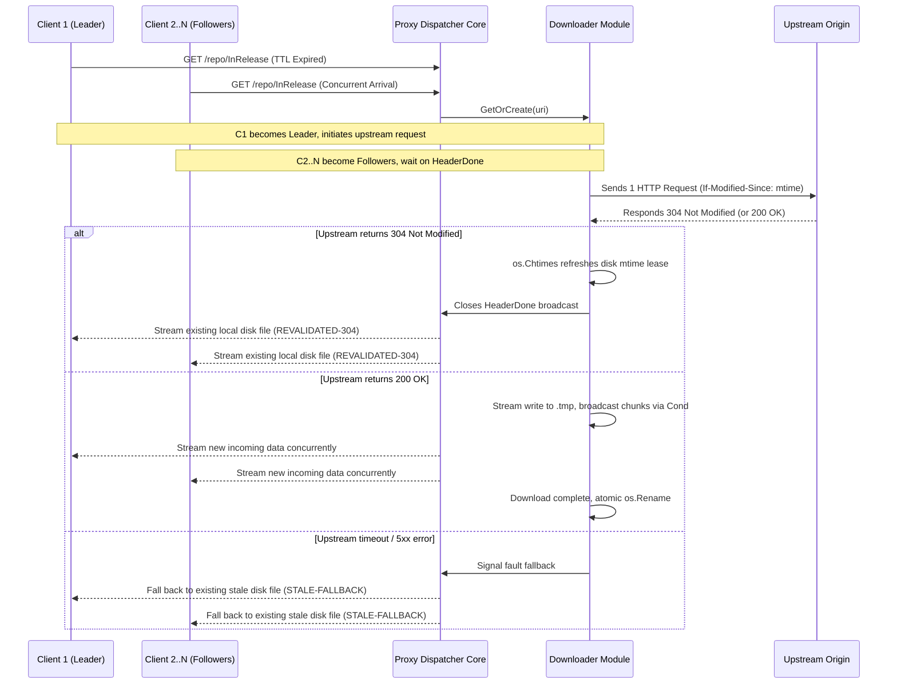

# Feature 333: Disk TTL Concurrent Revalidation & Request Coalescing

## 1. Goal & Background

### 1.1 Problem Analysis
Following the establishment of `Feature 332 (Disk TTL Cache with mtime Freshness & Conditional Revalidation)`, dynamic metadata index resources (such as APT `InRelease`, YUM `repodata`, and package manager dynamic indexes) are persisted to disk, with freshness evaluated via filesystem modification time (`mtime`).
However, without a request coalescing mechanism, when a heavily requested file passes its TTL expiration boundary, high-concurrency environments face a severe **Revalidation Stampede** risk:
1. **Redundant Upstream Conditional Inquiries**:
   - When dozens of clients (e.g., 30 CI runner containers launched simultaneously) request an expired resource at the same instant, each request routine independently dispatches an `If-Modified-Since` probe to the upstream origin, consuming outbound connections;
2. **Download Storms on Content Modification**:
   - If the origin server updates the file and returns `200 OK`, independent uncoalesced requests result in 30 simultaneous full payload downloads of identical content, wasting bandwidth and triggering upstream rate limits (`HTTP 429`);
3. **Concurrent File Replacement & Contention**:
   - Multiple routines downloading and attempting to replace the same file create temporary file accumulation and lock/write contention.

### 1.2 Feature Objectives
Subordinated to `Plan 330 (System Stability Hardening & Cache Governance Plan)` and deeply integrated with `Feature 332`, this feature extends the existing **Downloader Module (Leader/Follower mechanism)** to revalidate expired TTL-governed resources:
1. **Strict Single Upstream Revalidation per URI**: Regardless of how many concurrent requests hit an expired URI, strictly **1** conditional inquiry or payload download is dispatched to the upstream origin at any given time;
2. **Unified Broadcast & Result Sharing**:
   - If upstream returns `304 Not Modified`: The Leader touches the file's modification timestamp (`os.Chtimes`), and all waiting Followers share the existing local disk file concurrently;
   - If upstream returns `200 OK`: The Leader streams data into a temporary file while broadcasting to Followers, atomically renaming the file upon completion;
   - If upstream times out or fails: The Leader and Followers gracefully fall back to serving the existing stale disk file (`STALE-FALLBACK`);
3. **Robust Connection Lifecycle Decoupling**: Reuses the established disconnect isolation mechanism; client disconnections never interrupt upstream downloads, ensuring cache pre-warming and stability for remaining Followers;
4. **Zero Configuration**: Seamlessly reuses existing `ttl:<duration>` directives out of the box.

---

## 2. Architecture & Pipeline

### 2.1 Coalescing & Broadcast Sequence

---

## 3. Connection Lifecycle & Isolation

To maintain stability under high-concurrency environments with client cancellations, explicit isolation rules are enforced:

1. **Decoupled Upstream Context**:
   - The Leader's outbound HTTP request is bound to an independent background context rather than the initial client's request context;
2. **Leader Disconnection (Solo Client)**:
   - If the Leader disconnects before completion, the background download goroutine continues running to persist the file to disk, completing cache pre-warming for subsequent clients;
   - If the upstream download stalls, the background Watchdog terminates it after the idle timeout;
3. **Leader Disconnection (With Followers)**:
   - If the Leader disconnects, only its own response stream exits and decrements the reader count;
   - The background download continues writing and broadcasting data. Followers experience zero interruption and receive the full artifact;
4. **Individual Follower Disconnection**:
   - If a Follower client disconnects, its local file descriptor closes and the reader count decrements without affecting the Leader or other Followers.

---

## 4. Detailed Module Design

### 4.1 Proxy Dispatcher Core
In the bypass and TTL handling pipeline (`handleBypass`):
- When a resource is determined to be expired (`time.Since(stat.ModTime()) >= matchedBypass.TTL`):
  - Calls `GetOrCreate(uri)` on the Downloader Module;
  - If Leader: Constructs the `If-Modified-Since` conditional request and drives subsequent writing/renaming;
  - If Follower: Awaits the Leader's `HeaderDone` broadcast;
  - Both parties stream the resulting payload based on the Leader's outcome (`304`, `200`, or fallback).

### 4.2 Downloader Module
- **Conditional Headers & 304 Recognition**:
  - `DownloadJob` natively supports outbound `If-Modified-Since` headers;
  - When the upstream returns `304 Not Modified`:
    - The Leader touches the destination file timestamp via `os.Chtimes(diskPath, time.Now(), time.Now())`;
    - Sets `job.FilePath` to the existing target file;
    - Closes `job.HeaderDone` to awaken Followers, streaming the existing file without creating temporary files.

---

## 5. Verification & Test Criteria

1. **High-Concurrency 304 Probe Coalescing Verification**:
   - Pre-warm an expired TTL resource;
   - Concurrently send 30 client requests to the URI, configuring the mock origin to return `304 Not Modified`;
   - Verify the mock server receives **strictly 1** HTTP conditional request;
   - Verify all 30 clients receive the file with `X-Cache-Status: REVALIDATED-304`.
2. **High-Concurrency 200 Update Single-Stream Download Verification**:
   - Configure the origin to return `200 OK` with updated content for the expired resource;
   - Send 30 concurrent requests;
   - Verify only 1 full download occurs against origin, all 30 clients receive updated content, and the disk file is atomically replaced.
3. **Leader Disconnection Isolation Verification**:
   - Under multiple concurrent requests, forcibly terminate the Leader's TCP connection mid-transfer;
   - Verify remaining Followers download successfully without upstream interruption and the disk file is properly renamed.
4. **Origin Outage Concurrent Fallback Verification**:
   - Simulate an upstream timeout or 502 error on an expired resource with concurrent requests;
   - Verify all requests receive the stale disk file with `X-Cache-Status: STALE-FALLBACK` without goroutine deadlocks.
