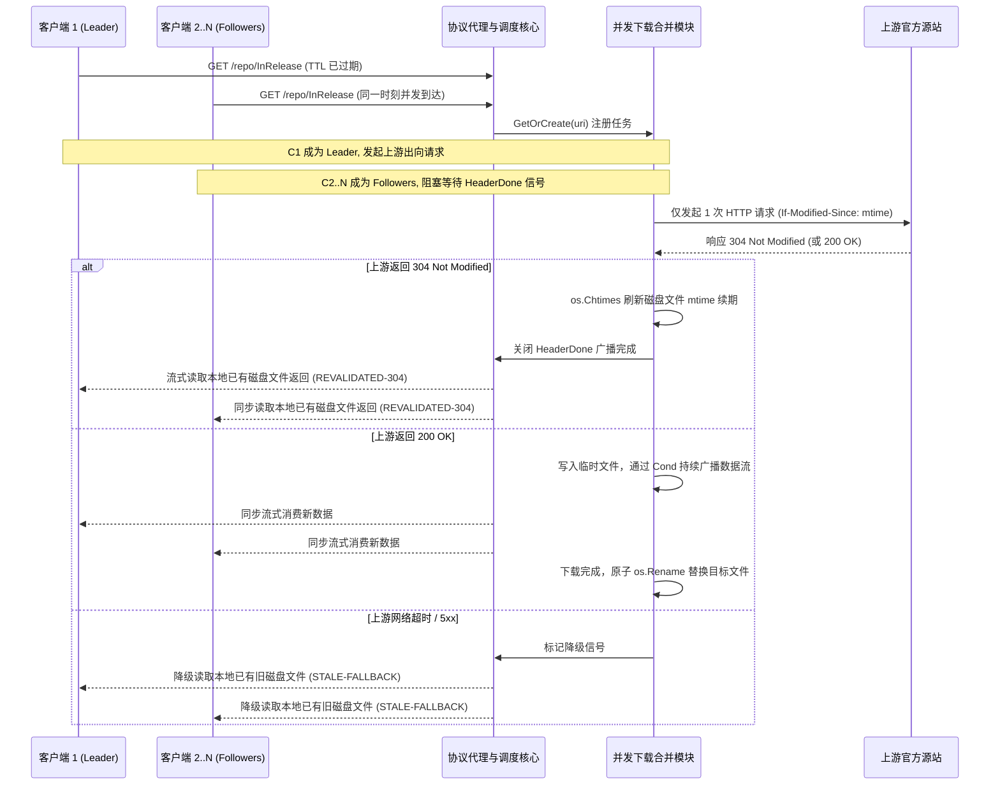

# Feature 333: 磁盘 TTL 资源并发刷新与请求合并方案 (Disk TTL Concurrent Revalidation & Request Coalescing)

## 1. 功能目标与背景 (Goal & Background)

### 1.1 现状痛点与风险剖析 (Problem Analysis)
在 `Feature 332 (基于磁盘文件与 mtime 的时效缓存与条件更新方案)` 确立后，带 TTL 的动态索引资源（如 APT `InRelease`、YUM `repodata`、各类包管理器动态索引）已实现全量磁盘落盘与基于文件修改时间（`mtime`）的时效检查。
然而，在没有请求合并机制的情况下，当某个热门文件跨过 TTL 判定时刻，在高并发业务场景中存在明显的**过期并发击穿（Revalidation Stampede）**隐患：
1. **重复发起源站条件协商**：
   - 当多个客户端（如同一时间段启动的 30 个自动化构建容器）几乎同时请求已过期的同一资源时，若无请求合并，每个请求协程都会独立向上游源站发出一个带有 `If-Modified-Since` 的 HTTP 探针，瞬间占用大量出向连接；
2. **内容变更时的下载风暴与带宽浪费**：
   - 若上游源站恰好更新了该文件并返回 `200 OK`，若各请求协程独立回源，将导致 30 个并发连接同时向上游全量拉取 30 份相同的文件，造成严重的公网带宽浪费与源站限流（`HTTP 429`）风险；
3. **并发文件覆盖与锁竞争**：
   - 多个协程同时拉取并尝试写盘时，容易产生临时文件堆积与写覆盖竞态。

### 1.2 建设目标 (Feature Objectives)
隶属于 `Plan 330 (系统稳定性加固与缓存治理方案)`，并与 `Feature 332` 深度协同，本特性旨在将既有的**并发下载合并模块（Leader/Follower 机制）**复用至带 TTL 资源的重验证管线中：
1. **同 URI 并发重验证严格合一**：无论瞬间涌入多少个同 URI 的过期探测请求，同一时刻向上游源站发起的条件协商与数据拉取严格收敛为 **1 个**；
2. **结果统一广播共享**：
   - 若上游返回 `304 Not Modified`：Leader 执行文件修改时间更新（touch），所有等待中的 Followers 与 Leader 一同零拷贝并发读取本地已有磁盘文件直接返回；
   - 若上游返回 `200 OK`：Leader 边写入临时文件边向 Followers 广播流式数据，下载完成后原子重命名落盘；
   - 若上游故障超时：Leader 与 Followers 一同平稳降级读取本地已有旧文件（`STALE-FALLBACK`）；
3. **健壮的客户端连接生命周期解耦**：继承并复用成熟的断开隔离机制，客户端异常断连绝不中断上游正常拉取，保障其余等待者的稳定性与缓存预热；
4. **零新增配置**：完全复用统一配置中的 `ttl:<duration>` 规则，开箱即具备并发保护。

---

## 2. 核心架构与并发合并流程 (Architecture & Pipeline)

### 2.1 任务合并与状态广播时序

---

## 3. 连接异常与取消隔离机制 (Connection Lifecycle & Isolation)

针对高并发网络环境下的客户端断开场景，建立明确的隔离规则：

1. **上游请求与客户端上下文完全解耦**：
   - Leader 发起的出向 HTTP 请求绑定独立的全局后台上下文，不与首个客户端的连接上下文绑定；
2. **只有 Leader 时的断连处理（静默完成与预热）**：
   - 若 Leader 客户端在下载过程中断开连接，后台数据泵协程继续运行并将数据完整写入磁盘，为后续客户端完成缓存预热；
   - 若上游发生卡死，由后台看门狗（Watchdog）在空闲超时后主动回收；
3. **有 Followers 时 Leader 断连的处理（无感继续）**：
   - 若 Leader 客户端断开连接，仅其自身退出并递减读者计数；
   - 后台下载协程继续向临时文件写入并广播数据，所有的 Followers 无任何感知，正常接收完整数据并完成落盘；
4. **单个 Follower 断连的处理（局部退出）**：
   - 某个 Follower 客户端断开时，其本地文件句柄正常关闭，读者计数递减，不影响 Leader 或其余 Followers 的数据接收。

---

## 4. 详细模块设计 (Detailed Module Design)

### 4.1 协议代理与调度核心 (Proxy Dispatcher Core)
在免缓存与 TTL 处理分支（`handleBypass`）中接入并发合并：
- 当资源被判定为已过期（`time.Since(stat.ModTime()) >= matchedBypass.TTL`）时：
  - 调用并发下载合并模块的 `GetOrCreate(uri)`；
  - 若为 Leader：负责构造带 `If-Modified-Since` 的条件请求并驱动后续写入与重命名；
  - 若为 Follower：等待 Leader 的 `HeaderDone` 信号广播；
  - 双方根据 Leader 获取的状态码（`304`、`200` 或故障降级）统一执行流式读取。

### 4.2 并发下载合并模块 (Downloader Module)
- **条件头透传与 304 识别**：
  - `DownloadJob` 原生支持携带上游 `If-Modified-Since` 条件头；
  - 当上游返回 `http.StatusNotModified`（`304`）时：
    - Leader 直接调用 `os.Chtimes(diskPath, time.Now(), time.Now())` 刷新目标文件的修改时间；
    - 将 `job.FilePath` 设定为已有目标文件；
    - 关闭 `job.HeaderDone` 唤醒所有 Followers，不创建临时文件，直接进入已有文件的并发读取流。

---

## 5. 验证场景与测试标准 (Verification & Test Criteria)

1. **高并发 304 探测合一验证**：
   - 预热一个已过期的 TTL 资源；
   - 使用 30 个并发客户端协程同时请求该 URI，模拟源站配置为返回 `304 Not Modified`；
   - 验证上游模拟服务器**严格只接收到 1 次** HTTP 条件请求；
   - 验证全部 30 个客户端均正常获取文件，响应头统一包含 `X-Cache-Status: REVALIDATED-304`。
2. **高并发 200 更新单流下载验证**：
   - 模拟源站对过期资源返回 `200 OK` 及新的响应正文；
   - 30 个并发客户端同时请求该 URI；
   - 验证源站只发生 1 次全量下载，30 个客户端均完整接收到新内容，磁盘文件完成原子替换。
3. **Leader 中途断连隔离验证**：
   - 多个客户端并发请求时，人为强行中断首个请求（Leader）的 TCP 连接；
   - 验证其余 Followers 依然平稳下载完成，上游连接未被意外中断，磁盘文件成功重命名。
4. **源站故障下的并发降级验证**：
   - 过期后模拟源站超时或 502 错误，同时发起并发请求；
   - 验证所有请求均成功收到旧磁盘文件，响应头标记为 `X-Cache-Status: STALE-FALLBACK`，零死锁、零协程挂起。
