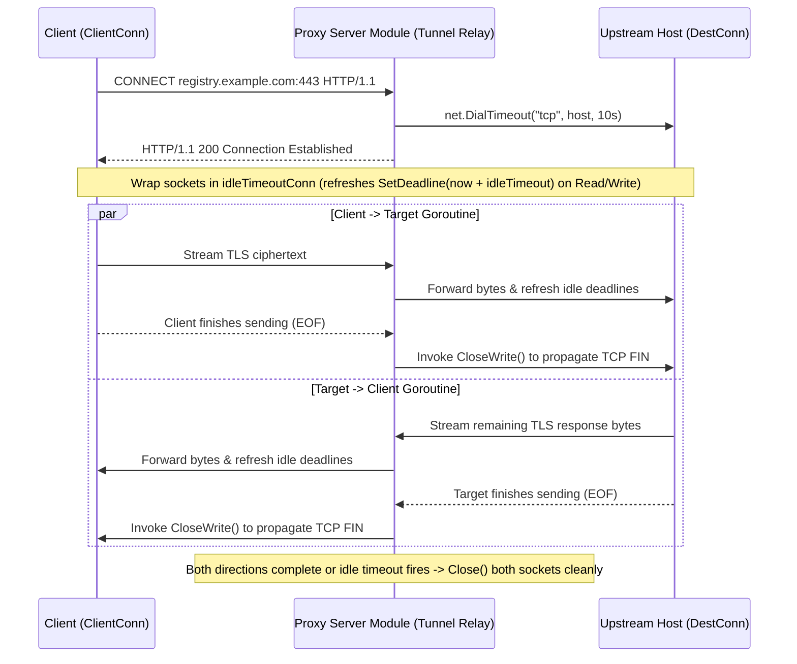

# Feature 335: CONNECT Tunnel Idle Timeout & Half-Close Recovery

## 1. Goal & Background

### 1.1 Problem Analysis
In `Feature 301 (Standard HTTP Forward Proxy)`, the Proxy Server Module supports establishing TCP tunnels via the HTTP `CONNECT` method for transparent HTTPS forwarding. However, an audit of the current tunnel relay implementation revealed two stability hazards:
1. **Unbounded Goroutine & Socket Leaks on Silent Connections**:
   - After hijacking the client connection (`Hijack`) and dialing the destination TCP host, the current implementation spawns two bare `io.Copy` goroutines without setting any read or write deadlines (`SetDeadline`) on either `clientConn` or `destConn`.
   - If a client container crashes abruptly, an intermediate NAT gateway silently drops state, or the remote host hangs without sending a TCP `FIN`/`RST`, both goroutines and their underlying socket file descriptors remain blocked on `Read` forever—gradually exhausting system file descriptors.
2. **Premature Full-Duplex Teardown on Unidirectional EOF**:
   - Currently, as soon as either `io.Copy` goroutine encounters an `EOF`, its `defer` block immediately invokes full `Close()` on both `destConn` and `clientConn`.
   - In standard TCP half-close scenarios (where a client finishes sending data and sends a `FIN` via `CloseWrite()` while still waiting to read the server's final response), closing both sockets immediately upon unidirectional `EOF` truncates in-flight response data traveling in the opposite direction.

### 1.2 Feature Objectives
As part of `Plan 330 (System Stability Hardening & Cache Governance Plan)`, `Feature 335` hardens HTTPS `CONNECT` tunneling with rolling idle timeouts and graceful TCP half-close propagation:
1. **Bidirectional Rolling Idle Deadlines**: Wrap both tunnel endpoints in a deadline-refreshing `net.Conn` wrapper that extends read/write deadlines on every successful transfer (default `5 minutes`). If a tunnel remains completely idle past the threshold, unblock and reclaim both sockets and goroutines immediately;
2. **Graceful TCP Half-Close Propagation**: When one direction reaches clean `EOF`, invoke `CloseWrite()` on the destination socket (when supported by the underlying `*net.TCPConn`) rather than tearing down the entire full-duplex connection prematurely;
3. **Clean Lifecycle Encapsulation**: Extract `CONNECT` handling into a dedicated `handleConnect` method that coordinates both relay goroutines via a `sync.WaitGroup` and guarantees deterministic socket cleanup.

---

## 2. Architecture & Lifecycle Design



---

## 3. Detailed Module Design

### 3.1 Proxy Server Module

#### 1. Rolling Idle Timeout Connection Wrapper (`idleTimeoutConn`)
Define a lightweight `net.Conn` wrapper that refreshes read and write deadlines on activity:
```go
type idleTimeoutConn struct {
    net.Conn
    idleTimeout time.Duration
}

func (c *idleTimeoutConn) Read(b []byte) (int, error) {
    if c.idleTimeout > 0 {
        _ = c.Conn.SetReadDeadline(time.Now().Add(c.idleTimeout))
    }
    return c.Conn.Read(b)
}

func (c *idleTimeoutConn) Write(b []byte) (int, error) {
    if c.idleTimeout > 0 {
        _ = c.Conn.SetWriteDeadline(time.Now().Add(c.idleTimeout))
    }
    return c.Conn.Write(b)
}
```

#### 2. Half-Close Interface & Relay Coordination (`handleConnect`)
Define the half-close capability interface:
```go
type closeWriter interface {
    CloseWrite() error
}
```
In `handleConnect`:
1. Default the tunnel idle timeout to `5 * time.Minute` (configurable on `Server` for fast unit testing);
2. Wrap `clientConn` and `destConn` with `idleTimeoutConn`;
3. When `io.Copy(dst, src)` finishes without error, if the underlying connection of `dst` implements `closeWriter`, call `CloseWrite()`; if `io.Copy` exits with a timeout or network error, close both connections to immediately unblock the peer goroutine;
4. Wait for both directional goroutines via `sync.WaitGroup` and ensure `clientConn.Close()` and `destConn.Close()` are executed on completion.

---

## 4. Verification & Test Criteria

1. **Silent Zombie Tunnel Idle Timeout Reclamation**:
   - Configure a `100ms` tunnel idle timeout in unit tests, establish a `CONNECT` tunnel, and send zero bytes;
   - Verify the tunnel automatically closes after ~`100ms` and both relay goroutines exit cleanly without leaks.
2. **Active Transfer Deadline Renewal**:
   - With a `150ms` tunnel idle timeout, transmit chunks every `50ms` over a total duration of `400ms`;
   - Verify rolling deadlines keep the tunnel alive across the entire transfer without premature disconnection.
3. **Unidirectional Half-Close Data Integrity**:
   - Have the client send a payload over the `CONNECT` tunnel and immediately call `CloseWrite()`, while the upstream server waits `50ms` before writing back its response;
   - Verify the client receives the complete response payload without truncation.
