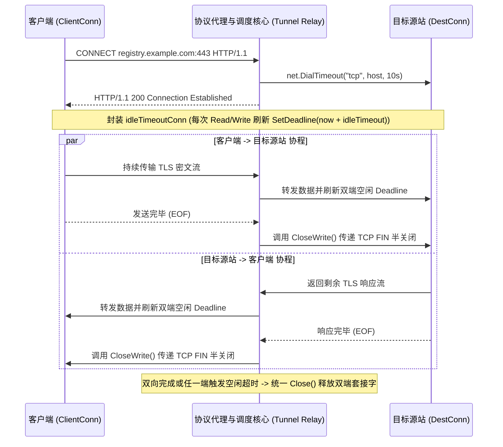

# Feature 335: CONNECT 隧道空闲超时与半关闭回收方案 (CONNECT Tunnel Idle Timeout & Half-Close Recovery)

## 1. 功能目标与背景 (Goal & Background)

### 1.1 现状痛点与风险剖析 (Problem Analysis)
在 `Feature 301 (标准 HTTP 正向代理)` 中，协议代理与调度核心支持通过 HTTP `CONNECT` 方法建立到目标源站的 TCP 隧道（用于标准正向代理模式下的 HTTPS 流量透传）。然而，审计现有的隧道转发实现发现存在两处严重的稳定性隐患：
1. **双向对拷协程无超时控制导致永久泄漏**：
   - 在劫持客户端连接（`Hijack`）并与目标主机建立 TCP 连接后，当前实现直接启动两个裸 `io.Copy` 协程执行双向字节流转发，**未在 `clientConn` 或 `destConn` 上设置任何读写超时（`SetDeadline`）**。
   - 当客户端容器非正常销毁、中间 NAT 网关静默丢弃连接表项，或远端主机挂起且未发送 TCP `FIN`/`RST` 包时，阻塞在 `Read` 系统调用上的两个协程与底层文件描述符（Socket FD）将永久驻留内存，随运行时间累积引发句柄耗尽。
2. **粗暴全关闭引发单向数据截断风险**：
   - 当前任一方向的 `io.Copy` 一旦遇到 `EOF` 退出，其 `defer` 语句会立即调用 `destConn.Close()` 与 `clientConn.Close()` 双向强行关闭整个连接。
   - 在标准 TCP 半关闭场景下（例如客户端发送完最后一段数据后率先关闭写端 `FIN`，但仍等待读取服务端返回的最终响应数据），单向 `EOF` 立即触发全连接关闭会导致另一方向尚在途的数据被强行截断。

### 1.2 建设目标 (Feature Objectives)
隶属于 `Plan 330 (系统稳定性加固与缓存治理方案)`，本特性旨在为 HTTPS `CONNECT` 隧道构建具备空闲超时自愈与优雅半关闭语义的稳态转发机制：
1. **双向滑动空闲超时（Rolling Idle Deadline）**：为隧道两端的 `net.Conn` 封装带超时刷新的读写包装器，每次成功读写数据时动态续期空闲超时（默认 `5 分钟`，或关联系统空闲超时阈值），一旦双向静默超过阈值立即中断阻塞并回收双端连接与协程；
2. **TCP 半关闭优雅传递（Half-Close Propagation）**：当单向 `io.Copy` 正常读取至 `EOF` 时，若目标连接支持 `CloseWrite()`（如 `*net.TCPConn`），优先执行半关闭通知对端，等待两个方向均完成传输或超时后再最终关闭底层套接字；
3. **主请求生命周期解耦**：将 `CONNECT` 隧道处理提取为协议代理与调度核心内独立清晰的处理方法，等待双向协程完全退出后统一释放连接资源。

---

## 2. 核心架构与隧道生命周期设计 (Architecture & Lifecycle Design)



---

## 3. 详细模块设计 (Detailed Module Design)

### 3.1 协议代理与调度核心 (Proxy Server Module)

#### 1. 滑动空闲超时连接包装器 (`idleTimeoutConn`)
定义轻量级连接包装结构体，在每次 `Read` 和 `Write` 操作前自动推迟连接的截止时间：
```go
type idleTimeoutConn struct {
    net.Conn
    idleTimeout time.Duration
}

func (c *idleTimeoutConn) Read(b []byte) (int, error) {
    if c.idleTimeout > 0 {
        _ = c.Conn.SetReadDeadline(time.Now().Add(c.idleTimeout))
    }
    return c.Conn.Read(b)
}

func (c *idleTimeoutConn) Write(b []byte) (int, error) {
    if c.idleTimeout > 0 {
        _ = c.Conn.SetWriteDeadline(time.Now().Add(c.idleTimeout))
    }
    return c.Conn.Write(b)
}
```

#### 2. 半关闭辅助接口与优雅转发 (`handleConnect`)
定义半关闭契约接口：
```go
type closeWriter interface {
    CloseWrite() error
}
```
在 `handleConnect` 中：
1. 默认设定隧道空闲超时为 `5 * time.Minute`（并允许在测试中通过 `Server` 字段自定义注入更短的超时值以便快速单测验证）；
2. 将劫持到的 `clientConn` 与拨号成功的 `destConn` 包装为 `idleTimeoutConn`；
3. 启动单向转发辅助函数：当 `io.Copy(dst, src)` 结束时，若 `dst` 底层连接实现了 `closeWriter`，则调用 `CloseWrite()` 通知对端写结束；若发生非 `EOF` 的超时或网络错误，则直接关闭连接以快速唤醒另一方向的阻塞读取；
4. 使用 `sync.WaitGroup` 等待双向协程均退出后，统一执行 `clientConn.Close()` 与 `destConn.Close()`。

---

## 4. 验证场景与测试标准 (Verification & Test Criteria)

1. **静默僵尸隧道超时自动回收验证**：
   - 在单元测试中设置隧道空闲超时为 `100ms`，客户端发起 `CONNECT` 建立隧道后保持完全静默不发送任何字节；
   - 验证隧道在约 `100ms` 后自动断开，双端连接关闭且转发协程 100% 退出，无协程泄漏。
2. **活跃传输持续续期验证**：
   - 设置隧道空闲超时为 `150ms`，客户端每隔 `50ms` 发送一次数据，持续 `400ms`（总时长超过单次空闲超时）；
   - 验证因每次读写动态刷新 Deadline，隧道保持正常连通且数据完整无损。
3. **单向半关闭（Half-Close）数据完整性验证**：
   - 客户端通过 `CONNECT` 隧道发送请求数据后立即调用 `CloseWrite()` 关闭写端，上游服务端延迟 `50ms` 后再返回响应数据；
   - 验证客户端仍能完整收到上游返回的全部响应字节，不会因客户端提前发送 `FIN` 而被代理粗暴截断。
