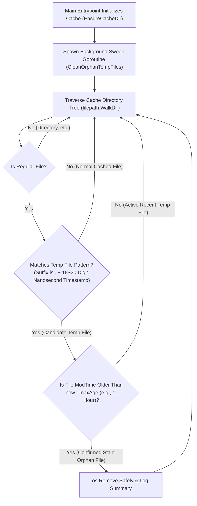

# Feature 336: Startup Orphan Temporary File Sweep & Auto-Cleanup

## 1. Goal & Background

### 1.1 Problem Analysis
In the Downloader Module's static file caching pipeline, when a Leader goroutine fetches an upstream artifact, it first streams data into a temporary file named `<finalName>.<unixNanoTimestamp>` inside the target cache directory (for example, `ubuntu/pool/main/c/curl/curl_7.81.0.deb.1728794857123456789`). Once the download finishes cleanly and all active Followers close their handles, `TryRename` atomically renames the temporary file to the final artifact name.
- **Normal Error Cleanup**: When a network error or watchdog timeout occurs during normal runtime, `TryRename` detects `job.Err != nil` and removes the incomplete temporary file via `os.Remove(job.TmpName)`.
- **Permanent Orphan Files After Abnormal Crashes**: If the `url-proxy` process is forcefully terminated mid-download (e.g., container OOM `SIGKILL`, host power loss, or abrupt container restart during deployment), the in-memory `DownloadJob` state is lost immediately. Upon restart, subsequent requests generate new nanosecond timestamps, leaving the incomplete `.<timestamp>` files permanently stranded on disk as **orphan temporary files** that are never reused or cleaned up—gradually wasting disk space.

### 1.2 Feature Objectives
As part of `Plan 330 (System Stability Hardening & Cache Governance Plan)`, `Feature 336` adds an automatic startup self-healing sweep to the Cache Module:
1. **Exact Pattern Matching**: Identify temporary download files strictly by their `.` + 19-digit nanosecond numeric suffix (`<finalName>.<unixNano>`), guaranteeing zero false positives against normal cached artifacts (such as `.deb`, `.tar.gz`, `.so.1`, or hex hashes);
2. **Modification Age Threshold Guard**: Only delete temporary files whose last modification timestamp (`ModTime`) is older than a safety threshold (default `1 hour`), preventing accidental deletion of actively downloading files in shared-volume deployments;
3. **Non-Blocking Asynchronous Startup Execution**: Run the directory walk asynchronously in a background goroutine after cache directory initialization so server startup and port binding remain instantaneous regardless of cache size.

---

## 2. Architecture & Cleanup Flow



---

## 3. Detailed Module Design

### 3.1 Cache Module
Introduce orphan temporary file detection and cleanup functions in the Cache Module:

```go
// IsTempCacheFile checks whether a filename matches the download temporary file pattern (<name>.<18~20 digit unixNano>)
func IsTempCacheFile(fileName string) bool

// CleanOrphanTempFiles walks cacheDir and removes temporary files with ModTime older than maxAge, returning the removed count
func CleanOrphanTempFiles(cacheDir string, maxAge time.Duration) (int, error)
```

#### Pattern Matching Rules (`IsTempCacheFile`)
1. Locate the last `.` in `fileName` (ensuring a non-empty base name precedes the dot) and extract the suffix `ext := fileName[lastDot+1:]`;
2. Verify `len(ext)` is between `18` and `20` characters (standard decimal representation of `time.Now().UnixNano()` is 19 digits) and every character in `ext` is an ASCII digit (`'0'`–`'9'`);
3. This rule cleanly distinguishes `pkg.deb.1728794857123456789` (`true`) from normal artifacts like `lib.so.1`, `node-v20.11.0.tar.gz`, or `Packages.bz2` (`false`).

### 3.2 Main Entrypoint
After `EnsureCacheDir` resolves the cache directory, launch the asynchronous sweep:
```go
go func() {
    if removed, err := cache.CleanOrphanTempFiles(resolvedCacheDir, 1*time.Hour); err != nil {
        log.Printf("orphan temp file cleanup error: %v", err)
    } else if removed > 0 {
        log.Printf("orphan temp file cleanup completed: removed %d stale files", removed)
    }
}()
```

---

## 4. Verification & Test Criteria

1. **Accurate Filename Pattern Recognition**:
   - Verify `curl.deb.1728794857123456789` returns `true`;
   - Verify normal artifact names such as `curl_7.81.0-1.deb`, `libssl.so.1.1`, `Packages.gz`, and `sha256.12345` return `false`.
2. **Selective Stale Orphan Removal**:
   - Create a simulated stale orphan file `test.whl.1700000000000000000` in a temporary test directory and backdate its `ModTime` by `2 hours` using `os.Chtimes`;
   - Also create a fresh temporary file `active.whl.1728794857123456789` (`ModTime = now`) and a normal cached file `valid.whl`;
   - Execute `CleanOrphanTempFiles(dir, 1*time.Hour)` and verify that only the stale orphan file is removed (returning `1`), while the active temporary file and normal cached file remain untouched.
