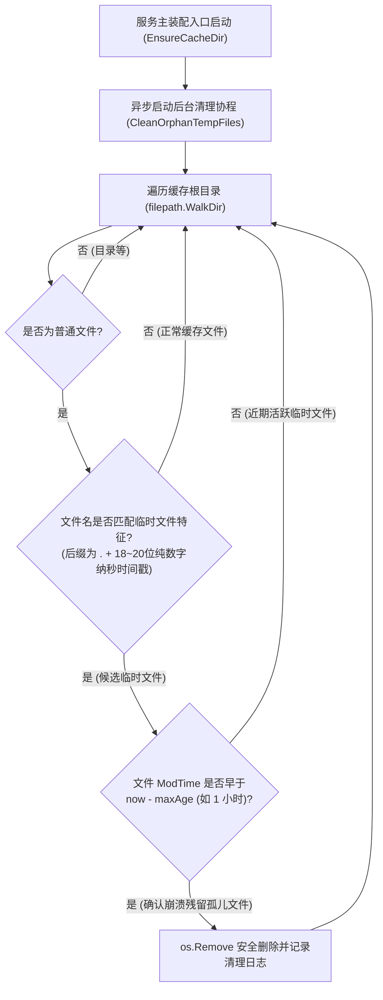

# Feature 336: 启动时孤儿临时文件扫描与自动清理方案 (Startup Orphan Temporary File Sweep & Auto-Cleanup)

## 1. 功能目标与背景 (Goal & Background)

### 1.1 现状痛点与风险剖析 (Problem Analysis)
在并发下载合并模块的静态缓存落盘设计中，Leader 协程在拉取上游文件时会先在目标缓存目录下创建名为 `<finalName>.<unixNanoTimestamp>` 的临时文件（例如 `ubuntu/pool/main/c/curl/curl_7.81.0.deb.1728794857123456789`），待完整下载无误且所有并发读取者（Followers）完成后，再通过 `TryRename` 原子重命名为最终文件名。
- **正常运行下的清理闭环**：当下载途中发生网络超时或看门狗取消时，`TryRename` 会检测到 `job.Err != nil` 并主动调用 `os.Remove(job.TmpName)` 删除残缺临时文件。
- **异常崩溃下的孤儿文件永久残留**：若 `url-proxy` 进程在下载中途遭遇不可捕获的强制终止（如容器 OOM 被系统 `SIGKILL`、宿主机断电重启或容器镜像升级强制销毁），内存中的 `DownloadJob` 状态瞬间丢失。重新启动后，新的下载请求会生成全新时间戳的临时文件，而崩溃前遗留的半截 `.<timestamp>` 临时文件将作为“孤儿文件（Orphan Temporary Files）”永久散落在缓存目录中，既无法被后续请求复用，也永远不会被自动清除，长期积累将白白蚕食磁盘空间。

### 1.2 建设目标 (Feature Objectives)
隶属于 `Plan 330 (系统稳定性加固与缓存治理方案)`，本特性旨在为缓存管理模块引入启动自愈的孤儿临时文件清理机制：
1. **精准模式识别**：基于临时文件命名特征（文件名以 `.` + 19 位纳秒级纯数字时间戳结尾），精准区分临时文件与合法的正常软件包缓存文件（如 `.1`、`.deb`、`.tar.gz` 等绝不误判）；
2. **安全年龄阈值保护（Age Threshold Guard）**：仅清理最后修改时间（`ModTime`）距今超过安全阈值（默认 `1 小时`，或在单进程独占启动阶段清理存量孤儿文件）的陈旧临时文件，彻底杜绝多实例共享目录或刚创建文件被误删的风险；
3. **非阻塞异步启动巡检**：在服务初始化缓存目录后以后台协程异步执行目录树巡检，确保即使缓存目录已有数万个历史文件，服务端口监听与启动耗时依然保持毫秒级零阻塞。

---

## 2. 核心架构与清理流程设计 (Architecture & Cleanup Flow)



---

## 3. 详细模块设计 (Detailed Module Design)

### 3.1 缓存管理模块 (Cache Module)
在缓存管理模块中新增孤儿临时文件识别与清理函数：

```go
// IsTempCacheFile 判断文件名是否符合下载临时文件命名格式 (<name>.<18~20位纳秒时间戳>)
func IsTempCacheFile(fileName string) bool

// CleanOrphanTempFiles 扫描指定缓存目录并删除修改时间超过 maxAge 的孤儿临时文件，返回清理文件数量
func CleanOrphanTempFiles(cacheDir string, maxAge time.Duration) (int, error)
```

#### 识别规则细节 (`IsTempCacheFile`)
1. 查找文件名最后一个 `.` 的位置，提取后缀 `ext := fileName[lastDot+1:]`（且 `.` 前面必须存在非空的主文件名）；
2. 校验 `len(ext)` 处于 `18 ~ 20` 字符之间（Go `time.Now().UnixNano()` 生成的十进制字符串固定为 19 位数字），且每个字符均为 `'0' ~ '9'` 纯数字；
3. 该规则可 100% 区分 `pkg.deb.1728794857123456789`（命中临时文件）与 `lib.so.1`、`node-v20.11.0.tar.gz`、`0123456789abcdef`（正常缓存文件，不命中）。

### 3.2 服务主装配入口 (Main Entrypoint)
在 `EnsureCacheDir` 成功解析并创建缓存目录后，启动异步清理：
```go
go func() {
    if removed, err := cache.CleanOrphanTempFiles(resolvedCacheDir, 1*time.Hour); err != nil {
        log.Printf("orphan temp file cleanup error: %v", err)
    } else if removed > 0 {
        log.Printf("orphan temp file cleanup completed: removed %d stale files", removed)
    }
}()
```

---

## 4. 验证场景与测试标准 (Verification & Test Criteria)

1. **临时文件名特征精准识别验证**：
   - 验证 `curl.deb.1728794857123456789` 被识别为临时文件（`true`）；
   - 验证正常包文件如 `curl_7.81.0-1.deb`、`libssl.so.1.1`、`Packages.gz`、`sha256.12345` 均返回 `false`，绝不误杀。
2. **过期孤儿临时文件自动清除验证**：
   - 在测试缓存目录中创建模拟孤儿文件 `test.whl.1700000000000000000`，使用 `os.Chtimes` 将其修改时间设为 `2 小时前`；
   - 同时创建修改时间为当前时刻的活跃临时文件 `active.whl.1728794857123456789` 与正常缓存文件 `valid.whl`；
   - 调用 `CleanOrphanTempFiles(dir, 1*time.Hour)`，验证仅过期的孤儿文件被删除（返回 `1`），活跃临时文件与正常缓存文件完好无损。
