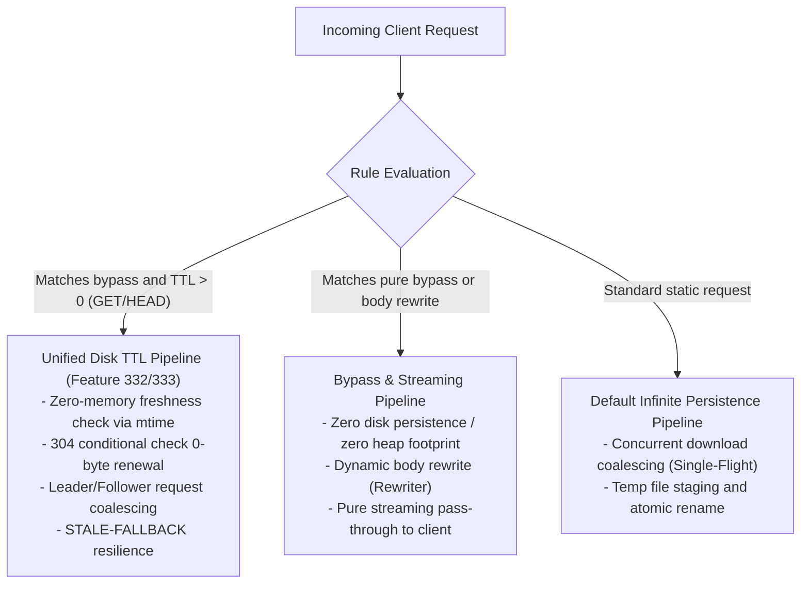

# Feature 337: Legacy In-Memory Soft TTL Cleanup & Cache Convergence Plan

## 1. Goal & Background

### 1.1 Problem Analysis & Architectural Reflection
During earlier feature iterations, the system introduced an in-memory soft TTL and caching mechanism to mitigate upstream rate-limiting (HTTP 429) caused by concurrent metadata queries. This mechanism stored metadata response bodies (`Data []byte`) and cloned HTTP headers inside in-process heap memory maps.
As the architecture progressed into `Plan 330`, comprehensive audits under long-running production environments and high concurrency established a modernized cache governance architecture centered around "100% disk persistence + zero-memory freshness validation via file modification time (`mtime`)" (namely `Feature 332` and `Feature 333`):
1. **Dead Code Generation & Branch Shadowing**: After the proxy dispatcher core was upgraded to route disk TTL requests, any GET/HEAD requests matching `TTL > 0` were intercepted early and dispatched to the disk TTL pipeline. Consequently, the legacy in-memory soft TTL branch in the bypass handler (including upstream conditional revalidation, 304 lease extension, and fallback) became 100% shadowed and unreachable dead code;
2. **Redundant Heap Memory & Component Lifecycle**: The in-memory TTL manager continued to be initialized in the main service entrypoint and injected through the proxy server entity, introducing unnecessary heap allocations and complicating component assembly dependencies;
3. **Ambiguous Architectural Semantics**: Having two nominal TTL caching mechanisms running simultaneously increased cognitive overhead and maintenance costs for testing and architectural evolution.

### 1.2 Feature Objectives
Subordinate to `Plan 330 (System Stability Hardening & Cache Governance Plan)`, this feature aims to completely remove the deprecated in-memory soft TTL module and unreachable dead code, consolidating the TTL caching pipeline:
1. **Completely Remove In-Memory TTL Component**: Safely strip the in-memory cache manager module, deleting its byte slice dictionary, mutexes, and associated lifecycle methods;
2. **Purge Dead Code from Proxy Dispatcher Core**: Fully remove the unreachable soft TTL branch in the bypass handler, ensuring the bypass pipeline focuses solely on streaming pass-through and response body rewriting;
3. **Simplify Service Construction & Dependency Injection**: Streamline the proxy server constructor parameters by eliminating the in-memory TTL manager dependency, maintaining simplicity and high cohesion in the main service entrypoint;
4. **Unified Convergence to Disk TTL Architecture**: Consolidate all bypass rules configured with the `ttl:` modifier into the disk TTL pipeline, entirely eliminating historical dual-track architectural debt.

---

## 2. Architecture Convergence Pipeline

---

## 3. Detailed Module Cleanup Design

### 3.1 Memory TTL Module
- Deprecate and remove the memory TTL manager module and its test suite;
- Eliminate all symbol imports referencing this module across the codebase.

### 3.2 Proxy Dispatcher Core
- **Server Entity Struct Simplification**: Remove the soft TTL manager reference field from the proxy server struct;
- **Constructor Signature Simplification**: Remove the soft TTL manager parameter from the server constructor and update all test instantiation calls accordingly;
- **Bypass Pipeline Dead Code Removal**: In the bypass handler, remove the dead soft TTL branch (freshness check, conditional revalidation, memory caching, and 304 lease refresh), streamlining the handler into pure streaming pass-through and response body rewriting.

### 3.3 Main Service Entrypoint
- Remove initialization calls for the memory TTL manager in the main application setup;
- Pass streamlined dependencies directly into the proxy server instance.
