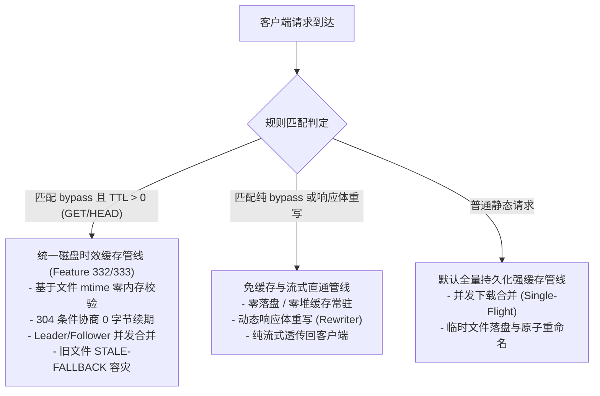

# Feature 337: 废弃内存软 TTL 机制清理与时效缓存收敛方案 (Legacy In-Memory Soft TTL Cleanup & Cache Convergence)

## 1. 功能目标与背景 (Goal & Background)

### 1.1 现状痛点与架构演进反思 (Problem Analysis & Architectural Reflection)
在早期功能迭代中，系统为解决高并发元数据拉取引发的源站限流（HTTP 429）问题，引入了内存软 TTL 与保鲜机制，将带 TTL 规则的元数据响应体（`Data []byte`）与响应头缓存在进程堆内存字典中。
随着系统演进至 `Plan 330` 阶段，通过深入的生产级长周期与高并发审计，确立了以“数据体 100% 磁盘落盘 + 基于文件修改时间（`mtime`）零内存开销时效校验”（即 `Feature 332` 与 `Feature 333`）为核心的新一代时效缓存体系：
1. **死代码产生与分支架空**：在协议代理与调度核心重构支持磁盘 TTL 后，凡是匹配 `TTL > 0` 的 GET/HEAD 请求均被调度核心前置拦截并路由至磁盘时效缓存管线，导致协议代理原免缓存处理流中的内存软 TTL 分支（包含条件回源、304 延长租期与容灾降级）被 100% 架空，沦为不可达死代码；
2. **堆内存与组件生命周期冗余**：内存软 TTL 管理器在服务主装配入口被初始化并贯穿注入至协议代理服务器实体中，不仅徒增堆内存常驻开销，还使服务装配依赖链路复杂化；
3. **架构语义模糊**：系统同时存在两套名义上的时效缓存处理逻辑，给后续维护与自动化测试带来了认知负担。

### 1.2 建设目标 (Feature Objectives)
隶属于 `Plan 330 (系统稳定性加固与缓存治理方案)`，本特性旨在彻底清理已废弃的内存软 TTL 模块及不可达代码，实现时效缓存管线的极简收敛：
1. **彻底移除内存软 TTL 组件**：安全剥离内存软缓存管理模块，移除响应体字节字典、互斥锁及相关生命周期方法；
2. **清理协议代理核心死代码**：彻底移除免缓存处理流程中被架空的软 TTL 分支代码，保持免缓存逻辑纯粹聚焦于流式透传与响应体重写；
3. **简化服务构造与依赖注入**：精简协议代理服务器的初始化参数列表，移除贯穿注入的软 TTL 管理器实例，使服务主装配入口保持高内聚与极简原则；
4. **统一收敛至磁盘 TTL 体系**：所有带 `ttl:` 修饰符的免缓存规则 100% 由磁盘时效缓存管线统一托管，彻底消除双轨制设计的历史技术债务。

---

## 2. 核心架构与处理管线收敛 (Architecture Convergence)

---

## 3. 详细模块清理设计 (Detailed Module Design)

### 3.1 内存软过期管理模块 (Memory TTL Module)
- 废弃并彻底移除内存软过期管理模块及其测试套件；
- 解除该模块与其他逻辑组件的任何符号引用。

### 3.2 协议代理与调度核心 (Proxy Core)
- **服务器实体结构精简**：从协议代理服务器结构体中移除软 TTL 管理器成员引用；
- **构造函数签名精简**：从协议代理服务器构造函数中移除软 TTL 管理器参数，更新各集成测试套件的初始化调用；
- **免缓存管线死代码剥离**：在免缓存处理函数中，完全移除原先不可达的软 TTL 保鲜期探测、内存回源协商、内存数据暂存及 304 续期分支，直接收敛至流式代理与响应体重写逻辑。

### 3.3 服务主装配入口 (Main Entrypoint)
- 移除服务主入口对内存软过期管理模块的初始化调用；
- 将精简后的组件依赖直接注入至协议代理服务器。
