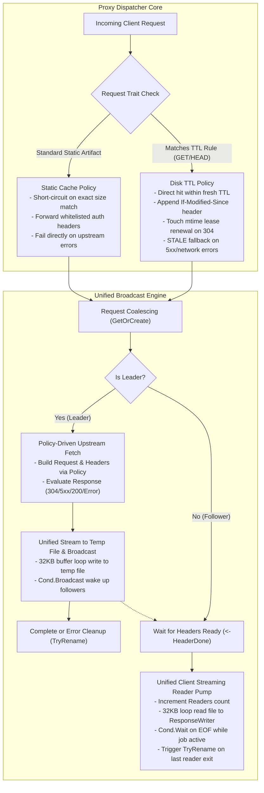

# Feature 338: Unified Concurrent Download & Broadcast Pipeline Plan

## 1. Goal & Background

### 1.1 Problem Analysis & Pipeline Duplication
During system evolution, the system initially introduced a "concurrent download coalescing mechanism" (single-flight) to mitigate upstream load when multiple clients concurrently pull the same binary artifacts. Subsequently, during the system stability hardening and cache governance stage, a dedicated "Disk TTL Pipeline" was independently developed to support zero-memory disk caching, freshness validation, and conditional revalidation for dynamic metadata like package indexes.

A thorough architectural audit and code comparison across both pipelines revealed severe redundancies and maintenance risks:
1. **Up to 85% Duplication in Core Streaming Multi-Broadcast Logic**:
   - **Leader Ingestion & Broadcast Pump**: Both pipelines mirror each other completely when creating temporary files, generating nanosecond-based filenames, reading upstream response streams via 32KB buffer loops, updating active timestamps, broadcasting to waiters via condition variables (`Cond.Broadcast`), and invoking atomic renames (`TryRename`) upon completion;
   - **Follower Streaming Consumer Pump**: Both implementations independently manage opening temporary files, tracking the active Readers counter, consuming through 32KB chunk loops, waiting on the condition variable (`Cond.Wait`) upon hitting `io.EOF` when the job is still active, and cooperatively executing atomic renames when the last Reader exits.
2. **Duplicated Non-200 Pass-Through & Anti-Pollution Bypass**:
   - Both pipelines independently handle non-200 upstream response interception, job pool de-registration, Leader streaming passthrough without disk caching, and Follower header propagation.
3. **Dual Maintenance Hazard & Divergence**:
   - Because the underlying transport mechanism is split across two separate implementations, minor behavioral discrepancies have emerged (e.g., redundant job removal calls in the standard download flow, inconsistent logging prefixes);
   - Any future optimizations or bug fixes applied to the streaming broadcast mechanism (such as buffer size tuning, client disconnection detection, cascading cancellation, or platform-specific file locking coordination) must be duplicated in two places, increasing the likelihood of regression and behavior drift.

### 1.2 Feature Objectives
Subordinate to the system stability hardening and cache governance architecture, this feature aims to decouple and consolidate the data streaming transport pipelines within the "Concurrent Downloader Module" and "Proxy Dispatcher Core":
1. **Abstract a Unified Streaming Ingestion & Broadcast Engine**: Sink the common lower-level concurrency pipelines—including Leader ingestion with live broadcasting, Follower catch-up consumption, Readers reference counting, and safe atomic renaming—into a single, unified execution engine;
2. **Separation of Policy and Mechanism**:
   - **Core Mechanism**: Dedicated solely to data staging, multi-subscriber broadcast coordination, and client streaming pumps;
   - **Upper-Level Policy**: Express "standard permanent caching" and "disk TTL freshness caching" as declarative policies that only differ during upstream request assembly, conditional negotiation (`If-Modified-Since` / 304 renewal), failure fallback (`STALE-FALLBACK`), and cache status header tagging;
3. **Eliminate Code Redundancy and Discrepancies**: Eliminate over 200 lines of duplicated concurrency control boilerplate and fix minor quirks such as duplicate task removal;
4. **Zero Breaking Changes & Backward Compatibility**: Preserve all existing caching semantics, status code handling, and external protocol behaviors with 100% test compatibility.

---

## 2. Architecture & Abstraction Model

### 2.1 Decoupled Pipeline Architecture

### 2.2 Core Policy Abstraction

Extract operational differences during the upstream fetch phase into lightweight declarative policies:

1. **Request Header Preparation Policy (`PrepareRequest`)**:
   - Static Mode: Forwards whitelisted headers (`If-Modified-Since`, `If-None-Match`, `Authorization`, `User-Agent`);
   - TTL Mode: Transparently relays all client headers and injects `If-Modified-Since` when a stale local file exists.
2. **Upstream Response Evaluation Policy (`HandleResponse`)**:
   - Static Mode:
     - Directly reuses local file if already cached with matching `Content-Length`;
     - Short-circuits on `304 Not Modified`;
   - TTL Mode:
     - On upstream `304 Not Modified`: Updates local file `mtime` to renew lease, sets `REVALIDATED-304`, and serves local file;
     - On upstream `>= 500` or network failure: Activates `STALE-FALLBACK` when local stale file exists;
     - On upstream `200 OK`: Tags response as `MISS-DISK-TTL`.
3. **Response Header Decoration Policy (`DecorateHeader`)**:
   - Injects cache status tracking headers (such as `X-Cache-Status`).

### 2.3 Unified Streaming Broadcast Engine

Encapsulate common operational primitives into reusable internal components:
- **`streamUpstreamToFile` (Leader Ingestion & Broadcast Pump)**: Handles 32KB loop reading from `resp.Body`, writing to temporary file, refreshing active timestamps, broadcasting to waiters, and executing file closure and rename attempts;
- **`streamFileToResponseWriter` (Unified Client Consumer Pump)**: Manages atomic Readers reference counting, safe file opening and fallbacks, 32KB loop writes to `ResponseWriter`, `io.EOF` and `job.Done` state coordination, `job.Cond.Wait` blocking suspension, and invoking `TryRename` upon the final Reader's departure;
- **Unified Non-200 Pass-Through**: Centralizes task pool de-registration and direct streaming bypass for non-200 responses.

---

## 3. Detailed Module Design

### 3.1 Concurrent Downloader Module
- Maintain stability in `DownloadJob` state machine and `Manager` pool lifecycle;
- Encapsulate the generic client consumer stream handler, centralizing Readers reference counting, file consumption, and rename triggers;
- Clean up minor redundancies such as duplicate `Manager.Remove` calls on error paths.

### 3.2 Proxy Dispatcher Core
- **Consolidate Download and Disk TTL Handlers**:
  - Extract the duplicated lower-level streaming control from the handler implementations;
  - Instantiate and pass specific cache policy configurations to the unified execution pipeline;
- **Standardize Request Header Relay**:
  - Replace fragmented ad-hoc forward header lists with policy-driven relaying;
- **Log Format Harmonization**:
  - Standardize log prefixes and context identifiers across Leader/Follower lifecycle events.

---

## 4. Implementation & Verification Plan

### 4.1 Implementation Roadmap
1. **Test Suite Construction**: Build dedicated automated test suites covering static concurrent downloads, disk TTL concurrent revalidations, 304 lease renewals, 5xx fallback degradations, and non-200 streaming bypasses;
2. **Streaming Execution Engine Abstraction**: Implement common streaming helper functions and policy contracts within the proxy core;
3. **Consolidate Handlers**: Refactor existing entry points to delegate to the unified engine, eliminating duplicated code;
4. **Full Regression Validation**: Execute all project test suites to verify 100% pass rate without regressions.

### 4.2 Verification Metrics
1. **Code Reduction**: Eliminate over 200 lines of duplicated streaming and concurrency control code;
2. **Functional Equivalence**:
   - Retain complete parity in single-flight coalescing, download resumption, and atomic renaming for static downloads;
   - Retain complete parity in freshness checks, 304 lease renewals, 5xx stale fallbacks, and `X-Cache-Status` headers for TTL caching;
3. **Zero External Dependencies & State Isolation**: Maintain pure Go standard library implementation without global state or locks;
4. **Automated Testing**: 100% pass rate across all unit and integration test suites.
