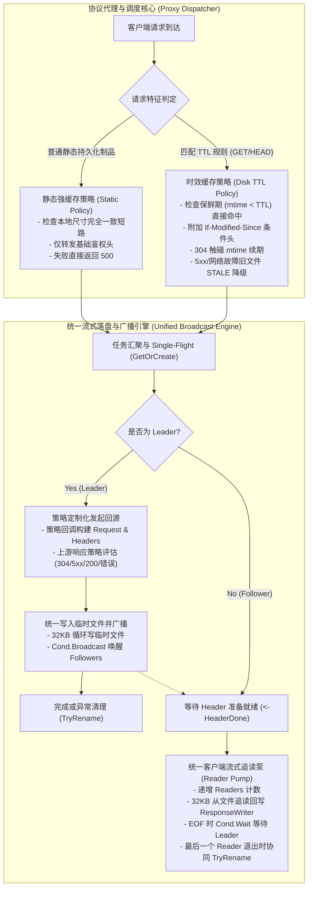

# Feature 338: 并发下载与时效缓存广播管线统合方案 (Unified Concurrent Download & Broadcast Pipeline Plan)

## 1. 功能目标与背景 (Goal & Background)

### 1.1 现状痛点与重合度深度剖析 (Problem Analysis & Pipeline Duplication)
在系统的演进过程中，为解决多客户端并发拉取同一制品的并发回源压力，系统在早期引入了“并发下载合并机制”；随后在稳定性加固与缓存治理阶段，为支持包索引等动态元数据的零内存时效缓存与条件更新，系统又独立实现了“磁盘时效缓存管线 (Disk TTL Pipeline)”。

经过对两条管线内部逻辑的深度审计与对比分析，暴露出以下严重的架构冗余与维护隐患：
1. **核心流式多路广播逻辑重复度高达 85%**：
   - **Leader 边下边存广播泵**：两条管线在建立临时文件、纳秒级命名、32KB 缓冲区逐块读取上游、更新活动时间戳、触发条件变量广播唤醒等待者（`Broadcast`）、以及末尾触发原子重命名的流程完全镜像复制；
   - **Follower 追读与文件流式推送泵**：两处均通过打开临时文件、跟踪 Readers 活跃读者计数、32KB 循环消费、遇 `EOF` 时结合任务完成状态执行条件等待（`Cond.Wait`）、并在最后一个读者退出时协同触发原子重命名，逻辑高度雷同。
2. **非 200 响应防污染与零落盘旁路重复实现**：
   - 两条管线分别独立实现了非 200 响应拦截、任务池反注册、Leader 客户端纯流式透传及唤醒 Follower 透传响应头的旁路逻辑。
3. **双重维护与演进脱节风险 (Dual Maintenance Hazard)**：
   - 由于核心底层并发传输被割裂为两处实现，导致两处的细节处理存在微小差异（如普通下载管线存在对任务池反注册的重复调用，两处对于 `reqID` 日志的前缀规范也不统一）；
   - 未来对流式广播机制的任何关键性能优化（例如缓冲区大小自适应调优、活跃客户端断开感知与级联取消、跨平台文件锁协同等）均需在两处重复编码与测试，极易引入行为分歧与回归隐患。

### 1.2 建设目标 (Feature Objectives)
本特性隶属于系统稳定性加固与缓存治理体系，旨在对“并发下载合并模块”与“协议代理与调度核心”中的数据传输骨干进行解耦与统合：
1. **抽象统一流式落盘与多路广播引擎**：将 Leader 回源边写边播、Follower 追赶消费、Readers 引用计数与安全原子重命名等通用的底层并发管道，下沉为统一的内部流式广播执行引擎；
2. **策略与机制彻底解耦 (Separation of Policy and Mechanism)**：
   - **底层机制**：专职负责数据流的落盘、多路广播协同与文件到客户端的流式推送；
   - **上层策略**：将“常规强缓存”与“磁盘 TTL 时效缓存”抽象为声明式策略，仅在上游请求构造、条件协商（`If-Modified-Since` / 304 续期）、故障降级（`STALE-FALLBACK`）及缓存状态标头打标阶段体现差异；
3. **消除代码冗余与行为分歧**：消灭超过 200 行高度重复的并发控制样板代码，彻底消除重复反注册等边缘缺陷；
4. **零破坏与向后兼容**：不改变任何现有的缓存语义、状态码处理策略与外部协议行为，现有集成测试套件 100% 保持兼容。

---

## 2. 架构设计与模型抽象 (Architecture & Abstraction Model)

### 2.1 机制与策略解耦架构 (Decoupled Pipeline Architecture)

### 2.2 核心策略抽象接口 (Fetch & Cache Policy)

将回源阶段的差异点提取为轻量级策略配置：

1. **请求头注入策略 (`PrepareRequest`)**：
   - 静态模式：转发白名单头（`If-Modified-Since`、`If-None-Match`、`Authorization`、`User-Agent`）；
   - TTL 模式：全量透传客户端头，并若本地存在旧文件则强制注入 `If-Modified-Since`。
2. **上游响应拦截与决策策略 (`HandleResponse`)**：
   - 静态模式：
     - 若本地已存在文件且尺寸与 `Content-Length` 一致，直接复用已存文件；
     - `304 Not Modified` 直接短路返回；
   - TTL 模式：
     - 上游返回 `304 Not Modified`：调用文件系统更新 `mtime` 续期租约，标记 `REVALIDATED-304` 并复用本地文件；
     - 上游返回 `>= 500` 或网络异常：若本地存在旧文件，激活 `STALE-FALLBACK` 容灾并复用本地文件；
     - 上游返回 `200 OK`：打标 `MISS-DISK-TTL`。
3. **响应头修饰策略 (`DecorateHeader`)**：
   - 注入特定缓存状态标头（如 `X-Cache-Status`）。

### 2.3 统一流式广播执行器 (Unified Streaming Broadcast Engine)

将以下通用操作彻底封装为单一执行实体：
- **`streamUpstreamToFile` (Leader 写入与广播泵)**：负责 32KB 循环读取 `resp.Body`、写入临时文件、记录活跃时间戳、条件变量广播、以及完成后的关闭与重命名尝试；
- **`streamFileToResponseWriter` (统一追读消费泵)**：负责 Readers 原子计数维护、文件打开与安全兜底、32KB 循环向客户端回写、`io.EOF` 与 `job.Done` 状态同步判定、`job.Cond.Wait` 阻塞挂起、以及在最终 Reader 离开时触发 `TryRename`；
- **非 200 响应统一旁路**：统一处理非 200 响应的反注册与流式直出通道，杜绝双重反注册缺陷。

---

## 3. 详细改造与模块分工设计 (Detailed Module Design)

### 3.1 并发下载合并模块 (Downloader Module)
- 保持 `DownloadJob` 状态机与 `Manager` 任务池的稳定；
- 封装通用的 `PumpToClient` 消费流处理函数，集中管理 Readers 引用计数、文件追读与重命名触发；
- 修复 `Manager.Remove` 在异常分支中被多处重复调用的偶发冗余。

### 3.2 协议代理与调度核心 (Proxy Core)
- **常规下载管线与磁盘 TTL 管线重组**：
  - 将原 `handleDownload` 与 `handleDiskTTL` 的主体剥离出重复的底层并发流控；
  - 提取两套业务策略实现对象；
  - 统一调用底层的聚合下载与广播协调函数；
- **请求头转发规范化**：
  - 消除各自硬编码的局部转发逻辑，统一通过策略驱动头转发；
- **日志一致性收敛**：
  - 统一 Leader/Follower、回源拉取、广播消费与流式退出的日志前缀与格式，降低故障排查复杂度。

---

## 4. 实施规划与验收指标 (Implementation & Verification)

### 4.1 实施步骤
1. **测试套件先行**：建立针对并发广播管线重构的独立测试套件，全面覆盖静态强缓存并发下载、磁盘 TTL 并发重验证、304 续期广播、5xx 降级容灾及客户端非 200 透传场景；
2. **抽象通用广播与消费管道**：在协议代理与调度核心中实现公共流式执行函数，完成策略抽象；
3. **收敛常规下载与磁盘 TTL 流程**：使用统一管道重构两处入口，移除重复代码；
4. **全量回归验证**：运行全量自动化测试，确保 100% 通过且无功能回退。

### 4.2 验收指标
1. **代码精简度**：消除 200 行以上重复的流式读写与并发控制代码；
2. **功能与协议完全等价**：
   - 普通下载的多客户端合并回源、断点感知、临时文件原子重命名行为保持完全一致；
   - 磁盘 TTL 机制的保鲜期判定、并发合并、304 mtime 续期、5xx 旧文件降级与 `X-Cache-Status` 标头保持完全一致；
3. **零外部依赖与状态隔离**：完全使用 Go 标准库，无全局变量与非必要锁引入；
4. **自动化测试**：所有单元测试与集成测试套件执行通过。
