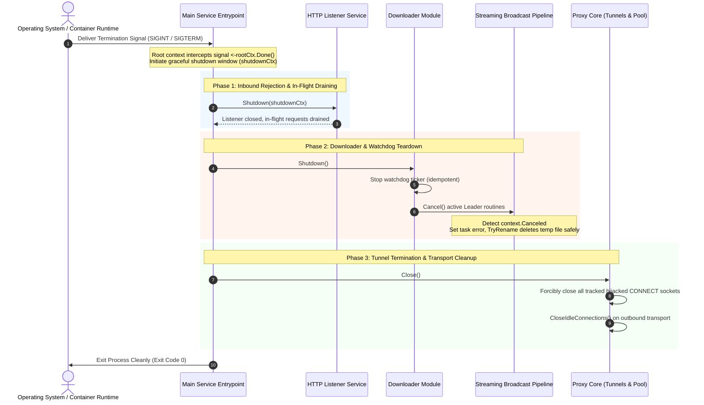

# Feature 339: Graceful Shutdown & Process Lifecycle Governance Plan

## 1. Goal & Background

### 1.1 Problem Analysis & Production Hazards
Throughout the architectural evolution of the system, features such as concurrent download coalescing, idle watchdog inspection, on-disk streaming temporary caching, and HTTPS CONNECT tunneling were introduced to tackle heavy concurrent upstream traffic and metadata relaying. However, in the main service entrypoint, the HTTP server was started directly via a synchronous blocking call. This led to serious operational hazards and lifecycle vulnerabilities:
1. **Immediate Process Termination & Defers Bypassed**:
   - When the process receives termination signals (such as `SIGINT` / `SIGTERM`, container teardown notifications, or service manager stop commands), the operating system forcibly aborts the process due to the absence of signal interception and root context propagation;
   - Forcible termination completely bypasses all deferred cleanup hooks registered in the main function (such as stopping the background watchdog routine of the download coalescing manager), violating the resource management contract.
2. **Abrupt In-Flight Request Truncation**:
   - Active client requests fetching artifacts are abruptly cut off with TCP connection resets (`ECONNRESET`) or premature closures. Clients cannot differentiate server maintenance from system crashes, frequently triggering severe retry storms.
3. **Partial Temp File Leakage & Cache Corruption Risk**:
   - If an asynchronous Leader download routine is killed mid-stream, incomplete temporary files remain orphaned on disk;
   - If the streaming pipeline encounters a cancellation (`context.Canceled`) without recording it as an explicit task failure, the trailing finalization logic risks mistakenly promoting the truncated `.tmp` file into the permanent cache directory, resulting in corrupted cache entries.
4. **Unmanaged Hijacked Tunnels & Connection Pool Leaks**:
   - The HTTPS proxy hijacks the underlying TCP socket upon `CONNECT` negotiation. The standard library's `http.Server.Shutdown()` is unaware of hijacked connections and will not close them;
   - Outbound HTTP keep-alive connection pools in the upstream transport layer lack active termination during process shutdown, potentially leaving remote sockets dangling.

### 1.2 Feature Objectives
Belonging to the system stability and lifecycle governance framework, this feature establishes a comprehensive, end-to-end graceful shutdown mechanism covering signal interception, in-flight request draining, download task cancellation with temp file cleanup, and long-lived tunnel/connection pool release:
1. **System Signal Interception & Root Context**: Intercept system-level termination signals (`SIGINT` and `SIGTERM`) at the main service entrypoint and derive a cancellable root application context;
2. **In-Flight HTTP Request Draining**: Stop accepting new inbound connections upon signal arrival while safely draining active standard HTTP requests within a configurable grace period;
3. **Coordinated Download Task Abort & Temp File Cleanup**:
   - Provide a unified shutdown interface on the download coalescing manager that idempotently terminates background watchdog routines;
   - Actively cancel all in-flight Leader upstream jobs, ensuring that incomplete downloads reliably delete their partial temporary files rather than polluting the cache;
4. **Active Hijacked Tunnel Termination & Transport Pool Teardown**:
   - Maintain a thread-safe registry of active hijacked CONNECT tunnels in the proxy core and close both client and destination sockets during shutdown to unblock streaming relays;
   - Explicitly close idle keep-alive connections on the outbound HTTP transport layer;
5. **Zero External Dependencies & Backward Compatibility**: Rely strictly on the Go standard library without introducing any global state or altering existing cache and proxy semantics.

---

## 2. Architecture & Shutdown Pipeline

### 2.1 Graceful Shutdown Sequence

---

## 3. Detailed Module Design

### 3.1 Main Service Entrypoint
- **Signal Listening & Lifecycle Coordination**:
  - Intercept `SIGINT` and `SIGTERM` using standard library signal context utilities;
  - Run the HTTP server listener in a dedicated background goroutine while the main thread waits on a multiplexed channel selector;
  - Apply a cohesive 15-second graceful shutdown grace window;
  - Sequentially coordinate HTTP draining, downloader task pool shutdown, and proxy core connection reclamation.

### 3.2 Downloader Module
- **Idempotent Watchdog Teardown**:
  - Incorporate a synchronization barrier into the manager to ensure that watchdog stop routines can be safely invoked multiple times without channel panics;
- **Active In-Flight Job Cancellation (`Shutdown`)**:
  - Expose a unified shutdown method on the manager that halts the watchdog routine;
  - Under mutex protection, traverse all registered jobs and invoke their cancellation callbacks to abort hanging upstream downloads.

### 3.3 Proxy Core
- **Anti-Pollution Pipeline Hardening**:
  - In the streaming upstream transfer loop, explicitly record `context.Canceled` as a job error;
  - Ensure that the trailing rename guard detects the error state and safely removes uncompleted temporary files, preventing corrupted data from entering the cache store;
- **Hijacked Tunnel Tracking & Active Termination**:
  - Maintain a thread-safe registry of active hijacked connections within the proxy server entity;
  - Register both client and destination sockets upon tunnel establishment and unregister them upon completion or error;
  - In the proxy server's closing method, iterate through active sockets and close them to unblock relay routines immediately;
- **Outbound Transport Connection Pool Teardown**:
  - In the proxy closing sequence, invoke idle connection cleanup on the outbound HTTP transport layer to release persistent TCP sockets cleanly.

---

## 4. Implementation & Verification Plan

### 4.1 Implementation Steps
1. **Test Suite First**: Construct the dedicated test suite `tests/339_graceful_shutdown/` covering in-flight draining, cancellation with temp file cleanup, tunnel termination, and pool reclamation;
2. **Downloader & Pipeline Hardening**: Implement the manager shutdown method and guarantee precise error assignment on task cancellation;
3. **Proxy Core Tunnel Tracking**: Add thread-safe connection tracking and the closing routine to the proxy server entity;
4. **Main Entrypoint Lifecycle Orchestration**: Modernize the main startup sequence with signal listening and multi-phase shutdown orchestration;
5. **Full Regression Testing**: Run all workspace tests to verify 100% backward compatibility.

### 4.2 Verification Metrics
1. **Graceful Draining Guarantee**: New connections are rejected immediately upon shutdown trigger, while existing in-flight transfers complete successfully within the grace period;
2. **Zero Cache Pollution**: Incomplete downloads canceled during shutdown cleanly remove their temporary files without promoting them to final cache files;
3. **Instant Tunnel Reclamation**: Active CONNECT tunnels terminate and release their background relay goroutines within milliseconds of the shutdown call;
4. **Lifecycle Call Safety**: Repeated invocations of watchdog stops and manager shutdowns are 100% idempotent with zero panics or deadlocks;
5. **Pure Standard Library**: Fully implemented using Go standard library primitives with zero external dependencies.
