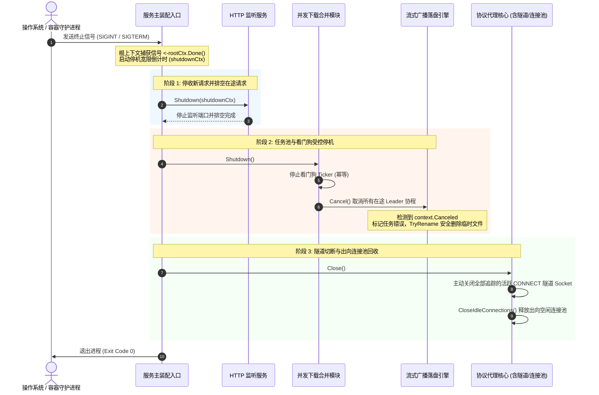

# Feature 339: 优雅停机与进程生命周期治理方案 (Graceful Shutdown & Process Lifecycle Governance Plan)

## 1. 功能目标与背景 (Goal & Background)

### 1.1 现状痛点与生产级风险剖析 (Problem Analysis & Production Hazards)
在系统的演进过程中，为应对高并发场景下的资源合并、时效缓存与长连接代理需求，系统相继引入了并发下载合并、后台看门狗轮询巡检、磁盘临时文件落盘以及 HTTPS 隧道代理等机制。然而，在服务主装配入口处，HTTP 服务直接通过阻塞调用启动，导致服务在接收到停止信号时的生命周期治理存在严重缺陷：
1. **进程异常直杀与资源析构旁路**：
   - 当收到系统中断或终止信号（如 `SIGINT` / `SIGTERM`、容器销毁信号或系统服务管理器的停止指令）时，由于缺乏针对操作系统信号的监听与上下文拦截机制，操作系统将直接强行终止进程；
   - 强行终止导致主函数中注册的所有延迟析构调用（如并发下载合并模块的看门狗停止逻辑）被完全跳过，破坏了模块的生命周期契约。
2. **在途客户端流量突发断裂 (In-Flight Request Truncation)**：
   - 正在拉取制品的客户端在进程强杀瞬间直接遭遇连接重置（TCP RST）或意外断开，客户端无法感知服务端的真实意图，直接表现为拉取报错并触发非必要的重试风暴。
3. **未完成下载落盘污染与孤儿临时文件残留**：
   - 后台 Leader 协程在拉取大文件过程中若突然随进程强杀中断，未下载完整的临时文件将直接遗留于磁盘中；
   - 核心流式落盘广播管线在遭遇上下文取消（`context.Canceled`）时，若未将取消状态显式标定为任务错误，将存在将残缺临时文件误重命名为正式缓存文件的严重数据污染隐患。
4. **长连接与隧道资源回收盲区**：
   - HTTPS 穿透代理在完成连接劫持（Hijack）后接管了底层 TCP Socket，标准 HTTP 服务的常规停机逻辑无法感知且不会主动中断被劫持的长连接；
   - 出向上游 HTTP 客户端的保活连接池在停机时亦缺乏主动释放，容易引发上游服务器侧的静默悬挂。

### 1.2 建设目标 (Feature Objectives)
本特性隶属于系统稳定性加固与生命周期治理体系，旨在构建覆盖信号拦截、请求安全排空、下载任务安全中止与临时文件清理、长连接隧道与连接池彻底回收的闭环优雅停机机制：
1. **系统级信号拦截与根上下文派生**：在服务主装配入口统一监听系统级中断与终止信号，建立服务根级可取消上下文；
2. **在途 HTTP 请求平稳排空 (Graceful Draining)**：在接收到停机信号后，立即停止监听并拒绝新连接接入，但在可配置的宽限超时窗口内等待在途正常请求处理完毕；
3. **并发下载任务协同中止与安全清理**：
   - 任务池管理器提供统一的停机接口，原子停止后台看门狗轮询；
   - 遍历并主动取消所有在途 Leader 回源任务，确保未完成任务在断开后 100% 清理对应的临时文件，严禁污染正式缓存库；
4. **长连接隧道主动回收与出向连接池释放**：
   - 协议代理核心维护被劫持活跃隧道的生命周期追踪账本，在停机阶段主动切断双端 Socket，打破阻塞读写；
   - 主动关闭出向 HTTP 客户端的空闲连接池，实现对外长连接的优雅断开；
5. **零外部依赖与完全向后兼容**：严格基于 Go 标准库实现，不改变现有的缓存语义与协议代理逻辑。

---

## 2. 核心架构与处理序列 (Architecture & Shutdown Pipeline)

### 2.1 优雅停机生命周期时序图 (Shutdown Sequence)

---

## 3. 详细模块设计与职责划分 (Detailed Module Design)

### 3.1 服务主装配入口 (Main Entrypoint)
- **信号监控与生命周期调度**：
  - 通过标准库信号上下文监听 `SIGINT` 与 `SIGTERM`；
  - 将 HTTP 服务的监听运行置于独立协程，主协程通过通道多路复用阻塞监听服务启动错误或停机信号；
  - 采用内聚的 15 秒优雅停机宽限窗口；
  - 信号到达后，依序调度 HTTP 服务排空、并发下载合并模块关闭以及协议代理核心长连接清理。

### 3.2 并发下载合并模块 (Downloader Module)
- **看门狗停止幂等性防护**：
  - 为任务池管理器引入单次同步保护屏障，保证看门狗停止方法在被显式调用或延迟调用多次时保持安全幂等，杜绝通道重复关闭引发的崩溃；
- **全量在途任务主动取消 (`Shutdown`)**：
  - 任务池提供统合停机入口，首先终止后台看门狗轮询；
  - 随后持有任务互斥锁遍历活跃任务字典，针对每一个仍具有取消函数的在途 Leader 任务触发取消回调，协同唤醒挂起的回源读取。

### 3.3 协议代理与调度核心 (Proxy Core)
- **流式广播管线防污染加固**：
  - 在底层流式回源循环中，针对遭遇上下文取消（`context.Canceled`）的分支，显式为任务记录取消错误；
  - 确保任务在退出重命名防护逻辑时，准确识别出错误状态并立即清除残留的临时文件，坚决禁止将未完成文件提升为正式缓存文件；
- **活跃隧道追踪与主动销毁**：
  - 在协议代理服务器实体中维护活跃被劫持网络连接的并发安全索引；
  - 针对 HTTPS 隧道请求，在劫持连接成功并连通目标后注册双端 Socket，并在传输结束或异常时注销；
  - 在核心关闭方法中，遍历索引并主动关闭所有活跃隧道连接，解除底层双向数据搬运协程的阻塞；
- **出向传输连接池释放**：
  - 在核心关闭方法中，主动调用出向 HTTP 客户端传输层的空闲连接清理接口，向各上游主机优雅释放 TCP 保活连接。

---

## 4. 实施规划与验收指标 (Implementation & Verification)

### 4.1 实施步骤
1. **测试套件先行**：建立针对优雅停机与进程生命周期的独立测试套件 `tests/339_graceful_shutdown/`，覆盖在途请求排空、下载取消防落盘、隧道切断与连接释放等完整场景；
2. **下载模块与管线加固**：实现任务池管理器停机方法与流式管线取消状态精准标定；
3. **代理核心隧道追踪与释放**：为协议代理服务器引入连接追踪记账与主动关闭功能；
4. **主入口生命周期编排**：重塑服务主函数运行模型，接入信号监听与多阶段停机序列；
5. **全量回归验证**：运行全量自动化测试，确保原有特性 100% 保持兼容。

### 4.2 验收指标
1. **优雅排空保障**：触发停机后，新接入请求立即被拒绝，但在途已有请求在宽限期内能完整顺利完成数据接收；
2. **零数据污染与临时文件清理**：在途下载被停机取消时，临时文件即刻被安全删除，正式缓存目录绝不产生破损文件；
3. **劫持隧道瞬时回收**：停机指令下达后，原本无超时的活跃隧道在毫秒级内全部响应断开并释放协程；
4. **生命周期调用安全**：反复调用停机与看门狗关闭逻辑具备 100% 幂等性，零死锁与零崩溃；
5. **纯标准库与状态隔离**：完全基于 Go 标准库实现，不引入任何全局变量或外部依赖。
