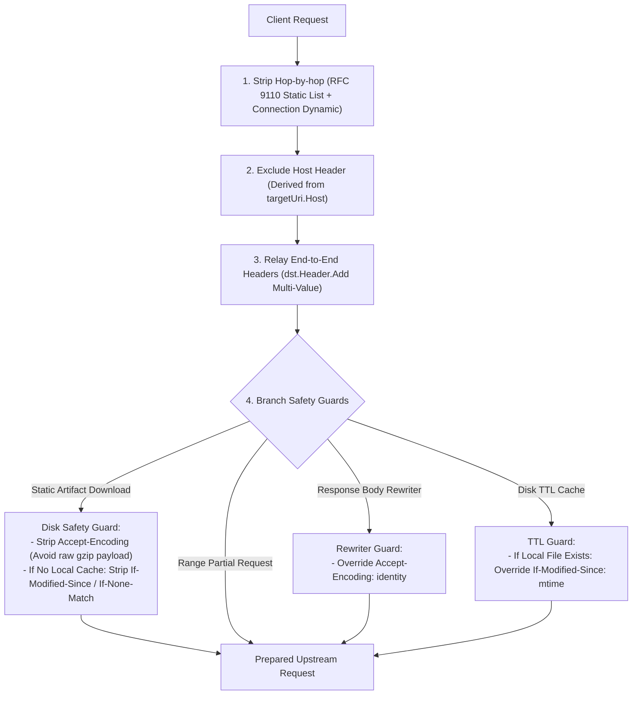

# Feature 341: Request Header Full Relay & Hop-by-Hop Filtering Plan

## 1. Goal & Background

### 1.1 Problem Analysis
In the current request dispatching and outbound fetching pipelines, different request branches maintain isolated logic for building upstream request headers, causing severe fragmentation and protocol inconsistencies:
1. **Restrictive Whitelists Hindering Multi-Ecosystem Compatibility**:
   - The static artifact download branch forwards only four headers: `If-Modified-Since`, `If-None-Match`, `Authorization`, and `User-Agent`.
   - The HTTP Range request branch forwards only six headers: `Range`, `If-Range`, `If-Modified-Since`, `If-None-Match`, `User-Agent`, and `Authorization`.
   - Both primary binary artifact pipelines **omit the critical `Accept` header**, preventing mirrors that rely on strict content negotiation (such as Docker Registry OCI/Manifest format negotiation) from returning the expected manifests.
   - Private mirror authentication credentials (`Cookie`, `X-Auth-Token`, `Private-Token`) and package manager telemetry headers (`npm-session`, `cargo-audit`) are silently discarded across most branches.
2. **Silent Truncation of Multi-Value Headers**:
   - The static download, Range partial, and no-cache branches retrieve and assign single values (`Get`/`Set`). When a client sends multiple headers with the same name (such as multiple `Accept` headers or tiered credentials), only the first value is forwarded while all subsequent values are discarded.
3. **Maintenance Burden & Duplication**:
   - Four distinct whitelist slices are hardcoded across multiple files, meaning any new header addition requires changes across disparate locations.

### 1.2 Four Derivative Risks of Blind Full Relay & RFC Basis (Adversarial Risks & RFC Basis)
Relaying all client headers blindly without proxy-aware and cache-aware defenses will introduce severe secondary failures:
1. **`Accept-Encoding` Penetration Polluting Disk Cache with Compressed Artifacts (P0 Hazard)**:
   - Clients (browsers, modern package managers) routinely send `Accept-Encoding: gzip, deflate, br`.
   - If this header is forwarded verbatim to upstream, Go's standard library `http.Transport` **disables transparent decompression**. Upstream gzip-compressed streams would be written directly to disk as `.deb`, `.whl`, or `.tgz` artifacts. Subsequent requests hitting the cache will fail integrity checks with `Hash Sum mismatch` errors.
   - **Client Compatibility Clarification (RFC 9110 Section 12.5.3)**: A client's `Accept-Encoding: gzip` declares capability rather than an obligation. The specification asserts that uncompressed representation (`identity`) is always acceptable. When the proxy returns uncompressed content without a `Content-Encoding` header, all compliant clients parse it seamlessly without error or warning.
2. **`Host` Header Penetration Breaking Upstream CDN / Virtual Hosts (P0 Hazard)**:
   - The client's `Host` header targets the proxy itself. Forwarding it upstream causes CDNs (Cloudflare, Fastly) to reject requests with `403 Forbidden`, `404 Not Found`, or `421 Misdirected Request` due to SNI/Host mismatches. The outbound `Host` must be strictly derived from the target upstream URI.
3. **Relaying Conditional Headers without Local Cache Causing Singleflight Empty 304 Failures (P0 Hazard)**:
   - When Client A (with a local client-side stale file) sends `If-None-Match`, while the proxy's local cache has no file, forwarding this header causes upstream to return an empty 304 response.
   - Under request coalescing (Singleflight), concurrent Follower B (requesting a fresh download without local cache) also receives the empty 304 and fails, while the proxy fails to persist a full 200 OK file to disk.
4. **Dynamic Hop-by-Hop Header Penetration (RFC 9110 Violation)**:
   - RFC 9110 states that beyond predefined static hop-by-hop headers, any header listed in the value of the `Connection` header is also hop-by-hop and must be stripped.

### 1.3 Feature Objectives
This feature refactors the outbound request header assembly pipeline to eliminate whitelist restrictions while establishing rigorous cache and protocol safety defenses:
1. **Full End-to-End Relay with Multi-Value Preservation**: Relay all client request headers to upstream servers by default (retaining multi-value slice semantics), stripping only standard and dynamic hop-by-hop headers.
2. **Strict Hop-by-Hop Header Stripping**: Conform to RFC 9110 by stripping static hop-by-hop headers and dynamic headers enumerated in `Connection`.
3. **Establish Rigorous Branch Safety Guards**:
   - **`Host` Isolation Guard**: Strictly derive outbound `Host` from the target upstream URI; never inherit from the client.
   - **Compression Pollution Guard**: Explicitly strip client `Accept-Encoding` in static artifact download branches to guarantee that raw binary artifacts are written to disk.
   - **Conditional Request Guard**: In static download branches, **only construct conditional requests when a local cached file actually exists**. When no local cache is present, strip client `If-Modified-Since` and `If-None-Match` to guarantee upstream returns a full 200 OK for caching.
   - **Body Rewriter Guard**: Override `Accept-Encoding: identity` for eligible rewrite targets.
   - **Disk TTL Guard**: Override `If-Modified-Since` with the local file modification time when an existing cache file is present.
4. **Eliminate Redundant Whitelist Slices**: Deprecate all hardcoded whitelist arrays and manual loops in favor of a single unified relay function.
5. **Zero Disruption & Full Backward Compatibility**: Maintain 100% compatibility across existing repository ecosystem proxying, cache hits, and revalidation behaviors.

---

## 2. Architecture & Abstraction Model

### 2.1 Request Header Relay & Branch Guards Pipeline

### 2.2 Hop-by-Hop & Protected Header Blocklist (RFC 9110 Section 7.6.1)
The following headers must be stripped from outbound requests:
- `Connection` (and all headers listed in its value)
- `Proxy-Connection`
- `Keep-Alive`
- `Proxy-Authenticate`
- `Proxy-Authorization`
- `Te`
- `Trailer`
- `Transfer-Encoding`
- `Upgrade`
- `Host` (Managed independently via `http.Request.Host`)

### 2.3 Module Integration Responsibilities
- **Proxy Dispatcher**:
  - Integrate the unified request header relay function across HTTP HEAD, HTTP Range partials, and no-cache/rewriter branches.
  - Inject `Accept-Encoding: identity` for eligible rewrite requests.
- **Downloader Module**:
  - Integrate the unified request header relay function within static download and disk TTL policy implementations when preparing Leader requests.
  - Execute compression pollution protection (strip `Accept-Encoding`) and un-cached conditional header stripping in static download policy.
  - Allow disk TTL policy to override `If-Modified-Since` using the existing local file timestamp.

---

## 3. Acceptance Criteria & Verification Plan

### 3.1 Core Verification Scenarios
1. **Multi-Value Header Fidelity**: When a client sends multiple headers with the same key (e.g., multiple `Accept` headers or custom `X-Custom-Multi`), the upstream mock server receives the entire slice without truncation.
2. **Ecosystem Critical Header Relay**: When a client sends `Accept: application/vnd.docker.distribution.manifest.v2+json`, `Cookie: session=123`, or `X-Private-Token: secret`, all request branches forward them intact to upstream.
3. **Hop-by-Hop Header Stripping**: Headers such as `Connection: keep-alive, X-Custom-Hop`, `Proxy-Connection: keep-alive`, and `Transfer-Encoding: chunked` are completely stripped along with dynamically declared `X-Custom-Hop`.
4. **Host Header Integrity**: When the client sends `Host: proxy-local`, the upstream request header contains `Host` matching the upstream target host.
5. **Static Download Compression Guard**: When a client sends `Accept-Encoding: gzip` during static download, `Accept-Encoding` is stripped from the upstream request, ensuring raw uncompressed files are cached.
6. **Un-cached Conditional Header Stripping**: When no local cache exists and a client sends `If-None-Match`, the header is stripped, ensuring upstream returns 200 OK and Followers receive full content.

### 3.2 Deliverables Checklist
- Feature specification documents: `docs/plans/341-request-header-relay-and-hop-by-hop-filtering-zh.md` and English counterpart;
- Independent test suite: `tests/341_request_header_relay/` with bilingual testing documentation, upstream mock server, and Go test suite;
- Logical module enhancements: Proxy Dispatcher and Downloader Module integrated with unified relay mechanics, deprecating legacy slice definitions.
