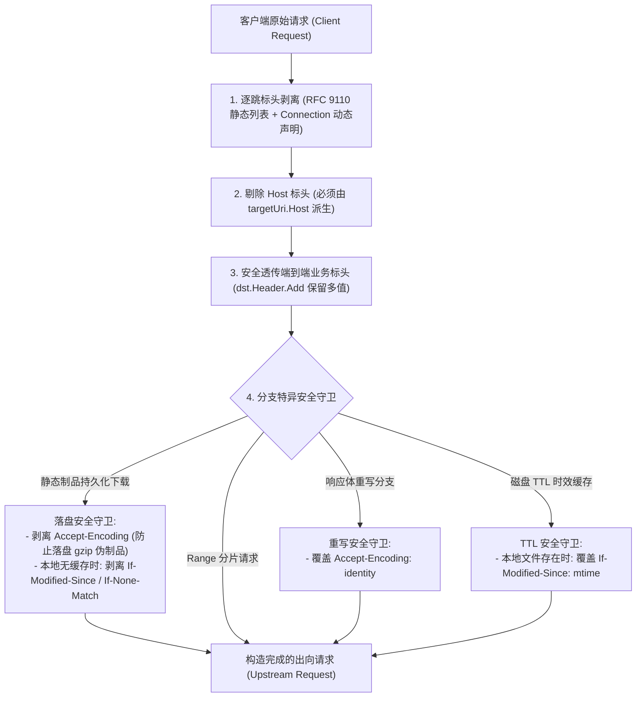

# Feature 341: 请求头全量透传与逐跳标头过滤方案 (Request Header Full Relay & Hop-by-Hop Filtering Plan)

## 1. 功能目标与背景 (Goal & Background)

### 1.1 现状痛点分析 (Problem Analysis)
在当前系统的请求分发与出向回源链路中，各业务请求分支在构造发往上游的 HTTP 请求时各自维护独立的请求头转发逻辑，存在严重的碎片化与协议不一致问题：
1. **狭窄白名单导致多生态协议兼容受阻**：
   - 静态制品下载分支仅转发 `If-Modified-Since`、`If-None-Match`、`Authorization`、`User-Agent` 4 个标头；
   - HTTP Range 分片分支仅转发 `Range`、`If-Range`、`If-Modified-Since`、`If-None-Match`、`User-Agent`、`Authorization` 6 个标头；
   - 两个最核心的二进制制品拉取链路均**遗漏了关键的内容协商标头（`Accept`）**，导致依赖严格内容协商机制的源站（如 Docker Registry 的 OCI/Manifest 格式协商）无法按客户端预期返回目标清单；
   - 私有源所需的 `Cookie`、Token 标头（如 `X-Auth-Token`、`Private-Token`）以及现代包管理器的会话跟踪标头（如 `npm-session`、`cargo-audit`）在多数分支中被无声遗弃。
2. **多值标头静默截断**：
   - 静态下载、Range 分片与免缓存分支均采用单值读取与赋值方式（`Get`/`Set`），当客户端发送多条同名标头（如多个 `Accept` 或分层认证凭证）时，仅保留首个值，后续值全部被截断。
3. **冗余硬编码与维护性劣化**：
   - 4 组功能重叠的白名单切片硬编码分散在多个业务处理模块中，任何新增标头均需重复多处维护。

### 1.2 全量透传必须防御的四大衍生隐患与协议依据 (Adversarial Risks & RFC Basis)
若脱离代理与缓存机制简单实施无脑全量透传，将引发严重的次生灾难；同时必须厘清 HTTP 压缩编码的协议边界：
1. **`Accept-Encoding` 穿透导致静态持久化落盘被压缩的伪制品（P0 级灾难）**：
   - 客户端（如浏览器、现代包管理器）普遍携带 `Accept-Encoding: gzip, deflate, br`；
   - 若出向请求原样透传该标头，Go 标准库出向传输层将**关闭自动解压缩**，导致上游返回的 gzip 压缩流被直接当成 `.deb`、`.whl`、`.tgz` 写入本地磁盘；后续所有请求命中缓存时将因数据不匹配而报 `Hash Sum mismatch` 损坏。
   - **客户端兼容性说明（RFC 9110 Section 12.5.3）**：客户端声明 `Accept-Encoding: gzip` 属于“能力通告”而非“强制要求”。协议规定未压缩的原始格式（`identity`）恒为客户端所接受。当代理返回未压缩明文且无 `Content-Encoding` 头时，所有合规客户端均能无缝解析，**绝对不会引发客户端异常**。
2. **`Host` 标头穿透导致上游 CDN / 虚拟主机 403/404 挂死（P0 级缺陷）**：
   - 客户端发来的 `Host` 是代理自身地址；若盲目透传给上游，上游 CDN（Cloudflare/Fastly）将因 SNI/Host 不匹配而直接拒绝请求。出向请求的 `Host` 必须绝对由目标源站 URL 权威派生。
3. **本地无缓存时透传条件头导致 Singleflight 广播空 304 传染（P0 级缺陷）**：
   - 当客户端 A（本地机器已有旧缓存）携带 `If-None-Match` 发起请求，而代理本地磁盘尚无该缓存时，若盲目透传条件头，上游将返回无 Body 的 304；
   - 在并发下载合并机制下，同时等待的全新拉取者 Follower B（本地无文件）也将共享收到空的 304 响应并直接安装失败，代理自身也错失了建立完整落盘缓存的机会。
4. **动态逐跳标头穿透风险（RFC 9110 违规）**：
   - RFC 9110 规定，除了预定义的静态逐跳头外，`Connection` 标头值中声明的所有自定义标头同样被定义为逐跳标头，必须一并剥离。

### 1.3 建设目标 (Feature Objectives)
本特性旨在重构出向请求头装配链路，在彻底消除白名单限制的同时构筑严密的缓存与协议安全防线：
1. **全量透传端到端标头并完整保留多值**：除协议规定的逐跳标头与受保护标头外，默认将客户端提交的全部标头原样透传给源站，完整保留多值切片语义；
2. **严格过滤逐跳标头（Hop-by-hop Headers）**：依据 RFC 9110 规范，剥离静态逐跳标头列表及 `Connection` 中动态声明的所有逐跳头；
3. **严密构筑分支安全守卫**：
   - **`Host` 隔离守卫**：出向请求 `Host` 严格从目标源站 URI 派生，严禁从客户端透传；
   - **落盘压缩防护守卫**：进入静态制品持久化落盘分支时，显式剥离客户端的 `Accept-Encoding`，确保落盘数据为原始二进制制品；
   - **条件请求防传染守卫**：在静态制品持久化落盘分支中，**仅在代理本地确实已存在完整缓存文件时**才允许基于本地文件信息构造条件请求；本地无缓存时强制剥离客户端条件头（`If-Modified-Since`、`If-None-Match`），保证回源必拿 200 OK 并成功落盘；
   - **响应体重写守卫**：命中响应体重写时，强制覆盖 `Accept-Encoding: identity`；
   - **磁盘时效缓存守卫**：本地存在旧缓存时，重写 `If-Modified-Since` 为本地文件修改时间。
4. **彻底消除冗余白名单**：废除所有独立的硬编码白名单数组与遍历循环，收敛为统一的透传函数；
5. **零破坏与向后兼容**：现有所有软件源生态代理能力、缓存命中与回源行为保持 100% 兼容。

---

## 2. 架构设计与模型抽象 (Architecture & Abstraction Model)

### 2.1 请求头透传与分支守卫流水线

### 2.2 逐跳标头与受保护标头过滤规则 (RFC 9110 Section 7.6.1)
出向请求构造时，严格拦截并丢弃以下标头：
- `Connection`（及其值所列举的所有动态标头）
- `Proxy-Connection`
- `Keep-Alive`
- `Proxy-Authenticate`
- `Proxy-Authorization`
- `Te`
- `Trailer`
- `Transfer-Encoding`
- `Upgrade`
- `Host`（由 Go `http.Request.Host` 字段独立管理，严禁注入 Header Map）

### 2.3 领域模块集成职责
- **协议代理与调度核心 (Proxy Dispatcher)**：
  - 在处理 HTTP HEAD 请求、HTTP Range 分片请求及免缓存与响应体重写请求时，接入统一请求头透传函数；
  - 对重写请求补充注入 `Accept-Encoding: identity`。
- **并发下载合并模块 (Downloader Module)**：
  - 静态下载策略与磁盘时效缓存策略在构造 Leader 出向请求时，接入统一请求头透传函数；
  - 静态下载策略中执行落盘压缩防护（移除 `Accept-Encoding`）与无缓存条件头剥离；
  - 时效缓存策略在此基础上为已存在旧文件自动附加或修正 `If-Modified-Since`。

---

## 3. 验收标准与验证规划 (Acceptance Criteria & Verification Plan)

### 3.1 核心测试场景
1. **多值标头完整传递**：客户端发起包含多条同名标头（如多条 `Accept` 或自定义 `X-Custom-Multi`）时，上游服务能够收到完整的全部取值切片，未发生首值截断；
2. **生态关键标头透传**：客户端发送 `Accept: application/vnd.docker.distribution.manifest.v2+json`、`Cookie: session=123` 及 `X-Private-Token: secret` 时，各分支均能完整转发至源站；
3. **逐跳标头坚决剥离**：客户端在请求中携带 `Connection: keep-alive, X-Foo`、`Proxy-Connection: keep-alive`、`Transfer-Encoding: chunked` 时，上游收到的请求中逐跳头与动态声明的 `X-Foo` 均被彻底清除；
4. **`Host` 标头正确重写**：客户端请求的 `Host` 为代理自身，上游服务收到的 `Host` 严格等于目标源站域名；
5. **静态下载防压缩污染**：客户端携带 `Accept-Encoding: gzip` 下载静态制品，上游收到的请求中无 `Accept-Encoding`，落盘内容为原始文件；
6. **无缓存条件头安全剥离**：本地无缓存时客户端携带 `If-None-Match`，出向请求不携带该头，上游返回 200 OK 且 Follower 正常消费。

### 3.2 交付物清单
- 子方案设计文档：`docs/plans/341-request-header-relay-and-hop-by-hop-filtering-zh.md` 与英文版本；
- 独立测试套件：`tests/341_request_header_relay/`，包含双语测试指南、上游 Mock 服务及原生自动化用例；
- 领域代码改造：协议代理与调度核心及并发下载合并模块接入统一透传机制，移除遗留硬编码切片。
