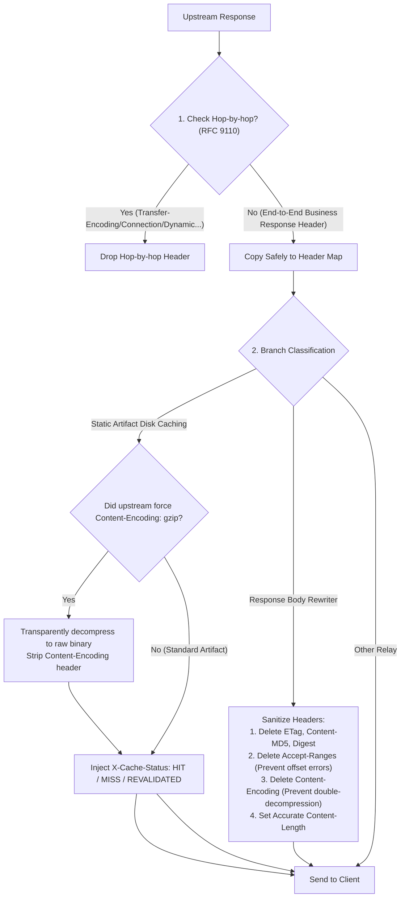

# Feature 342: Response Header Safety Governance & Rewrite Sanitization Plan

## 1. Goal & Background

### 1.1 Problem Analysis
In the current response relay pipeline, when the proxy server receives an upstream response and writes it back to downstream clients, several security hazards and protocol non-compliances exist:
1. **Blind Duplication of Hop-by-Hop Response Headers Triggering Protocol Errors**:
   - Currently, a generic header copy utility duplicates all upstream headers verbatim into downstream client responses.
   - **Fatal HTTP/2 Conflicts**: When an upstream mirror responds with chunked transfer encoding (`Transfer-Encoding: chunked`), if a downstream client communicates via HTTP/2, HTTP/2 strictly forbids any `Transfer-Encoding` header. Downstream clients receiving this header treat it as a fatal protocol violation and reset the stream (`PROTOCOL_ERROR`).
   - **Premature Connection Termination**: When upstream sends `Connection: close`, copying it verbatim forces the proxy-client connection to close, breaking client-side TCP connection reuse during high-concurrency downloads.
   - **Dynamic Hop-by-Hop Omissions**: Any header dynamically listed in the upstream `Connection` header is currently ignored and forwarded downstream.
2. **Residual Headers Following Body Rewriting Causing Verification & Decoding Failures**:
   - Although the response body rewriter strips stale `ETag` and `Content-MD5` headers and updates `Content-Length` after modifying textual content (such as PyPI indexes or npm metadata), it **omits stripping the modern `Digest` header (RFC 3230 / RFC 9530)**.
   - When downstream clients verify the payload hash against the stale `Digest` header, they abort with tampering or corruption errors.
   - **`Content-Encoding` Residual Hazards**: If upstream returns gzip-encoded content and the rewriter decompresses it to replace plaintext, failing to strip `Content-Encoding: gzip` causes downstream clients to attempt double-decompression and fail.
   - **Byte-Range Ambiguity**: Retaining upstream `Accept-Ranges: bytes` misleads clients into believing that dynamic, in-memory rewritten payloads support byte-range slicing, risking corrupted offset requests.
3. **Cache Pollution Risk from Non-Compliant Upstream Enforcing `Content-Encoding: gzip`**:
   - Under standard compliance, because Feature 341 strips `Accept-Encoding` on outbound requests, upstream mirrors will not compress static binary downloads.
   - However, if an anomalous or misconfigured upstream mirror disregards negotiation and forces `Content-Encoding: gzip`, writing this stream directly to disk corrupts the local artifact cache.
4. **Unclear Safety Boundaries for Ecosystem Verification Headers**:
   - Docker Registry clients impose strict byte-for-byte SHA256 checksum validations against the `Docker-Content-Digest` header in Manifest responses.
   - Architectural guarantees must be established to ensure ecosystem verification headers remain untouched across non-rewrite branches.
5. **Missing Observability Headers on Static Disk Cache Branches**:
   - While the disk TTL branch reports `X-Cache-Status` (`HIT-DISK-TTL`, `MISS-DISK-TTL`), regular static artifact download and local hit paths omit cache status headers entirely, leaving blind spots for operations, debugging, and automated testing.

### 1.2 Feature Objectives
This feature governs inbound response header filtering, sanitization, and observability:
1. **Centralize Hop-by-Hop Response Header Filtering**: Implement RFC 9110 compliant response header filtering, stripping static hop-by-hop headers and dynamic headers listed in `Connection` to eliminate HTTP/2 protocol conflicts and unexpected disconnections.
2. **Strengthen Header Sanitization on Rewritten Responses**: When body rewriting occurs, strip all content-bound checksum headers (`ETag`, `Content-MD5`, `Digest`), compression encoding (`Content-Encoding`), and slicing headers (`Accept-Ranges`), ensuring `Content-Length` precisely matches the rewritten body length.
3. **Double-Insurance Decompression Fallback for Anomalous Compressed Responses**: Prior to disk caching, inspect responses for forced `Content-Encoding: gzip`; transparently decompress to the raw binary artifact and strip `Content-Encoding` to guarantee pure cache storage.
4. **Enforce Zero-Tampering Guarantees for Critical Ecosystem Headers**: Guarantee that headers such as `Docker-Content-Digest`, `Docker-Distribution-Api-Version`, `Www-Authenticate`, and `Last-Modified` pass through unaltered across non-rewrite flows.
5. **Complete End-to-End `X-Cache-Status` Observability**: Populate standard `X-Cache-Status: HIT` / `MISS` / `REVALIDATED` headers across static artifact local hits, initial download caching, and 304 conditional revalidations.

---

## 2. Architecture & Abstraction Model

### 2.1 Response Header Processing & Sanitization Pipeline

### 2.2 Hop-by-Hop Response Header Blocklist (RFC 9110 Section 7.6.1)
The following headers must be stripped before writing back to the client:
- `Connection` (and all dynamic headers listed in its value)
- `Proxy-Connection`
- `Keep-Alive`
- `Transfer-Encoding`
- `Trailer`
- `Upgrade`

### 2.3 Sanitization Rules Matrix

| Scenario | `Content-Length` | `ETag` / `Content-MD5` / `Digest` | `Content-Encoding` | `Accept-Ranges` | `Docker-Content-Digest` | `X-Cache-Status` |
| :--- | :--- | :--- | :--- | :--- | :--- | :--- |
| **Static Download - Local Hit** | Match local file size | Upstream/stored value | Pass-through | Explicitly declare `bytes` | Pass-through verbatim | `HIT` |
| **Static Download - Upstream Miss** | Upstream original | Upstream original | Decompress and **Delete** if forced gzip | Explicitly declare `bytes` | Pass-through verbatim | `MISS` |
| **Static Download - 304 Revalidated** | 0 or omitted | Upstream original | Pass-through | Unchanged | Pass-through verbatim | `REVALIDATED` |
| **Body Rewriting Applied** | **Recalculated to rewritten length** | **Thoroughly deleted (Del)** | **Thoroughly deleted (Del)** | **Thoroughly deleted (Del)** | N/A (Docker never rewritten) | Relay / Tag as needed |
| **Range 206 Partial Miss** | Upstream chunk length | Upstream original | Pass-through | Upstream original | Pass-through verbatim | Pass-through |

---

## 3. Acceptance Criteria & Verification Plan

### 3.1 Core Verification Scenarios
1. **Hop-by-Hop Response Header Stripping**: When an upstream response includes `Transfer-Encoding: chunked`, `Connection: close, X-Custom-Hop`, these headers are stripped from the response received by the client.
2. **Deep Sanitization on Rewrites**:
   - When an upstream response contains `ETag: "123"`, `Digest: sha-256=abc`, `Content-MD5: xyz`, `Content-Encoding: gzip`, and `Accept-Ranges: bytes`, all five headers are absent in the rewritten response sent to the client.
   - The returned `Content-Length` exactly equals the byte length of the rewritten payload.
3. **Anomalous Forced Gzip Fallback**: When an upstream mirror forces `Content-Encoding: gzip`, the cached disk file is transparently decompressed to raw content, and the client response header omits `Content-Encoding`.
4. **Ecosystem Verification Header Integrity**: `Docker-Content-Digest` in manifest responses and `Www-Authenticate` in 401 challenges pass through 100% unaltered.
5. **Cache Status Observability**:
   - Initial static artifact download returns `X-Cache-Status: MISS`.
   - Subsequent requests hitting the local disk cache return `X-Cache-Status: HIT`.
   - 304 revalidated responses return `X-Cache-Status: REVALIDATED`.

### 3.2 Deliverables Checklist
- Sub-plan design documents: `docs/plans/342-response-header-safety-and-rewrite-sanitization-zh.md` and English counterpart;
- Independent test suite: `tests/342_response_header_safety/` containing bilingual test guides, mock server, and automated tests;
- Logical module improvements: Refactored response header duplication helper, comprehensive rewrite branch sanitization, static download forced-gzip decompression fallback, and static download cache status injection.
