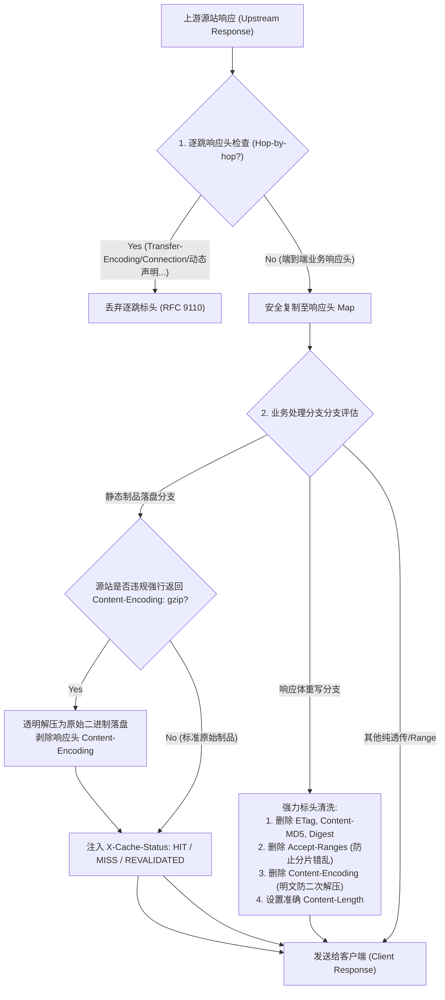

# Feature 342: 响应头安全治理与重写标头清洗方案 (Response Header Safety Governance & Rewrite Sanitization Plan)

## 1. 功能目标与背景 (Goal & Background)

### 1.1 现状痛点分析 (Problem Analysis)
在当前系统的响应回写链路中，代理服务器向上游拉取到响应并写回给下游客户端时，存在以下安全隐患与协议瑕疵：
1. **逐跳响应头（Hop-by-hop Headers）盲目复制引发协议冲突**：
   - 当前在响应头回写时，直接使用全量复制工具函数将上游返回的所有标头原样复制到客户端响应中；
   - **HTTP/2 致命冲突**：当上游源站以分块编码返回 `Transfer-Encoding: chunked` 时，如果下游客户端使用 HTTP/2 协议访问代理，HTTP/2 规范严禁出现任何 `Transfer-Encoding` 标头，客户端在收到该标头后会判定为严重协议错误并重置连接（`PROTOCOL_ERROR`）；
   - **长连接异常中断**：当上游返回 `Connection: close` 时，若盲目复制给客户端，会导致客户端与代理的长连接被强制关闭，破坏客户端高并发拉包的 TCP 复用能力；
   - **动态逐跳声明遗漏**：部分上游源站会在 `Connection` 标头中动态声明单跳标头，当前实现完全未予解析和拦截。
2. **响应体重写后的残存标头导致客户端校验与解码失败**：
   - 响应体重写引擎在替换文本（如 PyPI 索引、npm 元数据）后，虽然删除了旧的 `ETag` 与 `Content-MD5` 并重写了 `Content-Length`，但**遗漏了清除现代源站广泛支持的 `Digest`（RFC 3230 / RFC 9530）标头**；
   - 客户端（如现代自动化部署工具）在接收到重写后的内容时，若依据残存的 `Digest` 标头校验内容哈希，会报错指出内容损坏或被篡改；
   - **`Content-Encoding` 残留隐患**：若上游以 gzip 形式返回，重写模块在内存解压并完成明文替换后，若遗漏清理 `Content-Encoding: gzip`，下游客户端会尝试对明文二次解压导致解压失败报错；
   - **分片歧义**：上游若返回了 `Accept-Ranges: bytes`，重写后的内容仅存在于内存并未提供分片范围支持，保留此标头会误导客户端发起 Range 请求并导致数据错位。
3. **畸形源站强行传输压缩（`Content-Encoding: gzip`）的落盘污染风险**：
   - 在正常规范下，由于 Feature 341 在出向请求中已剥离 `Accept-Encoding`，合规源站绝不会对静态制品进行传输层压缩；
   - 但若遇到极个别非标/畸形源站，无视请求协商强行返回 `Content-Encoding: gzip`，若代理直接落盘将导致落盘数据为压缩体而破坏制品完整性。
4. **生态强校验标头的安全边界未明晰化**：
   - Docker Registry 客户端对 Manifest 清单返回的 `Docker-Content-Digest` 标头具有严格的逐字节哈希断言要求；
   - 必须在架构层面确立非重写分支绝对原样透传生态强校验标头的红线，杜绝任何格式化或意外过滤。
5. **静态持久化缓存链路的可观测标头缺失**：
   - 磁盘时效缓存分支规范地返回了 `X-Cache-Status`（如 `HIT-DISK-TTL`、`MISS-DISK-TTL`），而普通静态制品下载与本地命中链路完全没有下发任何缓存状态标识，导致运维排障与自动化测试无法直接通过响应头感知缓存命中状态。

### 1.2 建设目标 (Feature Objectives)
本特性旨在治理入向响应头的过滤、清洗与可观测性，确保协议合规与生态安全：
1. **统一过滤逐跳响应头**：实现具备 RFC 9110 逐跳头拦截能力的响应头复制机制，剥离静态逐跳列表与 `Connection` 动态声明的所有逐跳头，消除下游 HTTP/2 协议冲突与连接提前断开风险；
2. **全面强化重写场景的深度标头清洗**：在响应体重写生效时，强制清除所有与原始正文强绑定的摘要头（`ETag`、`Content-MD5`、`Digest`）、压缩编码头（`Content-Encoding`）及分片能力头（`Accept-Ranges`），确保 `Content-Length` 准确无误；
3. **非标源站强行压缩的落盘解压双保险**：在静态制品落盘前增加防御检查，若源站违规返回 `Content-Encoding: gzip`，代理透明解压后再将原始制品写入磁盘并剥除该头，确保落盘资产绝对纯净；
4. **恪守生态强校验标头原样透传红线**：确保 `Docker-Content-Digest`、`Docker-Distribution-Api-Version`、`Www-Authenticate`、`Last-Modified` 等生态元数据头在非重写场景中 100% 忠实透传；
5. **补齐静态下载全链路 `X-Cache-Status` 状态标识**：为静态制品持久化缓存的本地命中、首次回源落盘与条件协商 304 注入标准的 `X-Cache-Status: HIT` / `MISS` / `REVALIDATED`，实现全链路统一可观测。

---

## 2. 架构设计与模型抽象 (Architecture & Abstraction Model)

### 2.1 响应头处理与标头清洗流水线

### 2.2 逐跳响应头黑名单定义 (RFC 9110 Section 7.6.1)
向客户端回写响应头时，严格拦截并丢弃以下标头：
- `Connection`（及其值中列举的所有动态标头）
- `Proxy-Connection`
- `Keep-Alive`
- `Transfer-Encoding`
- `Trailer`
- `Upgrade`

### 2.3 标头清洗规则矩阵 (Sanitization Matrix)

| 场景 | `Content-Length` | `ETag` / `Content-MD5` / `Digest` | `Content-Encoding` | `Accept-Ranges` | `Docker-Content-Digest` | `X-Cache-Status` |
| :--- | :--- | :--- | :--- | :--- | :--- | :--- |
| **静态下载-命中本地缓存** | 按本地文件大小设置 | 上游返回/本地记录透传 | 透传 | 显式声明 `bytes` | 原样透传 | `HIT` |
| **静态下载-回源下载落盘** | 上游原始透传 | 上游原始透传 | 若上游违规返回 gzip 则解压并**删除** | 显式声明 `bytes` | 原样透传 | `MISS` |
| **静态下载-上游 304 协商** | 0 或不设置 | 上游原始透传 | 透传 | 不修改 | 原样透传 | `REVALIDATED` |
| **响应体重写生效** | **重新计算为重写后字节长度** | **彻底删除 (Del)** | **彻底删除 (Del)** | **彻底删除 (Del)** | 不适用 (Docker 不重写) | 透传/按需标记 |
| **Range 206 分片未命中** | 上游分片长度透传 | 上游原始透传 | 透传 | 上游原始透传 | 原样透传 | 透传 |

---

## 3. 验收标准与验证规划 (Acceptance Criteria & Verification Plan)

### 3.1 核心测试场景
1. **逐跳响应头剥离验证**：上游响应中包含 `Transfer-Encoding: chunked`、`Connection: close, X-Dynamic-Hop` 等逐跳头时，客户端收到的响应头中这些标头均被干净清除；
2. **重写场景深度清洗验证**：
   - 上游响应包含 `ETag: "123"`、`Digest: sha-256=abc`、`Content-MD5: xyz`、`Content-Encoding: gzip` 及 `Accept-Ranges: bytes` 时，触发重写后客户端收到的响应中上述 5 个标头全部被清除；
   - 响应中的 `Content-Length` 与实际重写后下发的正文字节数严格一致；
3. **畸形源站强行压缩落盘解压验证**：源站强行下发 `Content-Encoding: gzip` 时，本地磁盘落盘文件为解压后的原始文件，写回给客户端的响应头中不含 `Content-Encoding`；
4. **生态关键标头原样透传**：Docker 镜像清单请求返回的 `Docker-Content-Digest` 及 401 响应的 `Www-Authenticate` 均能 100% 完整原样抵达客户端；
5. **全链路缓存状态可观测性**：
   - 静态制品首次回源时，响应头包含 `X-Cache-Status: MISS`；
   - 静态制品后续请求命中磁盘缓存时，响应头包含 `X-Cache-Status: HIT`；
   - 静态制品条件协商 304 时，响应头包含 `X-Cache-Status: REVALIDATED`。

### 3.2 交付物清单
- 子方案设计文档：`docs/plans/342-response-header-safety-and-rewrite-sanitization-zh.md` 与英文版本；
- 独立测试套件：`tests/342_response_header_safety/`，包含双语测试指南、Mock 源站及自动化测试用例；
- 领域代码改造：重构响应头复制工具函数，完善重写分支清洗列表，增加静态落盘解压兜底，并在静态下载分支注入缓存状态标识。
