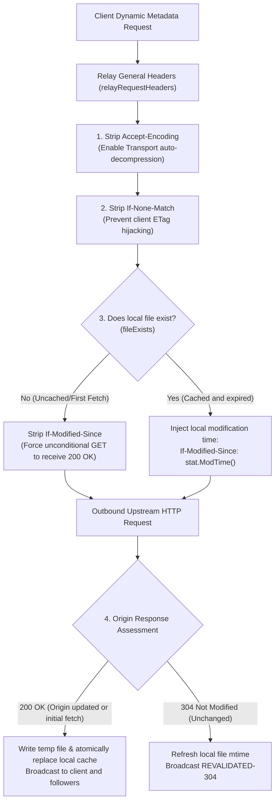

# Feature 343: Disk TTL Conditional Header Isolation & Compression Guard Plan

## 1. Goal & Background

### 1.1 Problem Analysis
In the current system's metadata revalidation pipeline (Disk TTL), requests are managed through the coalesced pipeline policy. After Feature 341 implemented full outbound request header relaying, the proxy began relaying all non-hop-by-hop client headers directly to upstreams. However, the Disk TTL policy in `prepareRequest` only added `If-Modified-Since` when a local file exists, missing critical guards for client conditional headers and encoding negotiation, introducing severe protocol negotiation distortion and cache consistency deadlocks:

1. **Heterogeneous Client ETags Degrading 304 Revalidations into 200s (Negotiation Hijacking)**:
   - Clients requesting dynamic metadata often attach stale `If-None-Match: "..."` headers from their own caches.
   - Under RFC 9110 Section 13.2.2 (Precedence of Conditional Headers), when a request includes both `If-None-Match` and `If-Modified-Since`, the origin server **MUST evaluate `If-None-Match` first and ignore `If-Modified-Since`**.
   - Even when the proxy's local file matches the upstream content identically, an unmatched client ETag causes the origin to return a 200 OK full body. The proxy's lightweight `mtime`-based 304 lease renewal is completely hijacked by client ETags, wasting network bandwidth and triggering unnecessary disk writes.

2. **Accidental 304 Responses on Uncached Metadata (First-Fetch Black Hole)**:
   - When a resource is fetched for the first time or after a cache wipe (`fileExists == false`), client-supplied `If-Modified-Since` or `If-None-Match` headers are relayed without filtering.
   - If the origin decides the resource matches the client's condition, it responds with a 304 Not Modified (empty body).
   - Because the proxy has no local file, it cannot revalidate or serve valid content to the client; in concurrent singleflight coalescing, all waiting follower routines receive empty data or fail, trapping initial cache creation in a deadlock.

3. **Dirty Lease Renewal Deadlock (Client-New, Cache-Old, Origin-New)**:
   - If a client previously obtained a newer version directly (timestamp $T_{new}$), its request carries `If-Modified-Since: T_new`.
   - The proxy's local cache holds an older version ($T_{old}$), and the origin's latest version is $T_{new}$.
   - If the client's $T_{new}$ is relayed directly, the origin determines nothing changed and returns 304 Not Modified.
   - Upon receiving the 304, the proxy mistakenly assumes its local $T_{old}$ file is still valid and executes `os.Chtimes`, renewing the lease on obsolete data.
   - **Impact**: The proxy's stale $T_{old}$ file is perpetually renewed and never refreshed, leading to stale data contamination.

4. **Non-Standard Upstream Compression Overhead**:
   - Relaying client `Accept-Encoding: gzip` disables Go runtime HTTP transport transparent decompression, increasing negotiation overhead and payload format ambiguity.

### 1.2 Feature Objectives
This feature strictly decouples client cache state from proxy cache truth, establishing the principle that "outbound revalidation must exclusively reflect the proxy's local storage state":
1. **Establish Local Truth Revalidation**: Outbound conditional headers must strictly and solely reflect the proxy's local disk file state, completely isolated from client conditions.
2. **Eliminate ETag Negotiation Hijacking**: Strip client `If-None-Match` headers on outbound requests to guarantee lightweight 304 renewal.
3. **Prevent Empty 304 Black Holes and Dirty Renewal Deadlocks**: Strip all conditional headers when uncached to force a 200 OK initial fetch; negotiate solely using the proxy's local `mtime` so that stale files are automatically overwritten by newer origin files.
4. **Unified Anti-Compression Guard**: Explicitly strip `Accept-Encoding` on outbound requests, aligning with static downloads to ensure automatic transparent decompression and raw disk storage.

---

## 2. Architecture & Abstraction Model

### 2.1 State Transition & Conditional Isolation Flow

### 2.2 Conditional Header Governance Matrix

| Scenario | Client Inbound Headers | Outbound Upstream Headers | Expected Origin Behavior | Proxy Behavior & Self-Healing |
| :--- | :--- | :--- | :--- | :--- |
| **First Fetch / Uncached (`!fileExists`)** | `If-Modified-Since` `If-None-Match` | **Strip Both (Del)** | **200 OK** | Fetches full body, establishes local cache, prevents 304 black hole |
| **Expired Renewal - Unchanged (`fileExists`)** | `If-None-Match: "old"` `If-Modified-Since` | Strip `If-None-Match` `If-Modified-Since: stat.ModTime()` | **304 Not Modified** | Successfully renews local lease, prevents 200 degradation |
| **Self-Healing (Client-New, Cache-Old, Origin-New)** | `If-Modified-Since: T_new` | `If-Modified-Since: T_old` ($T_{new}$ stripped) | **200 OK** (Origin detects $T_{new} > T_{old}$) | Fetches latest version and atomically replaces old cache, preventing dirty lease deadlocks |
| **Anti-Compression (Universal)** | `Accept-Encoding: gzip` | **Strip (Del)** | Negotiated & decompressed transparently by Transport | Guarantees raw payload on disk and broadcast stream |

---

## 3. Acceptance Criteria & Verification Plan

### 3.1 Core Test Scenarios
1. **Uncached First Fetch Conditional Stripping**:
   - Verifies outbound requests strip both `If-None-Match` and `If-Modified-Since` when no local cache exists, securing 200 OK and avoiding empty 304s.
2. **Expired Revalidation ETag Stripping**:
   - Verifies outbound requests strip client ETag to allow `If-Modified-Since` to trigger 304 renewal without degrading to 200.
3. **Self-Healing on Stale Cache (Client-New, Cache-Old, Origin-New)**:
   - Verifies the proxy sends its own $T_{old}$ rather than the client's $T_{new}$, allowing origin to return 200 OK and self-heal the cache.
4. **Outbound Compression Guard**:
   - Verifies `Accept-Encoding` is stripped from outbound Disk TTL requests.
