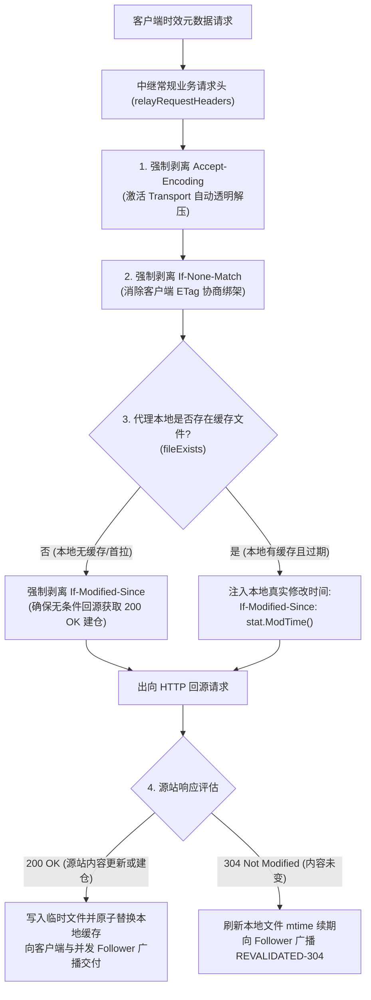

# Feature 343: 磁盘时效缓存条件头单向隔离与防压缩守卫方案 (Disk TTL Conditional Isolation & Compression Guard Plan)

## 1. 功能目标与背景 (Goal & Background)

### 1.1 现状痛点分析 (Problem Analysis)
在当前系统的时效缓存（Disk TTL）回源重验证链路中，请求由代理统合管线中的时效缓存策略统一调度。在 Feature 341 实现了出向请求头的全量透传后，代理开始将客户端的所有非逐跳请求标头无差别中继至上游源站。然而，时效缓存分支在构建回源请求时，仅覆盖了本地文件存在时注入 `If-Modified-Since` 的逻辑，遗漏了对客户端条件标头与编码协商标头的防卫治理，导致严重的协议协商失真与缓存一致性死锁隐患：

1. **客户端异构 ETag 导致 304 协商退化为 200（协商绑架）**：
   - 客户端在请求动态元数据时，常携带其本地历史留存的 `If-None-Match: "..."` 标头；
   - 根据 RFC 9110 Section 13.2.2（条件请求评估优先级）规范，当 HTTP 请求同时包含 `If-None-Match` 与 `If-Modified-Since` 时，源站**必须优先且仅评估 `If-None-Match`**；
   - 即使代理本地磁盘文件与源站实际内容完全一致，只要客户端发来的旧 ETag 与源站当前不匹配，源站就会强制返回 200 OK 全量正文。这导致代理基于本地修改时间（`mtime`）的轻量 304 续期机制彻底失效，引发不必要的全量回源带宽浪费与磁盘频繁重写。

2. **本地未建仓时的 304 误收与空包黑洞（首拉黑洞）**：
   - 当代理本地初次接收请求、或者本地磁盘缓存被周期性清理后（`fileExists == false`），客户端发来的 `If-Modified-Since` 或 `If-None-Match` 未被剥离，直接透传至源站；
   - 若源站依据客户端条件头判定内容未改动，会向代理返回 304 Not Modified（正文为空）；
   - 由于代理本地尚无缓存实体，既无法完成续期，也无法为下游客户端交付有效数据；在并发请求合并（Singleflight）场景下，所有等待该资源的协程均会接收到空数据或异常，导致首次建仓陷入死锁。

3. **客户端新、缓存旧、源站新时的“脏续期”死锁（陈旧缓存锁死）**：
   - 若客户端此前已通过直连或其他途径获得了最新版本（时间戳为 $T_{new}$），其请求携带 `If-Modified-Since: T_new`；
   - 代理本地缓存文件处于旧版本（时间戳为 $T_{old}$），且源站最新版本时间戳为 $T_{new}$；
   - 若直接透传客户端的 $T_{new}$ 给源站，源站判定文件未修改并返回 304 Not Modified；
   - 代理收到 304 后，误认为自身本地的旧文件 $T_{old}$ 依然有效，执行修改时间刷新（`os.Chtimes`）完成了错误的租期续约；
   - **后果**：代理本地的陈旧版本 $T_{old}$ 被错误续期且永远得不到拉取更新，导致脏数据长期蔓延。

4. **非标源站压缩协商开销**：
   - 客户端透传的 `Accept-Encoding: gzip` 会导致 Go 运行时传输层禁用默认的自动透明解压，增加了回源报文格式不确定性与协商开销。

### 1.2 建设目标 (Feature Objectives)
本特性旨在彻底解耦下游客户端状态与代理本地缓存真值，确立“以代理本地存储状态为唯一协商事实”的单向隔离原则：
1. **确立本地真值协商原则**：代理回源时的条件请求必须严格且唯一反映代理本地磁盘的真实状态，杜绝任何客户端异构条件头的干扰；
2. **阻断 ETag 协商绑架**：出向请求强制清除客户端 `If-None-Match`，确保时效缓存 304 轻量续期 100% 稳定生效；
3. **消除首拉 304 黑洞与脏续期死锁**：本地无缓存时剥离所有条件头强制 200 建仓；本地过期回源时基于自身真实 `mtime` 发起协商，确保旧版本被源站新版本自愈覆盖；
4. **统一落盘防压缩守卫**：显式剥离出向 `Accept-Encoding`，确保与常规静态下载保持同等级别的自动透明解压与原生存储标准。

---

## 2. 架构设计与模型抽象 (Architecture & Abstraction Model)

### 2.1 状态转移与条件隔离决策流

### 2.2 条件标头治理矩阵 (Header Governance Matrix)

| 场景 | 客户端输入标头 | 出向源站标头 | 预期源站行为 | 代理行为与自愈效果 |
| :--- | :--- | :--- | :--- | :--- |
| **首拉/无缓存 (`!fileExists`)** | `If-Modified-Since` `If-None-Match` | **全部剥离 (Del)** | **200 OK** | 成功获取全量数据，建立本地持久化缓存，杜绝 304 空包黑洞 |
| **过期续期-源站未变 (`fileExists`)** | `If-None-Match: "old"` `If-Modified-Since` | `If-None-Match` 剥离 `If-Modified-Since: stat.ModTime()` | **304 Not Modified** | 成功刷新本地租期，消除客户端 ETag 引起的 200 全量退化 |
| **陈旧自愈-客户端新/缓存旧/源站新** | `If-Modified-Since: T_new` | `If-Modified-Since: T_old` (客户端 $T_{new}$ 被剥离) | **200 OK** (源站检测到 $T_{new} > T_{old}$) | 代理拉取最新版本原子覆盖本地旧版本，阻断脏续期死锁 |
| **传输防压缩 (通用)** | `Accept-Encoding: gzip` | **显式剥离 (Del)** | 由 Transport 协商并自动透明解压 | 确保落盘与广播流均为原生数据，杜绝非标压缩污染 |

---

## 3. 验收标准与验证规划 (Acceptance Criteria & Verification Plan)

### 3.1 核心测试场景
1. **未缓存首拉条件头剥离防 304 黑洞测试**：
   - 客户端携带 `If-None-Match` 与 `If-Modified-Since` 请求未缓存的元数据；
   - 验证上游收到的请求中无任何条件头，上游返回 200 OK 并成功落盘。
2. **过期重验证 ETag 剥离防 200 退化测试**：
   - 本地已存在过期文件，客户端携带不匹配的 `If-None-Match`；
   - 验证出向请求剥离该 ETag，源站基于匹配的 `If-Modified-Since` 返回 304，代理成功续期并标记 `REVALIDATED-304`。
3. **客户端新/缓存旧自愈测试（防脏续期死锁）**：
   - 代理本地为旧时间戳 $T_1$，源站与客户端为新时间戳 $T_2$；
   - 客户端请求携带 $T_2$ 的条件头，验证代理出向依然发送本地真实的 $T_1$，源站返回 200 OK，本地缓存成功替换自愈为新版本。
4. **时效资源出向防压缩测试**：
   - 验证客户端携带的 `Accept-Encoding: gzip` 在时效分支被成功剥离。
