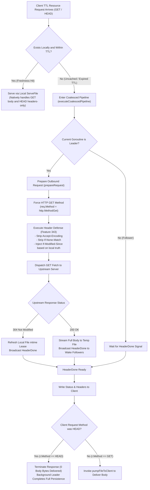

# Feature 344: Disk TTL HEAD Method Conversion Plan

## 1. Goal & Background

### 1.1 Problem Analysis
In the current disk time-to-live (Disk TTL) caching pipeline, the disk TTL policy is responsible for constructing upstream fetch requests for resources matching rules with `TTL > 0` (e.g. Debian `InRelease`, PyPI `simple/` indices, npm package metadata).
In the proxy and dispatch core, rules configured with TTL permit both `GET` and `HEAD` requests to enter the coalesced disk TTL caching pipeline. However, the disk TTL policy previously adopted the downstream client's raw HTTP method (`r.Method`) when constructing outbound fetch requests. This implementation introduced a critical data integrity flaw and cache contamination vulnerability:

1. **HEAD Upstream Fetch Causing 0-Byte Empty File Persistence and Data Corruption (P0 Severity Defect)**:
   - Clients (such as `apt`, `pip`, `npm`, or Docker clients) frequently issue initial `HEAD` requests to inspect resource metadata (such as `Content-Length`, `ETag`, etc.) before downloading package payloads;
   - If the resource is not yet cached locally or has expired beyond its TTL, the proxy acts as the Leader and initiates an upstream fetch;
   - Because the upstream request transparently relays the client's `HEAD` method, the upstream server returns `200 OK`, but its response body is strictly empty (0 bytes) per HTTP specifications;
   - The unified coalesced download and broadcast pipeline then writes this 0-byte stream into a temporary file and atomically renames it over the target disk cache file while updating the modification time (`mtime`);
   - **Consequence**: The resource is permanently corrupted as a 0-byte file throughout the subsequent TTL cycle. Subsequent regular `GET` requests detect that the file is fresh and serve the 0-byte file directly via `http.ServeFile`, causing downstream clients to receive empty payloads and trigger checksum failures, index corruption, or decompression errors.

2. **Valid Stale Cache Overwritten by Empty Payloads on Content Update**:
   - If a valid stale file exists locally but expires past its TTL, and a client happens to issue a `HEAD` request first;
   - If the upstream server has updated the content (returning `200 OK` rather than `304 Not Modified`), the fetch is executed with `HEAD`. The 0-byte response atomically overwrites the valid stale file, degrading the cache from "stale data" to "corrupted empty data".

### 1.2 Feature Objectives
This feature eliminates the 0-byte empty file persistence defect in the disk TTL caching pipeline, achieving clean decoupling and protocol fidelity between client `HEAD` requests and backend disk caching:
1. **Establish Outbound Method Conversion Principle**: In the disk TTL policy request preparation phase, outbound requests are unconditionally converted to `http.MethodGet` regardless of whether the client issued `GET` or `HEAD`, ensuring cached files always contain complete payloads;
2. **Preserve Downstream HTTP Protocol Fidelity**: When a downstream client issues a `HEAD` request, the proxy returns immediately after sending response headers without emitting any body bytes, strictly adhering to RFC 9110;
3. **Enable Cross-Method Request Coalescing and Cache Preheating**: By converting HEAD to GET, the pipeline naturally preheats the local cache, allowing subsequent `GET` requests for the same URI to hit local disk cache directly;
4. **Harmonize Dual Pipeline Design**: Align the disk TTL policy with the static download policy in terms of upstream fetch method semantics.

---

## 2. Architecture Trade-offs & Deep Analysis

The team thoroughly analyzed and evaluated three architectural approaches for handling `HEAD` requests under cache misses or expirations:

### 2.1 Evaluation of Three Candidate Approaches

| Approach | Core Mechanism | Advantages | Disadvantages & Risks |
| :--- | :--- | :--- | :--- |
| **Approach 1: Convert Outbound Request to `GET` (Adopted)** | Hardcode `http.MethodGet` in the disk TTL policy; fetch the full stream to disk; downstream HEAD client short-circuits upon receiving headers | 1. Eliminates 0-byte file persistence; 2. Minimal, localized code change; 3. Fully aligned with static download policy; 4. Preheats cache for subsequent GETs; 5. Conforms to industry standards (e.g. Nginx `proxy_cache_convert_head on`) | Negligible bandwidth cost if a client **only** sends HEAD and never GET (acceptable since TTL resources are small KB~MB metadata) |
| **Approach 2: Pure Streaming Bypass for HEAD** | Bypass coalesced caching pipeline completely for HEAD requests | Avoids downloading body if unrequested | 1. Forfeits request coalescing; 2. Cannot refresh `mtime` lease on 304; 3. Breaks convergence of disk TTL architecture |
| **Approach 3: In-Pipeline Method-Based Branching** | Add special HEAD branches inside the unified pipeline to skip disk writes | Avoids writing temp files | Pollutes unified pipeline abstraction; introduces branching into broadcast pumps and state machines, increasing deadlock risks |

### 2.2 Deep Feasibility Analysis across 5 Key Dimensions

To ensure Approach 1 does not introduce unintended side effects, the team verified 5 key technical dimensions:

1. **HTTP Specification and Client Transparency (RFC 9110 Compliance)**:
   - RFC 9110 Section 9.3.2 specifies that `HEAD` is identical to `GET`, except that the server must not return a message body. When the upstream responds to `GET`, the proxy copies complete headers (`Content-Length`, `ETag`, etc.) into job state;
   - The downstream client handler detects `r.Method == http.MethodHead` and returns immediately without writing body bytes, providing 100% compliant downstream behavior;
   - Any server supporting HEAD for a given URI is required by HTTP specifications to support GET.
2. **Client Early Disconnect vs Background Download Context Isolation**:
   - Downstream HEAD clients typically terminate the TCP connection immediately after receiving response headers;
   - The background Leader download goroutine operates under an independent root context (`context.Background()`) detached from downstream client request lifetimes;
   - Client disconnects therefore do not interrupt background file writes or atomic replacement.
3. **Bandwidth and Disk Storage Overhead**:
   - Only resources matching explicit `TTL > 0` configuration enter the disk TTL pipeline. In real-world mirror ecosystems, these are strictly limited to lightweight metadata/index files (e.g., small `InRelease` or package indices);
   - Large binary artifacts follow regular static download routing, where HEAD requests are already handled before reaching the download pipeline.
4. **File Handles and Windows OS Compatibility**:
   - Downstream HEAD clients return immediately without invoking `pumpFileToClient`, avoiding opening OS file handles or incrementing `Readers` count;
   - When the Leader completes writing and calls `TryRename`, `Readers` is 0, completely avoiding Windows file-locking rename collisions (`ERROR_SHARING_VIOLATION`).
5. **Cross-Method Request Coalescing and Cache Preheating**:
   - If client A sends `HEAD` and client B sends `GET` microseconds later;
   - `HEAD` becomes the Leader and initiates full GET streaming, while concurrent `GET` joins as a Follower and reads the stream;
   - The proxy automatically coalesces HEAD and GET requests into a single upstream round-trip.

---

## 3. Detailed Design

### 3.1 Decision Flow

### 3.2 Policy Modification
- **Upstream Method Conversion**: In `diskTTLPolicy.prepareRequest`, replace `r.Method` with `http.MethodGet`;
- **Synergy with Header Guards**: Combines with Feature 343 conditional isolation and compression guards to ensure both data completeness and lease renewal reliability.

---

## 4. Acceptance Criteria & Verification Plan

### 4.1 Core Verification Scenarios
1. **Uncached Initial HEAD Converted to GET Full Persistence**:
   - Issue a `HEAD` request for an uncached TTL resource;
   - Verify upstream receives a `GET` request;
   - Verify downstream client receives 200 OK with correct headers and strictly 0 body bytes;
   - Verify local disk successfully persists the complete payload matching upstream content, avoiding 0-byte file corruption;
   - Issue an immediate `GET` request and verify it hits cache (`HIT-DISK-TTL`) and reads the complete payload.
2. **Expired Content Update with HEAD Atomic Replacement**:
   - Pre-populate and expire a stale version;
   - Update upstream content;
   - Issue a `HEAD` request, verify the stale file is atomically replaced with the complete new payload rather than overwritten with 0 bytes;
   - Subsequent `GET` receives the updated content.
3. **Expired Content Unchanged with HEAD 304 Lease Renewal**:
   - Pre-populate and expire a cache file; configure upstream to return 304;
   - Issue a `HEAD` request, verify local file `mtime` is refreshed and marked `REVALIDATED-304`.
4. **Concurrent HEAD and GET Coalescing**:
   - `HEAD` arrives first as Leader, `GET` arrives microseconds later as Follower;
   - Verify only 1 upstream request is made, `HEAD` client completes header reception, and `GET` client successfully receives full payload via the broadcast pump.
