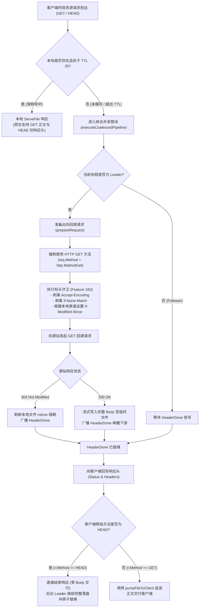

# Feature 344: 磁盘时效缓存 HEAD 回源方法强制转换与防空包落盘方案 (Disk TTL HEAD Method Conversion Plan)

## 1. 功能目标与背景 (Goal & Background)

### 1.1 现状痛点分析 (Problem Analysis)
在当前系统的时效缓存（Disk TTL）回源落盘链路中，时效缓存策略负责为匹配 `TTL > 0` 规则的资源（如 Debian `InRelease`、PyPI `simple/` 索引、npm 包元数据等）构建回源请求。
协议代理与调度核心中，带 TTL 的规则允许 `GET` 与 `HEAD` 请求进入时效缓存管线。然而，时效缓存策略在构建出向回源请求时，直接使用了下游客户端请求的原始 HTTP 方法（`r.Method`）。这一实现存在严重的数据完整性损坏缺陷与缓存污染隐患：

1. **HEAD 回源导致 0 字节空文件落盘与数据损坏（P0 级缺陷）**：
   - 客户端（如 `apt`、`pip`、`npm` 或 Docker 客户端）在拉取制品前，常先发起 `HEAD` 请求探测资源元数据（如 `Content-Length`、`ETag` 等）；
   - 若此时本地无缓存或缓存已超出 TTL 过期，代理将作为 Leader 向上游源站发起回源；
   - 由于回源直接透传了客户端的 `HEAD` 方法，源站返回 200 OK，但响应实体（Body）严格按 HTTP 规范为空（0 字节）；
   - 统合并发下载与广播管线随后将该 0 字节空流写入临时文件，并通过原子重命名将其覆盖为正式的本地磁盘缓存，同时更新了文件修改时间（`mtime`）；
   - **后果**：该资源在后续整个 TTL 周期内都被固化为一个 0 字节的空文件。后续正常的 `GET` 请求到达时，判定文件在保鲜期内而直接返回本地磁盘文件，导致下游客户端接收到空包，引发校验失败、索引损坏或解包异常。

2. **过期资源更新时的陈旧数据被空包覆盖**：
   - 若本地已存在旧版本有效文件，但在 TTL 过期后客户端先发起了 `HEAD` 请求；
   - 若源站内容已更新（返回 200 OK 而非 304），回源以 `HEAD` 执行，0 字节响应将直接原子替换原本有效的旧文件，使本地缓存从“陈旧数据”直接退化为“损坏的 0 字节空数据”。

### 1.2 建设目标 (Feature Objectives)
本特性旨在彻底根除时效缓存回源链路中的 0 字节空文件落盘缺陷，实现客户端 `HEAD` 请求与后端缓存落盘的优雅解耦与协议保真：
1. **确立回源方法强制转换原则**：时效缓存回源构建阶段，无论客户端原始方法为 `GET` 还是 `HEAD`，出向请求强制统一转换为 `GET` 方法，确保落盘数据 100% 具备完整实体；
2. **严守下行 HTTP 协议保真性**：下游客户端发起的若为 `HEAD` 请求，代理在接收到头部就绪信号后仅透传响应头，绝不向客户端输出正文，下行行为 100% 符合 RFC 9110 规范；
3. **实现跨方法请求汇聚与缓存预热**：通过 HEAD 转换 GET，自然完成本地缓存预热，使紧随其后的同 URI GET 请求直接命中本地磁盘强缓存，提升整体代理吞吐；
4. **统一双管线设计规范**：使时效缓存策略与常规静态下载策略在回源方法语义上保持高度统一。

---

## 2. 方案对比与技术可行性论证 (Architecture Trade-offs & Deep Analysis)

针对 HEAD 请求命中时效缓存未命中或过期时的处理路径，团队进行了深入讨论与方案推演：

### 2.1 三种备选方案对比

| 方案 | 核心实现机制 | 优点 | 缺陷与风险 |
| :--- | :--- | :--- | :--- |
| **方案一：回源端强制转换为 `GET`（采纳）** | 在时效缓存策略中将回源方法硬编码为 `GET`，管线拉取完整流落盘，下游 HEAD 客户端在收到头部后短路退出 | 1. 根治 0 字节空文件问题； 2. 逻辑极简，改动收敛； 3. 与静态下载管线完全一致； 4. 自然预热缓存，加速后续 GET； 5. 符合工业标准（Nginx `proxy_cache_convert_head on`） | 若资源体积极大且下游**只发 HEAD 不发 GET** 会造成一定带宽开销（但时效资源均为 KB~MB 级元数据，开销完全可控） |
| **方案二：HEAD 零落盘纯透传** | HEAD 请求绕过统合落盘管线，直接作为免缓存资源流式透传 | 不对未请求正文的资源进行后台拉取 | 1. 丧失并发合并能力； 2. 无法利用 304 刷新本地旧文件的 `mtime` 租期； 3. 破坏时效缓存体系的收敛性 |
| **方案三：管线内按方法特判分流** | 在统一管线内部增加针对 HEAD 方法的分支判断，跳过临时文件写入与重命名 | 避免创建临时文件 | 破坏统一管线的抽象纯粹性，在广播泵与状态机中引入过多条件分支，增加死锁与状态泄漏风险 |

### 2.2 方案一关键技术维度推演

为确保采纳方案一后不引入其他衍生问题，针对 5 个核心维度进行了技术论证：

1. **HTTP 规范与客户端透明性 (RFC 9110 遵从性)**：
   - RFC 9110 第 9.3.2 节规定，`HEAD` 方法的语义与 `GET` 完全相同，只是服务器严禁在响应中返回实体主体。源站按 `GET` 返回后，代理将完整 Headers（包括 `Content-Length`、`ETag` 等）复制到任务状态中；
   - 下游客户端协程在收到头部信号后，检测到 `r.Method == http.MethodHead` 立即返回，**绝不向下游客户端写入任何正文**，客户端感知完全合规；
   - HTTP 规范明确要求：任何支持 HEAD 的资源必须支持 GET。源站必定兼容 GET 请求。
2. **下游提前断开与后台下载上下文隔离**：
   - 下游 HEAD 客户端在接收完响应头后通常会立即关闭连接；
   - 统合管线中的后台 Leader 下载协程使用的是独立的根上下文（`context.Background()`），并未绑定下游客户端的请求生命周期；
   - 因此，下游客户端连接关闭完全不会中断后台的数据写入与完整落盘流程。
3. **系统带宽与存储资源开销评估**：
   - 进入时效缓存管线的资源必须匹配用户显式配置的 `TTL > 0` 规则。在现实包管理镜像生态中，此类规则严格限定为轻量元数据/索引文件（如几 KB 的 `InRelease` 或几十 KB 的包索引），回源拉取开销微乎其微；
   - 真正体积庞大的二进制软件包走常规静态下载路由，普通静态路由的 HEAD 请求已在前置路由中被独立处理，不会穿透到落盘下载流。
4. **操作系统文件句柄与 Windows 兼容性**：
   - 下游 HEAD 客户端直接返回，**不会调用客户端追读泵**，因而不会打开底层文件句柄，也不会增加 Readers 活跃计数；
   - 后台 Leader 协程写入完毕后执行文件原子重命名时，Readers 计数恰为 0，完全杜绝了 Windows 平台常见的文件占用导致的重命名拒绝访问错误。
5. **跨方法并发请求合并与缓存预热红利**：
   - 若客户端先发起 `HEAD`，微秒级后另一个客户端发起 `GET`；
   - `HEAD` 作为 Leader 回源拉取完整 `GET` 流，并发的 `GET` 作为 Follower 挂载到同一任务并追读该数据流；
   - 代理自发实现了 HEAD 与 GET 之间的请求汇聚，额外节省了 1 次对上游源站的回源开销。

---

## 3. 详细设计与实现机制 (Detailed Design)

### 3.1 决策流程图

### 3.2 策略模块调整 (Policy Modification)
- **回源方法转换**：在时效缓存策略的请求准备方法中，将构造出向请求的参数由 `r.Method` 调整为固定的 `http.MethodGet`；
- **组合标头守卫**：与 Feature 343 的单向条件隔离及防压缩标头守卫形成合力，既保证回源数据的完整性，又确保租期协商的真实可控。

---

## 4. 验收标准与验证规划 (Acceptance Criteria & Verification Plan)

### 4.1 核心测试场景
1. **未缓存首拉 HEAD 请求转 GET 完整落盘验证**：
   - 客户端以 `HEAD` 方法请求尚未缓存的 TTL 资源；
   - 验证上游实际接收到的方法为 `GET`；
   - 验证下游客户端仅接收到 200 OK 与正确响应头，响应正文严格为空（0 字节）；
   - 验证本地磁盘成功生成完整的持久化缓存文件，内容与源站实体完全一致，杜绝 0 字节空文件；
   - 紧接着发起相同的 `GET` 请求，验证直接保鲜命中（`HIT-DISK-TTL`）且能够完整读出正文内容。
2. **过期资源更新时 HEAD 请求原子更新验证**：
   - 预热落盘旧版本内容，手动使其过期；
   - 源站更新为新版本内容；
   - 客户端以 `HEAD` 方法请求，验证本地磁盘旧文件被原子替换为新版本完整文件，而非被 0 字节文件破坏覆盖；
   - 随后的 `GET` 请求成功获取新版本正文。
3. **过期资源未改动时 HEAD 请求 304 续期验证**：
   - 预热落盘并使其过期，源站配置为返回 304 Not Modified；
   - 客户端以 `HEAD` 方法请求，验证本地文件 `mtime` 成功刷新，标记 `REVALIDATED-304`。
4. **并发 HEAD 与 GET 请求汇聚验证**：
   - `HEAD` 请求先到达成为 Leader，`GET` 请求微秒级后到达成为 Follower；
   - 验证上游仅接收到 1 次回源请求，`HEAD` 客户端正常完成元数据接收，`GET` 客户端通过流式追读泵成功接收完整正文。
